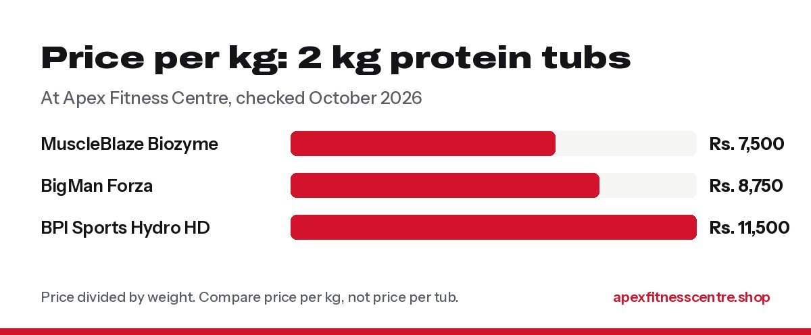

The "best" whey protein in Nepal is the one that is **genuine, gives you enough protein per scoop, fits your budget, and tastes good enough that you actually use it.** For most people, a **2 kg whey concentrate or blend from a well-known brand, bought from a seller who can show the import details**, is the right choice. Expensive isolates and hydrolyzed wheys are a nice extra, not a must.

*Disclosure: Apex Fitness Centre sells some of the products below. We have kept the advice general so it applies wherever you buy.*

## First: do you even need whey?

Whey is simply **milk protein in powder form**. It is convenient, not magic. You need it only if you struggle to reach your daily protein target from food. Work out your number with our guide on [how much protein you need](../how-much-protein-do-you-need/).

## The 3 types of whey, explained simply

| Type | What it is | Good for | Price |
|---|---|---|---|
| **Concentrate** | Most common form, some lactose and fat remain | Most people, best value | Lowest |
| **Isolate** | Filtered further, more protein, less lactose and fat | People sensitive to lactose, strict diets | Higher |
| **Hydrolyzed** | Protein partly broken down for faster digestion | Serious athletes, people with sensitive stomachs | Highest |

Many popular tubs are **blends** of concentrate and isolate, with extra ingredients like digestive enzymes, creatine or MCT. Read the label so you know what you are paying for.

## 5 things to check before you buy

### 1. Protein per scoop (and per 100 g)

Look at the nutrition table. A good whey gives roughly **20 to 25 g protein per scoop** and around **70% protein or more** by weight. If a "whey" has a lot of carbohydrate and sugar, it may be closer to a mass gainer.

### 2. Price per kg, not price per tub

Always divide the price by the weight. A cheaper 1 kg tub is often more expensive per kg than a 2 kg tub.

*Price per kg of the 2 kg tubs we stock, checked October 2026.*

### 3. Genuine product and import details

Fake and refilled tubs are a real problem in South Asia. Check the **seal, batch number, expiry date, importer label and authenticity code**. Our guide on [how to spot fake supplements in Nepal](../fake-supplements-in-nepal-how-to-spot-them/) explains each check.

### 4. Extra ingredients you may not need

Some products add **creatine, MCT oil, BCAAs or enzymes**. That is fine, but if your protein already has creatine, you may not need a separate creatine tub.

### 5. Taste and mixability

You will drink this every day. Popular flavours like chocolate and vanilla are safe choices. If you have tried a brand and hated it, it does not matter how good the label is.

## Picks by budget

These are the 2 kg options we stock, with current prices. Prices are the same as in our store.

| Product | Type | Price | Price per kg | Best for |
|---|---|---|---|---|
| **MuscleBlaze Biozyme Performance Whey** | Whey blend with enzymes | Rs. 15,000 | Rs. 7,500 | Best value for most lifters |
| **BigMan Forza Protein** | Protein blend with creatine and MCT (per label) | Rs. 17,500 | Rs. 8,750 | People who want an all-in-one shake |
| **BPI Sports Hydro HD** | Hydrolyzed whey | Rs. 23,000 | Rs. 11,500 | Serious athletes, sensitive stomachs |

**Our honest take:** if you are a beginner or on a budget, a good-value whey blend does the job. Spend the difference on food. The more expensive options make sense once you train seriously and know what suits you.

## How to use whey

- **One scoop a day** is enough for most people. Two if your protein from food is very low.
- **Timing does not matter much.** After training or between meals are popular choices. Your total protein for the day matters most.
- Mix with **water** (lighter) or **milk** (more calories, good for weight gain).
- Whey **does not replace meals**. Keep eating dal bhat, eggs and the rest.

## Frequently asked questions

### Which whey protein is best for beginners in Nepal?

A genuine, good-value 2 kg whey concentrate or blend from a known brand. You do not need an expensive isolate to start.

### Is whey protein safe?

For healthy adults at normal amounts, yes. It is a food made from milk. If you have kidney disease or a milk allergy, ask your doctor first.

### Can I take whey without going to the gym?

You can, but you probably do not need it. Whey helps most when you train and struggle to eat enough protein.

### Whey vs mass gainer: which is better?

Whey is mainly protein. Mass gainers add lots of carbohydrate (often sugar) for extra calories. For weight gain, milk with banana, oats and peanuts plus a scoop of whey is often cheaper and cleaner.

### Does whey cause hair loss or acne?

There is no good evidence that whey causes hair loss. Some people notice acne with dairy products. If that happens, try reducing it or switching to an isolate.

*Prices checked on 23 October 2026. General information, not medical advice.*
