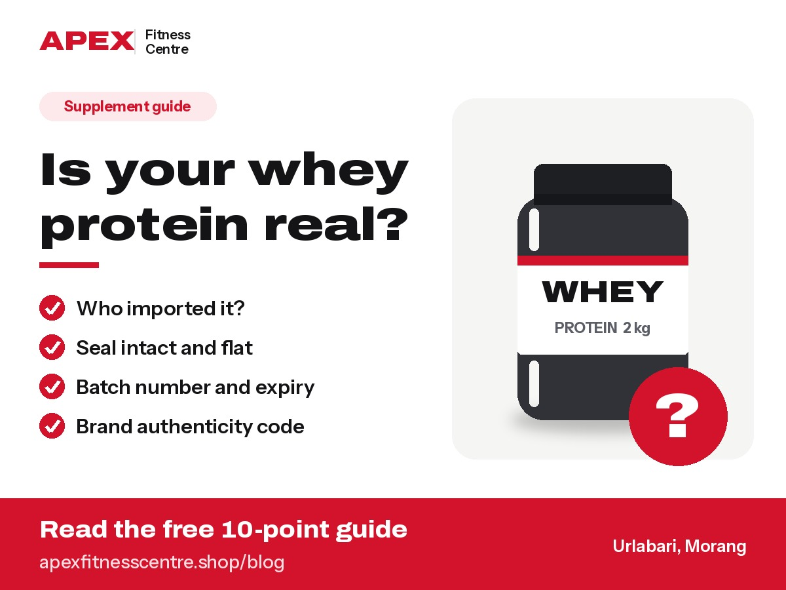

The quickest way to avoid fake supplements in Nepal is to **buy only from sellers who can show where the product came from**, check the **seal, batch number and expiry date**, verify the brand's **authenticity code** if it has one, and walk away from **prices that are far below everyone else's**. No single check is perfect, but together they catch most fakes.

Fake and adulterated protein powders are a real problem in South Asia. In March 2026, Delhi Police [reported busting a fake protein supplement racket](https://www.newsgram.com/delhi/2026/03/09/delhi-police-bust-fake-protein-supplement-racket) in the National Capital Region, seizing around 100 kg of counterfeit products. Much of the supplement stock sold in Nepal comes through India, so Nepali buyers should take the same care.

*Disclosure: Apex Fitness Centre sells supplements. This guide applies to any seller, including us.*

## What the law in Nepal says

In Nepal, food and dietary supplements are regulated by the **Department of Food Technology and Quality Control (DFTQC)**.

- All food supplements, health supplements, dietary supplements, nutraceuticals and probiotics must be **registered with DFTQC before they can be sold**. The department repeated this in a [public notice in May 2026](https://www.fiscalnepal.com/2026/05/21/26120/magnesium-glycinate-supplements-illegal-in-nepal-govt-warns-of-action-against-sales/), when it warned that magnesium glycinate supplements are not authorised for sale in Nepal.
- Under the dietary supplement directive, imports are meant to come through **official sellers of the foreign brand**, and each consignment needs approval before it reaches the market, according to [this legal summary](https://lawaxion.com/food-supplement-registration-in-nepal/).
- According to the same summary, labels must show details such as the **manufacturer, batch number, manufacturing and expiry dates**, and the **importer's name and address**.

In simple terms: a legitimate product in Nepal has a clear import trail. A seller who cannot tell you who imported it is a warning sign.

## Why fakes exist

Fake protein usually looks real on the outside and is cheap on the inside. Common tricks include:

- **Fillers:** maltodextrin (a cheap carbohydrate), flour or other powders mixed in to make up weight
- **Under-dosed protein:** a label that claims 24 g of protein per scoop when the real amount is much lower
- **Refilled tubs:** genuine empty tubs refilled with cheap powder and resealed
- **Expired stock:** old products with new expiry stickers

For sellers, the money is the motive. An industry executive quoted by [NutraIngredients](https://www.nutraingredients.com/Article/2022/08/16/MuscleBlaze-develops-test-kit-for-consumers-to-verify-protein-powder-authenticity/) said retailers in India could make about **₹1,500 on a fake sale versus about ₹400 on a genuine one**.

*The four quickest checks before you open a new tub.*

## 10 checks before you buy

### 1. Know where the seller gets stock

Ask: "Who is the importer?" A real shop can name the importer or distributor and show the importer label on the tub. Vague answers like "from India, from a friend" are a red flag.

### 2. Look for the importer label

Products imported legally into Nepal should carry the importer's name and address. A tub with no Nepal importer details at all deserves extra questions.

### 3. Compare the price

If a 2 kg whey is thousands of rupees cheaper than every other shop, ask why. Genuine stock has similar costs for every legal importer, so huge discounts usually mean fake, expired or grey-market stock.

### 4. Check the seal

The inner foil seal under the lid should be intact, flat and properly stuck. A loose, wrinkled, re-glued or missing seal means do not use it.

### 5. Check print quality

Genuine labels have sharp text, straight alignment and consistent colours. **Spelling mistakes, blurry printing, or a label that peels off too easily** are classic counterfeit signs.

### 6. Match batch number and expiry

The batch number and expiry date are usually **printed or stamped** on the tub. They should be clear, not handwritten or on a sticker covering something else. The batch on the tub and on the box (if any) should match.

### 7. Verify the authenticity code

Many big brands now print a **scratch code or QR code** on each pack that you can check on the brand's website. For example, Dymatize India describes a [13-digit code under a scratch panel](https://dymatize.co.in/thescoop/how-to-check-authentic-protein-powder) that you enter on its website. If your brand offers this, always use it, and be suspicious if the code is already scratched.

### 8. Read the nutrition label

Check protein per serving and serving size. A whey with 24 g protein in a 30 g scoop is about 80% protein. If the numbers do not add up, or the ingredient list starts with maltodextrin or sugar for a product sold as "whey isolate", be careful.

### 9. Mix, smell and taste (weak signals only)

Genuine whey usually mixes reasonably well and smells like its flavour. **Clumps, a chemical smell or an unusual taste can be warning signs**, but they cannot prove a product is real or fake. Some real products clump, and good fakes can taste fine. Use this only together with the other checks.

### 10. Keep your bill

Ask for a bill from the shop. If something is wrong, it is your proof of purchase.

## Can you test protein at home?

Not accurately. Popular "home tests" (burning powder, mixing with hot water, iodine tests) **cannot measure protein content** and are easy to misread. The only reliable way is a **lab test**. In India, MuscleBlaze developed a simple test kit that estimates whey content from how a shake curdles, but the company said it was about 70% accurate in early testing, and it is not widely available in Nepal.

For most people, buying from a trustworthy seller is far more practical than testing.

## Red flags at a glance

| Red flag | What it may mean |
|---|---|
| Price far below other shops | Fake, expired or grey-market stock |
| No importer details on the tub | Not imported through the official route |
| Seal loose, missing or re-glued | Refilled or tampered tub |
| Blurry print, spelling mistakes | Counterfeit packaging |
| Authenticity code already scratched | Reused or fake packaging |
| Seller avoids questions about the source | Unknown supply chain |

## What to do if you think your supplement is fake

1. **Stop using it.**
2. Take clear photos of the tub, seal, batch number, expiry date and bill.
3. Contact the brand's customer care with the photos and batch number.
4. Return to the seller and ask for a refund.
5. You can report suspected fake or unregistered food supplements to the **Department of Food Technology and Quality Control** through its official channels.

## Frequently asked questions

### Are supplements legal in Nepal?

Yes, if they are registered with the Department of Food Technology and Quality Control (DFTQC). Unregistered supplements are not allowed to be sold, and DFTQC has warned it will take legal action against sellers of unauthorised products.

### How do I know if my whey protein is original?

Buy from a seller who can name the importer, then check the seal, print quality, batch number, expiry date and the brand's authenticity code. No single check is enough on its own.

### Is cheap whey protein always fake?

No. Some brands are simply cheaper. But the same brand and size sold far below normal market price is a strong warning sign.

### Can fake supplements harm you?

They can. Unknown powders may contain contaminants, undeclared ingredients or allergens, and you get much less protein than you paid for. If you feel unwell after using a supplement, stop and see a doctor.

### Does creatine get faked too?

Yes, though less often than whey. Use the same checks: seal, print quality, batch number, expiry and seller source.

## The bottom line

Fakes win when buyers only look at the price. Ask where the product came from, check the seal and codes, keep your bill, and buy from a seller you can contact again.

*Checked on 23 October 2026. Rules and brand verification systems change, so check the latest from DFTQC and the brand's official website.*
