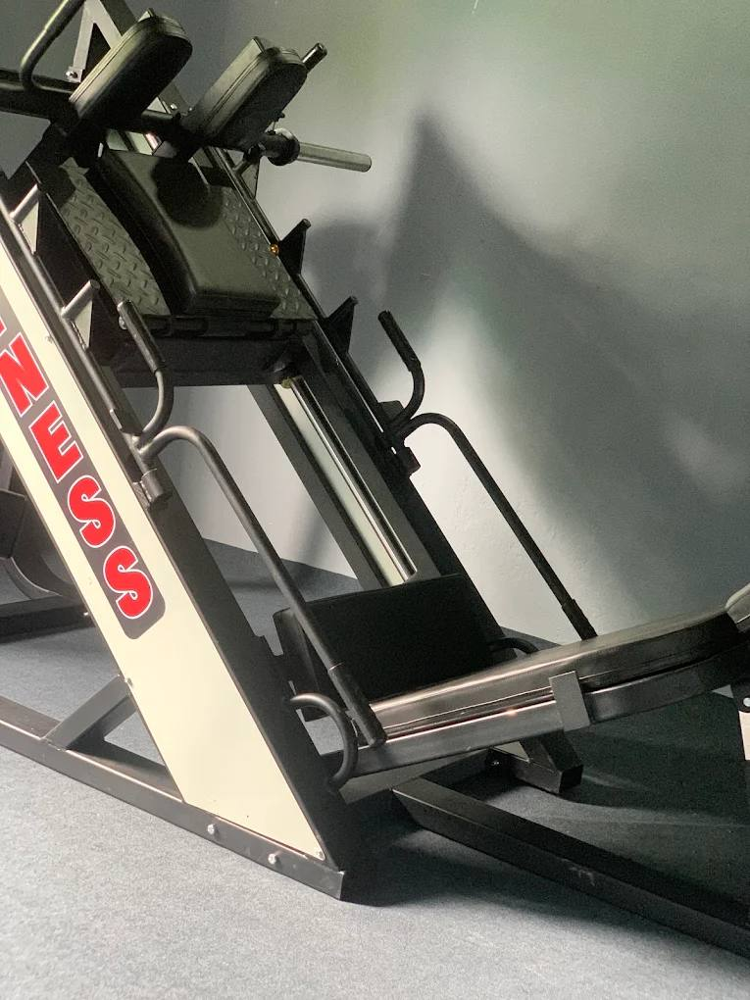

Many Nepali trainers work in gyms in the UAE, Qatar, Saudi Arabia and other Gulf countries. To get a **real trainer job** (not just a cleaning or "gym attendant" role), you need **an internationally recognised personal trainer certificate, First Aid and CPR, some gym experience in Nepal, and a job offer through a licensed agency with a valid labour permit.**

This guide covers what employers ask for, what trainers actually earn, and the safe legal route from Nepal.

## Gym attendant vs personal trainer: know the difference

Many Gulf job ads say "gym job" but mean very different things:

| Role | What you do | Typical requirement |
|---|---|---|
| **Gym attendant** | Clean and arrange equipment, help members, watch the floor | Basic English, fitness interest |
| **Fitness instructor / floor trainer** | Show exercises, write basic plans, run classes | Recognised certificate, experience |
| **Personal trainer (PT)** | One-to-one coaching, own clients, sales targets | Level 3 or international PT certificate, experience, good English |

Always ask: **"What is the exact job title and monthly salary in the contract?"** An attendant contract with a trainer title in the advert is a common trick.

## Certificates employers ask for

### 1. A recognised personal trainer certificate

In the UAE, fitness professionals are generally expected to hold an internationally recognised qualification. According to a [2025 Dubai certification guide](https://fit4it.ae/dubai-personal-trainer-certification-requirements/), the minimum is usually a **Level 3 Diploma in Personal Training** or an equivalent from bodies such as **NASM, ACE, ISSA, NSCA or Active IQ**. These take about 3 to 6 months.

You can prepare for NASM or ACE from Nepal. See our guide on [how to become a gym trainer in Nepal](../how-to-become-a-gym-trainer-in-nepal/) for options and fees.

### 2. REPs UAE registration (for the UAE)

**REPs UAE** is the register of exercise professionals in the UAE. Trainers register with their certificate and First Aid/CPR. The same guide lists the annual registration fee for personal trainers as **AED 450**. Many UAE gyms expect it, and your employer often helps with it after you arrive. Check the latest rules with REPs UAE directly.

### 3. First Aid and CPR

A valid **First Aid/CPR certificate** is commonly required, both for certification bodies like NASM and ACE and for gym registration abroad.

### 4. Proof of experience

A letter from your gym in Nepal, before and after photos of clients (with their permission), and a short video of you coaching a session make your CV much stronger.

*Coaching experience on a real gym floor in Nepal makes your CV much stronger. Photo: Apex Fitness Centre.*

## How much do gym trainers earn in the Gulf?

It depends hugely on the role, the gym and whether you have your own clients.

- **Personal trainers in Dubai:** one Dubai guide gives a range of **AED 8,000 to 25,000 a month**, with freelancers often earning more but paying their own costs. Top earners usually have a strong client base and good English, and much of that income comes from **session commissions**, not basic salary.
- **Contracts through manpower agencies:** these are often for **attendant or junior instructor** roles and can be **much lower** than those figures.

**Always check three numbers in your contract:** basic salary, whether food and accommodation are provided, and any commission per session. Do not rely on what an agent says verbally.

## The legal process from Nepal, step by step

Nepal's foreign employment process is run by the **Department of Foreign Employment (DoFE)**. Here is the typical route, based on [this step-by-step summary](https://www.workforcenepal.com/resources/dofe-process). Confirm current rules at **dofe.gov.np**.

1. **Choose a licensed recruitment agency** and check its licence on the DoFE website.
2. **Apply only for jobs with DoFE pre-approval** (the job demand, known as *swikrit maag*).
3. **Read and sign the contract** in Nepali or a language you understand. Photograph every page.
4. **Medical test:** Gulf countries require a GAMCA-approved medical.
5. **Pre-departure orientation:** a short orientation course at an approved centre.
6. **Welfare fund contribution:** listed as NPR 1,500 for Gulf countries.
7. **Labour permit (shram swikriti):** must be issued before you fly. Without it, you are not protected.
8. **Visa stamping and departure.**

### What should it cost?

For many Gulf jobs, employers are meant to cover the visa and air ticket. The same guide lists the agency service charge cap for the Gulf at **NPR 10,000**, and estimates the worker's total cost under **NPR 25,000** when visa and ticket are free. **If an agent asks for lakhs of rupees, treat it as a serious warning sign** and check with DoFE.

## How to avoid job scams

- **Never go on a visit visa** expecting to "convert it" to a work visa. You lose your legal protection and labour permit coverage.
- **Never pay large amounts in cash without a receipt.**
- **Check the agency licence and the job demand number** on the DoFE website.
- **Search the gym's name** on Google Maps and Instagram. A real gym has photos, reviews and a trainer team.
- **Keep copies** of your passport, contract and labour permit with your family in Nepal.

## How to stand out

- **Speak confident English.** It matters as much as your physique for PT jobs.
- **Build a simple portfolio:** certificate, CPR card, 3 to 5 client results, a 60-second coaching video.
- **Specialise:** fat loss, strength, women's training or group classes are in high demand.
- **Use LinkedIn and gym career pages** to see real job requirements, even if you apply through an agency.

## Frequently asked questions

### Can I work as a gym trainer in Dubai without a certificate?

Not as a proper trainer. Recognised gyms generally require an international PT certificate, and registration with REPs UAE is expected. Without it you may only get attendant roles.

### Which certificate is best for the Gulf?

Internationally recognised ones such as NASM, ACE, ISSA or a UK Level 3 Diploma in Personal Training are widely accepted. Check the specific employer's requirements.

### How much does a gym trainer earn in Dubai?

It varies by role and experience. One Dubai guide puts personal trainers at roughly AED 8,000 to 25,000 a month, mostly linked to client sessions. Agency contracts for junior roles are often much lower.

### Is the labour permit necessary?

Yes. The labour permit (shram swikriti) is required by Nepali law for foreign employment and gives you access to welfare fund protection and insurance.

### How long does the process take?

Usually a few weeks to a few months, depending on medicals, orientation, permit processing and visa stamping.

*Rules, fees and salaries change. Checked on 23 October 2026. Always confirm with dofe.gov.np, REPs UAE and your employer before you pay or travel.*
