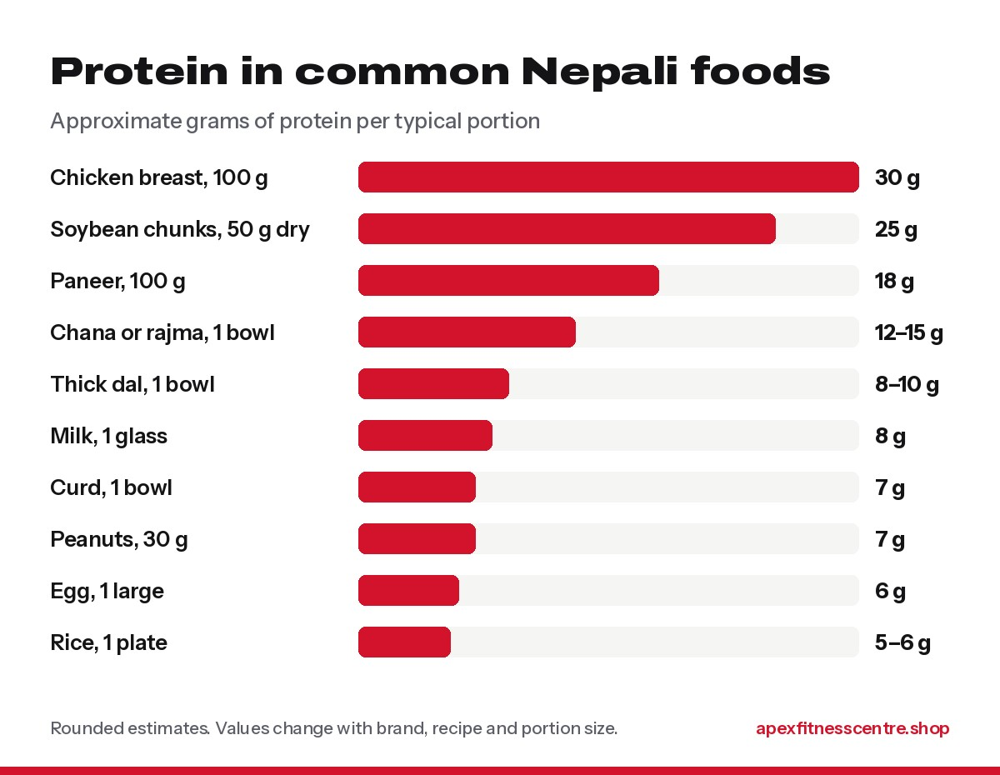

If you lift weights, a common target is **about 1.6 to 2.2 grams of protein per kilogram of body weight per day**. For a 65 kg member that is roughly 105 to 140 grams a day. If you are not training, much less is enough.

Many people in Nepal eat far less than that. Not because they eat badly, but because a normal day of dal bhat, tea and snacks is mostly rice. Here is how to work out your number and reach it with food you already eat.

## Step 1: Find your number

Multiply your body weight in kilograms by 1.6 for the low end and by 2.2 for the high end.

| Body weight | Protein per day |
|---|---|
| 55 kg | about 90 to 120 g |
| 65 kg | about 105 to 145 g |
| 75 kg | about 120 to 165 g |
| 85 kg | about 135 to 185 g |

Start at the low end. That is already a big change for most people, and it is enough to recover and build muscle when you train regularly.

If you are carrying a lot of extra weight, use your goal weight instead of your current weight.

## Step 2: See what you eat now

Write down one normal day. Use these rough numbers (they change by brand, recipe and portion size):

- **1 egg:** about 6 g
- **100 g cooked chicken breast:** about 30 g
- **100 g paneer:** about 18 g
- **1 glass of milk (250 ml):** about 8 g
- **1 bowl of curd (200 g):** about 7 g
- **1 bowl of thick dal:** about 8 to 10 g
- **1 bowl of cooked chana or rajma:** about 12 to 15 g
- **50 g soybean chunks (dry weight):** about 25 g
- **A handful of peanuts (30 g):** about 7 g
- **1 plate of rice:** about 5 to 6 g

A typical day of tea, two plates of dal bhat with tarkari and a snack often comes to only 40 to 60 g. That is the gap.

*Approximate protein per portion of everyday Nepali foods.*

## Step 3: Close the gap with food first

You do not need a perfect diet. Add one protein food to each meal:

1. **Morning:** 2 to 3 boiled eggs, or a glass of milk with your breakfast.
2. **Lunch and dinner:** a bigger bowl of dal, plus chicken, fish, eggs, paneer or soybean chunks. Make the protein bigger and the rice a little smaller.
3. **Snack:** chana, peanuts, curd or a glass of milk instead of biscuits.

Vegetarian members can reach their number too. Paneer, curd, milk, soybean chunks, chana and dal together cover a lot, it just takes planning.

## Where a whey shake fits

Whey protein is just food in powder form. It does not build muscle by itself, and you do not need it if you already hit your number with meals.

It helps when:

- you train early and cannot cook a protein breakfast,
- you are vegetarian and still fall short,
- your day is busy and meals are mostly rice.

One scoop usually gives about 20 to 25 g of protein. Check the label of your tub, since it differs by brand. Many members take one shake after training and get the rest from food.

## Common questions

**Is more protein always better?** No. Above about 2.2 g per kg there is little extra benefit for muscle, and the money is better spent on food, sleep and consistent training.

**Do I have to drink the shake right after the workout?** Not really. Your total for the whole day matters much more than the exact minute.

**Is protein bad for the kidneys?** For healthy people, normal high-protein diets are not shown to harm the kidneys. If you have kidney disease or another medical condition, ask your doctor before changing your diet.

## The short version

1. Multiply your weight by 1.6 to get a starting target.
2. Add one protein food to every meal.
3. Use a shake only to fill the gap you cannot fill with food.
4. Train regularly and sleep well. Protein only helps if you give your muscles a reason to grow.

Not sure what your gap is? Send us one day of your meals on WhatsApp and we will tell you roughly where you are.

## Sources

- [International Society of Sports Nutrition position stand: protein and exercise](https://pubmed.ncbi.nlm.nih.gov/28642676/) (Jäger et al., 2017)
- [Protein supplementation and resistance training gains: systematic review and meta-analysis](https://bjsm.bmj.com/content/52/6/376) (Morton et al., *British Journal of Sports Medicine*, 2018)

