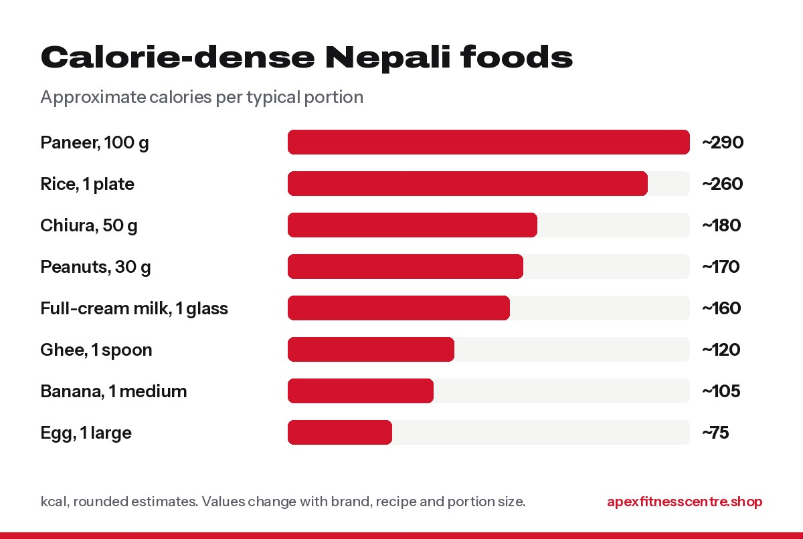

If you are naturally thin, gaining weight comes down to one rule: **eat more energy than your body burns, every single day.** For most people that means adding about **300 to 500 extra calories a day**, which is the range the [NHS suggests](https://www.nhs.uk/live-well/healthy-weight/managing-your-weight/healthy-ways-to-gain-weight/), plus **lifting weights** so the extra weight becomes muscle, not just fat.

"I eat a lot but don't gain" is the most common thing skinny members tell us. Almost always, they eat a lot at *one* meal, then very little for the rest of the day. Here is how to fix it.

## First: check it is not a health problem

See a doctor before you start if you have **lost weight suddenly without trying**, have stomach problems, or your appetite has changed. Thyroid problems, worms, diabetes and other conditions can stop you gaining weight, and they need treatment, not more food.

## How fast should you gain?

Aim for about **0.25 to 0.5 kg per week**. That is 1 to 2 kg a month. Faster than that is mostly fat. Weigh yourself once a week, same day, same time.

## Calorie-dense Nepali foods

The trick is foods that pack a lot of energy into a small amount, so you are not forced to eat huge plates.

*Approximate calories. Values vary with brand, recipe and portion size.*

Easy ways to add energy:

- **Add a spoon of ghee** to dal or rice.
- **Drink full-cream milk** instead of tea without milk, 2 glasses a day.
- **Keep peanuts, chana and chiura** for snacks.
- **Bananas** with milk or curd.
- **Paneer, eggs and chicken** for protein.
- A **banana and milk shake** with oats and peanuts between meals is one of the easiest 500-calorie snacks.

## Sample day for weight gain

| Time | What to eat |
|---|---|
| 6:00 AM | 1 glass full-cream milk + 2 bananas |
| 9:30 AM khana | 1½ to 2 plates rice, dal with a spoon of ghee, chicken or paneer, tarkari |
| 12:30 PM | Chiura with curd, or 2 eggs with roti |
| 3:30 PM | Banana-oats-peanut milkshake |
| After gym | Milk or a whey shake, plus a fruit |
| 8:00 PM | Rice or roti, dal, egg curry or fish, tarkari |
| Before bed | 1 glass warm milk |

**Six eating times, not two.** That is the main difference from a normal Nepali day.

## Train to gain muscle, not just belly

If you eat more without training, much of the weight goes to your belly. Lifting weights tells your body to use the extra food for **muscle**:

- Train **3 to 4 days a week** with compound lifts: squats, push-ups or bench press, rows, deadlifts, overhead press.
- **Add a little weight or a few reps** every week.
- **Limit long cardio.** A short walk is fine, but hours of running burn the calories you need.
- **Sleep 7 to 9 hours.** Muscle grows when you rest.

New to the gym? Follow our [beginner gym workout plan](../beginner-gym-workout-plan-first-3-months/).

## Do you need supplements to gain weight?

No, food comes first. But some products make it easier:

- **Whey protein:** a quick way to add about 20 to 25 g of protein per scoop (check your label).
- **High-protein oats:** quick breakfast with more protein than normal oats.
- **Creatine monohydrate:** helps you lift a little more over time, and adds some water weight inside muscles. See [creatine side effects: myths and facts](../creatine-side-effects-myths-and-facts/).

Be careful with cheap **"mass gainer"** powders. Many are mostly sugar. Making your own shake with milk, banana, oats and peanuts is cheaper and just as effective.

## Common mistakes

- **Eating big once, then skipping meals.**
- **Junk food bulking.** Samosa, chowmein and cola every day adds fat, not strength.
- **Changing plans every week.** Give it 8 weeks before judging.
- **Not tracking weight.** If the scale has not moved in 2 weeks, add another snack.

## Frequently asked questions

### Why can't I gain weight even if I eat a lot?

Usually because the total for the whole day is still lower than you think. Eat 5 to 6 times a day, add calorie-dense foods, and track your weight every week. If nothing changes, see a doctor.

### How can a skinny person gain weight in 1 month?

With 300 to 500 extra calories a day and strength training, 1 to 2 kg in a month is realistic and healthy.

### Is banana and milk good for weight gain?

Yes. It is cheap, tasty and calorie-dense. Add oats and peanuts for even more energy and protein.

### Should skinny people do cardio?

A little is fine for health. Keep it short and focus on strength training so the extra food builds muscle.

### Are weight gain pills safe?

Avoid pills or powders that promise fast weight gain without a clear ingredient list. Health regulators have repeatedly warned about products sold online for weight gain and bodybuilding that contain hidden drugs, including steroids.

*General information, not medical advice. If you are underweight because of illness, an eating problem or medicines, please speak to a doctor.*
