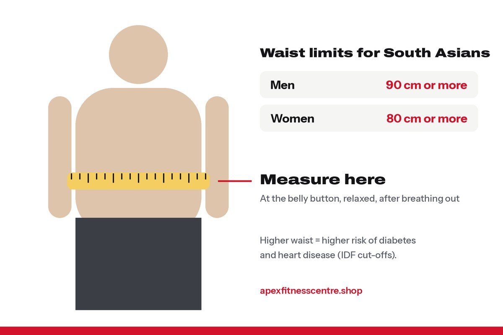

**You cannot burn fat from only your belly.** Doing sit-ups or crunches strengthens your stomach muscles, but research shows it does not remove the fat on top of them. Belly fat goes down when your **total body fat** goes down, through **a small daily calorie deficit, enough protein, strength training, regular walking and good sleep.**

The good news: belly fat, especially the deeper fat around your organs, often responds well once you start losing weight.

## Why sit-ups do not burn belly fat

The idea of "spot reduction", losing fat from the exact place you exercise, has been tested many times. In one well-known study, published in 2011, adults did **seven abdominal exercises, five days a week, for six weeks**. Their stomach muscles got stronger, but **their belly fat did not go down** ([summary of the research](https://en.wikipedia.org/wiki/Spot_reduction)).

Your body decides where it takes fat from, mostly based on your **genes, hormones and age**. Many men store fat first on the belly and lose it from there last. That is frustrating, but normal.

## Why belly fat matters more for South Asians

There are two kinds of belly fat:

- **Subcutaneous fat:** the soft fat under the skin that you can pinch.
- **Visceral fat:** deeper fat around the liver and other organs. This is the type linked with **diabetes, high blood pressure and heart disease**.

South Asians, including Nepalis, tend to store more visceral fat at a lower body weight than many other populations. That is why the **International Diabetes Federation** uses lower waist limits for South Asians:

| | Waist size that signals higher risk |
|---|---|
| Men | **90 cm (about 35.5 inches) or more** |
| Women | **80 cm (about 31.5 inches) or more** |

*Measure at the belly button, standing relaxed, after breathing out normally.*

## How to measure your waist

1. Stand straight and relax. Do not pull your stomach in.
2. Wrap a measuring tape around your belly **at the level of your belly button**.
3. Keep the tape flat and snug, not tight.
4. Breathe out normally and read the number.
5. Measure again every 2 weeks, at the same time of day.

Your waist number is often a **better progress marker than weight**, especially if you are also building muscle at the gym.

## 6 things that actually reduce belly fat

### 1. Eat a little less, every day

A small, steady deficit works better than starving. Use the Nepali plate method: half vegetables, a quarter protein, a quarter rice. See our [weight loss diet plan with Nepali food](../weight-loss-diet-plan-nepali-food/).

### 2. Cut sugar and drinks first

Sweet tea, soft drinks, packet juices and alcohol are some of the easiest calories to remove. Alcohol in particular is strongly linked with belly fat ("beer belly" is real).

### 3. Eat protein at every meal

Protein keeps you full and protects muscle while you lose fat. Eggs, dal, chicken, fish, paneer, curd and soybean chunks all count. Read [how much protein you need](../how-much-protein-do-you-need/).

### 4. Lift weights 2 to 4 times a week

Strength training builds muscle, which helps you burn more energy and look firmer as the fat goes. The [WHO](https://who.int/initiatives/behealthy/physical-activity) recommends muscle-strengthening on 2 or more days a week.

### 5. Walk more, every day

Brisk walking is underrated. 8,000 to 10,000 steps a day adds up to a lot of extra energy used each week, without making you as hungry as hard cardio.

### 6. Sleep 7 to 9 hours and manage stress

Short sleep and constant stress make you hungrier and are linked with more belly fat. Fixing sleep often makes the diet much easier.

## A simple weekly plan

| Day | Plan |
|---|---|
| Sun | Full-body weights, 45 min + 20 min walk |
| Mon | Brisk walk 45 min |
| Tue | Full-body weights, 45 min |
| Wed | Brisk walk or cycling 45 min |
| Thu | Full-body weights, 45 min |
| Fri | Long walk or hike, 60 min |
| Sat | Rest, light stretching |

New to the gym? Start with our [beginner gym workout plan](../beginner-gym-workout-plan-first-3-months/).

## What does not work

- **Belly-fat belts, sauna belts and "slim" wraps.** You lose water sweat, not fat.
- **Detox teas and fat-burner pills.** Small effect at best, some can be unsafe.
- **Hundreds of crunches a day.** Good for core endurance, not for fat loss.
- **Skipping breakfast and then eating a huge dinner.**

## How long does it take?

It depends on how much fat you have to lose. Many people see a **few centimetres off the waist in 4 to 8 weeks** of consistent eating and training. Visible abs usually need a much lower body fat level and take months or longer.

## Frequently asked questions

### Can I lose belly fat in 7 days?

Not fat, no. You can lose some water and bloating in a week by cutting salt and sugar, but real fat loss takes weeks.

### What is the best exercise to lose belly fat?

There is no single exercise that burns belly fat. A combination of strength training, daily walking and a calorie deficit works best.

### Does drinking hot water or jeera water burn belly fat?

No. They can replace sugary drinks, which helps, but they do not melt fat on their own.

### Why is my belly the last place to lose fat?

Fat storage is mostly decided by genes and hormones. For many men, the belly is the first place to gain fat and the last to lose it. Keep going and it will follow.

*General information, not medical advice. If your waist is above the limits in the table, or you have diabetes or heart problems in the family, ask your doctor for a check-up.*
