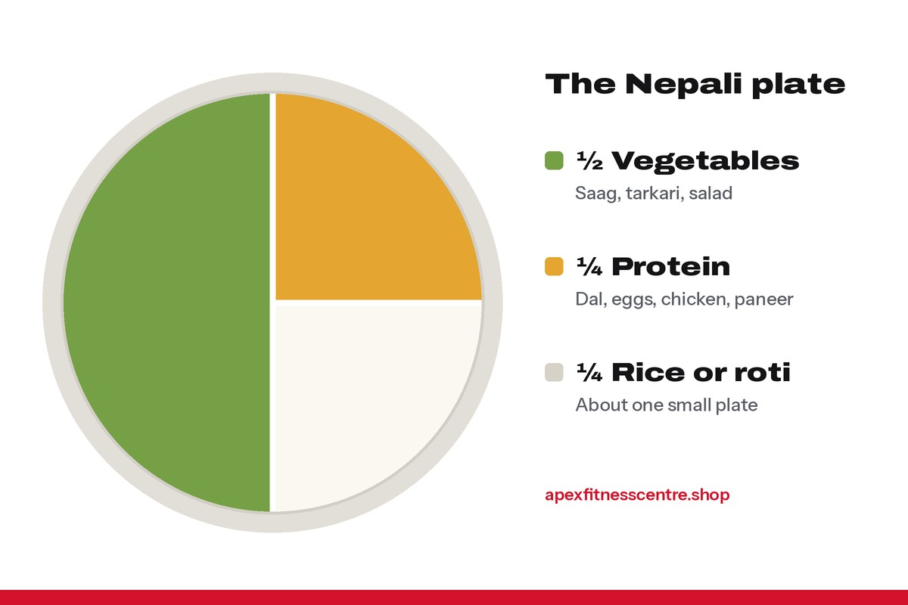

You do not have to stop eating dal bhat to lose weight. **Weight loss happens when you eat a little less energy than your body uses, every day, for weeks.** With Nepali food, the easiest way to do that is to **eat less rice, more vegetables and more protein** at each meal, cut sugary tea and fried snacks, and walk more.

A safe, realistic speed is about **0.5 to 1 kg per week**, which is what the [NHS recommends](https://www.nhs.uk/better-health/lose-weight/). Faster crash diets usually come back as soon as you stop.

## Why most diets fail in Nepal

Most people try one of three things:

1. **Skipping meals.** You get so hungry by evening that you eat double.
2. **Stopping rice completely.** It works for a week, then you go back to three plates.
3. **Buying "fat burner" products.** They do very little. Your plate does far more.

The plan below works because **you keep normal Nepali food**, so you can actually stick to it.

## The Nepali plate method

Use this at every khana. No counting needed.

*Half vegetables, a quarter protein, a quarter rice. The same food, in different amounts.*

- **Half the plate: vegetables.** Saag, tarkari, salad, cucumber, radish, gundruk. Low in energy, high in fibre, very filling.
- **A quarter: protein.** Thick dal, eggs, chicken, fish, paneer, soybean chunks, chana. Protein keeps you full and protects your muscle while you lose fat.
- **A quarter: rice or roti.** About one small plate of rice, not two or three.

Add one spoon of achar if you like, and keep ghee and oil to a small amount.

## Sample day (about 1,500 to 1,800 kcal for most adults)

| Time | What to eat |
|---|---|
| Morning | Black tea or tea with little sugar, 2 boiled eggs or a bowl of curd |
| 9:30 AM khana | 1 small plate rice, 1 big bowl dal, large tarkari and saag, salad |
| Afternoon | 1 fruit (apple, guava, orange) or roasted chana |
| Evening snack | Tea without biscuits, or a bowl of curd |
| Dinner | 2 roti or half plate rice, chicken, egg or paneer curry, big tarkari |

*Exact needs depend on your body size, age and activity. If your weight does not move for 3 weeks, reduce rice a little more or walk more.*

## 7 swaps that make the biggest difference

| Instead of | Choose |
|---|---|
| 3 to 4 cups of sweet milk tea | Black tea, green tea, or tea with less sugar |
| Samosa, pakoda, chowmein | Roasted chana, fruit, curd, boiled eggs |
| Second plate of rice | Second bowl of tarkari and dal |
| Cola and packet juice | Water, lemon water, buttermilk (mohi) |
| Fried momo | Steamed momo, fewer pieces, more achar and soup |
| Biscuits and namkeen | A handful of peanuts (not the whole packet) |
| Eating late at night in front of the TV | Dinner at the table, then stop eating |

## Exercise: what actually helps

- **Walk every day.** 30 to 45 minutes of brisk walking burns energy and is easy to keep up.
- **Lift weights 2 to 4 times a week.** The [WHO](https://who.int/initiatives/behealthy/physical-activity) recommends muscle-strengthening activity on at least 2 days a week. Muscle helps you look toned and keeps your metabolism up while dieting.
- **Do not try to "burn off" a bad diet.** One plate of chowmein can undo a long gym session. Food decides most of your weight loss, exercise shapes your body.

## How to track progress

1. Weigh yourself **once a week**, same day, same time, after the toilet, before food.
2. Measure your **waist** at the belly button once every two weeks.
3. Take a **photo** every month.

Weight goes up and down by a kilo from day to day because of water and salt. Look at the **trend over 3 to 4 weeks**, not one day.

## Common mistakes

- **Cutting too much.** Very low intake makes you tired and hungry, and you quit.
- **Forgetting drinks.** Sweet tea, juices and alcohol add a lot without filling you.
- **Weekend binges.** Five good days and two big feasts can cancel each other out.
- **Too little protein.** You lose muscle and feel hungry all the time.
- **Waiting for motivation.** Plan meals and walks like appointments.

## Frequently asked questions

### Can I lose weight eating rice every day?

Yes. Weight loss depends on your total intake, not on one food. Keep the rice portion smaller and fill the plate with vegetables and protein.

### How fast can I lose weight safely?

About 0.5 to 1 kg a week is a safe, sustainable pace for most adults. In the first week you may lose more, mostly water.

### Is roti better than rice for weight loss?

Not by much. Both are carbohydrates. The portion size matters more than the choice. Whole wheat roti has a little more fibre, which can help you feel full.

### Do fat burners and L-carnitine help?

Their effect, if any, is small compared with your diet and activity. They are not a shortcut. Spend that money on good food and a gym membership first.

### Should I skip dinner to lose weight?

Not necessary. A lighter, earlier dinner with protein and vegetables works better than skipping meals and overeating later.

## Sources

- [Lose weight](https://www.nhs.uk/better-health/lose-weight/) (NHS Better Health)
- [WHO fact sheet: obesity and overweight](https://www.who.int/news-room/fact-sheets/detail/obesity-and-overweight) (World Health Organization)
- [ISSN position stand: protein and exercise](https://pubmed.ncbi.nlm.nih.gov/28642676/) (Jäger et al., 2017)
- [WHO fact sheet: physical activity](https://www.who.int/news-room/fact-sheets/detail/physical-activity) (World Health Organization)

*General information, not medical advice. If you have diabetes, thyroid problems, high blood pressure or are pregnant, speak to your doctor before changing your diet.*
