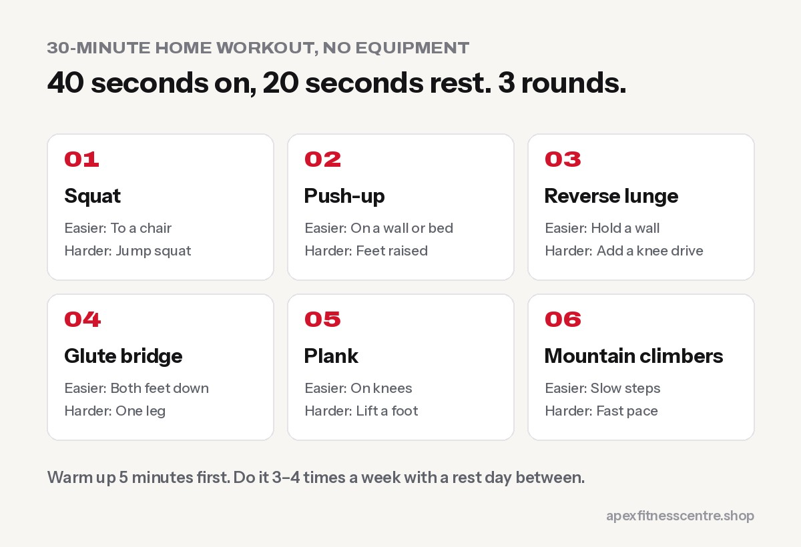

You can get fitter, stronger and leaner at home with **nothing but your body weight and a bit of floor space**. The key is the same as in the gym: do a few basic movements well, rest briefly, and make the workout a little harder every week.

This plan takes **30 minutes**, needs about **2 by 2 metres** of space, and works whether you live in a flat in Kathmandu or a house in the village.

## The 30-minute workout

Do it **3 to 4 times a week**, with at least one rest day between sessions.

### Warm-up (5 minutes)

- 1 minute marching or jogging on the spot
- 10 arm circles forward and back
- 10 hip circles each way
- 10 slow bodyweight squats
- 10 "cat-cow" stretches on hands and knees

### Main circuit (20 minutes)

Do each exercise for **40 seconds**, rest **20 seconds**, then move to the next. After all six, rest 1 minute. Repeat the circuit **3 times**.

| Exercise | Easier version | Harder version |
|---|---|---|
| Squat | Squat to a chair | Jump squat or slow 3-second squat |
| Push-up | Hands on a wall or bed | Feet raised on a step |
| Reverse lunge | Hold a wall for balance | Add a knee drive at the top |
| Glute bridge | Both feet on floor | One-leg bridge |
| Plank | On knees | Lift one foot or one arm |
| Mountain climbers | Slow steps | Fast running pace |

### Cool-down (5 minutes)

Slow walking around the room, then gentle stretches for thighs, hips, chest and shoulders. Hold each stretch for 20 to 30 seconds.

## How to make it harder every week

Your body adapts quickly, so the workout must change slowly over time:

| Week | Change |
|---|---|
| Week 1 | 40 sec work / 20 sec rest, 3 rounds |
| Week 2 | Same, but use the harder version for 2 exercises |
| Week 3 | 45 sec work / 15 sec rest |
| Week 4 | 4 rounds |

If your form breaks down, go back to the easier version. Good reps count, bad reps do not.

## Household items that work as equipment

- **A school bag with books:** wear it for squats and lunges to add weight.
- **Water bottles or a full gallon:** use as light dumbbells for rows and shoulder presses.
- **A sturdy chair or bed:** for step-ups, triceps dips and incline push-ups.
- **A towel:** for sliding mountain climbers on a smooth floor.
- **Stairs:** walking up stairs two at a time is excellent leg and heart training.

## Is home training enough?

For general fitness, fat loss and basic strength, **yes**. The World Health Organization recommends muscle-strengthening activities on **2 or more days a week** for adults ([WHO](https://who.int/initiatives/behealthy/physical-activity)). This plan covers that.

For building **a lot of muscle or strength**, you will eventually need heavier resistance than your body weight. That is the point where a gym with dumbbells and machines makes progress much faster. See our [beginner gym workout plan](../beginner-gym-workout-plan-first-3-months/) when you are ready.

## Tips that keep you consistent

- **Same time every day.** Early morning before the house wakes up works for many people.
- **Put your mat or towel where you will see it.**
- **Track it.** A tick on a calendar after each session is surprisingly motivating.
- **Pair it with walking.** 30 minutes of brisk walking on non-workout days doubles the benefit.
- **Eat enough protein.** Training breaks muscle down, food builds it back. See [how much protein you need](../how-much-protein-do-you-need/).

## Frequently asked questions

### Can I lose weight with home workouts?

Yes, if you also eat a little less than you burn. Exercise helps, but your diet decides most of the result. Our [weight loss diet plan with Nepali food](../weight-loss-diet-plan-nepali-food/) explains how.

### How long until I see results?

Most people feel fitter within 2 to 3 weeks. Visible changes usually take 6 to 8 weeks of steady training and eating.

### Is it okay to do this every day?

Light walking and stretching every day is fine. Do the full circuit 3 to 4 times a week so your muscles can recover.

### I have bad knees. What should I do?

Use the easier versions, keep squats shallow and pain-free, and skip jumping. If pain continues, see a doctor or physiotherapist before training harder.

## Sources

- [WHO fact sheet: physical activity](https://www.who.int/news-room/fact-sheets/detail/physical-activity) (World Health Organization)
- [ACSM position stand: progression models in resistance training for healthy adults](https://pubmed.ncbi.nlm.nih.gov/19204579/) (American College of Sports Medicine, 2009)

*General information, not medical advice. If you have heart problems, high blood pressure or an injury, check with a doctor before starting a new exercise routine.*
