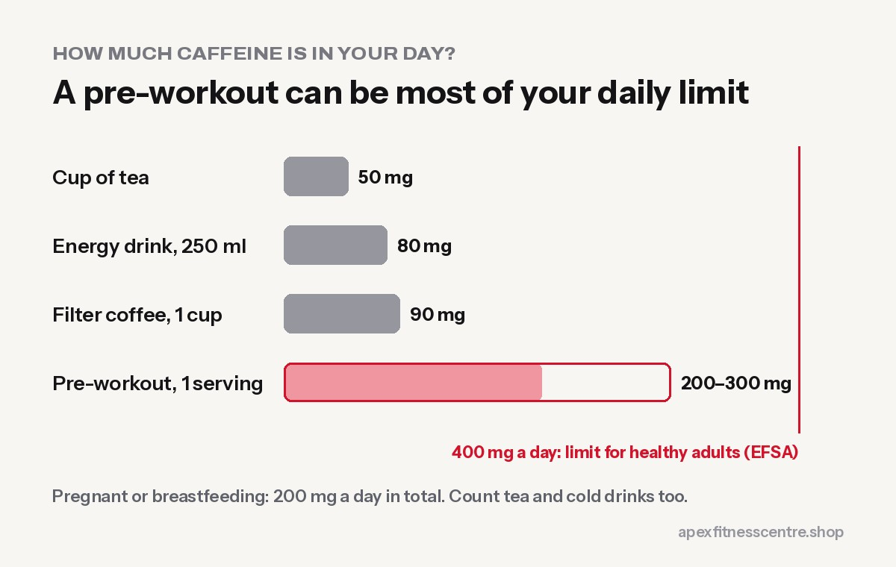

For most **healthy adults**, a pre-workout is safe **if you respect the caffeine dose, take it early in the day and do not combine it with other caffeine**. Most of the problems people have, such as a racing heart, anxiety, bad sleep or nausea, come from **too much caffeine**, not from the other ingredients.

Pre-workout is **not** suitable for teenagers, pregnant or breastfeeding women, or anyone with heart problems or high blood pressure.

## What is actually in a pre-workout?

Most pre-workouts contain some of these:

| Ingredient | What it does | What to know |
|---|---|---|
| **Caffeine** | Alertness, energy, focus | The ingredient that matters most for safety |
| **Beta-alanine** | May help in hard efforts of 1 to 4 minutes | Causes harmless tingling in face and hands |
| **Citrulline or arginine** | Marketed for "pump" | Generally well tolerated |
| **Creatine** | Strength and power over weeks | Works daily, not only before training |
| **Taurine, tyrosine, B vitamins** | Supporting ingredients | Usually small amounts |

Always read the label. Two products with the same flavour can have **very different caffeine doses**.

## How much caffeine is safe?

The European Food Safety Authority (EFSA) concluded that for healthy adults:

- up to **400 mg of caffeine a day** is not a safety concern, and
- a **single dose of up to 200 mg** is not a concern.

For **pregnant and breastfeeding women**, EFSA's level is **200 mg a day** in total ([EFSA summary by EUFIC](https://eufic.org/en/whats-in-food/article/efsa-opinion-on-the-safety-of-caffeine)).

To compare, according to the same source: a cup of tea is about **50 mg**, a cup of filter coffee about **90 mg**, and a 250 ml energy drink about **80 mg**.

**Many pre-workouts contain 200 to 300 mg per serving.** One serving plus two cups of milk tea and a cold drink can easily push you over 400 mg in a day.

## Common side effects

- **Tingling or itching** (from beta-alanine): harmless and fades within an hour.
- **Jitters, fast heartbeat, anxiety:** too much caffeine. Use half a serving.
- **Poor sleep:** caffeine stays in your body for many hours. Do not take it in the evening.
- **Nausea or stomach upset:** take it with a little food and plenty of water.
- **Crash later in the day:** common with high doses.

## Who should not use pre-workout

- **Under 18s**
- **Pregnant or breastfeeding women**
- People with **heart conditions, irregular heartbeat or high blood pressure**
- People with **anxiety disorders** or trouble sleeping
- Anyone on **medicines that interact with caffeine**, or sensitive to caffeine

If you are not sure, ask your doctor and show them the label.

## How to use a pre-workout safely

1. **Start with half a serving** to see how you react.
2. **Count all your caffeine for the day,** including tea, coffee and cola.
3. **Take it 20 to 30 minutes before training,** not on an empty stomach if it upsets you.
4. **Not after about 2 to 3 PM** if you sleep around 10 PM.
5. **Drink water** during training.
6. **Take breaks.** Use it on hard training days, not every day, so it keeps working.
7. **Never mix it** with energy drinks or "fat burners".

## Do you even need pre-workout?

No. It can help on days when you are tired, but **sleep, food and consistency matter far more**. Many lifters do just as well with a cup of black coffee and a banana before training. A light meal 1 to 2 hours before training does the rest.

## Frequently asked questions

### Is pre-workout bad for your heart?

For healthy adults at normal doses, it is generally considered safe. High doses of caffeine can raise heart rate and blood pressure, so anyone with heart problems should avoid it unless a doctor says otherwise.

### Why does pre-workout make my face tingle?

That is beta-alanine. It is a harmless nerve sensation and usually fades within an hour.

### Can I take pre-workout every day?

You can, but your body gets used to caffeine. Using it only on harder sessions keeps it effective and helps your sleep.

### Can teenagers take pre-workout?

No. High caffeine doses are not recommended for young people.

*General information, not medical advice. Read the label of your product and follow its serving size.*
