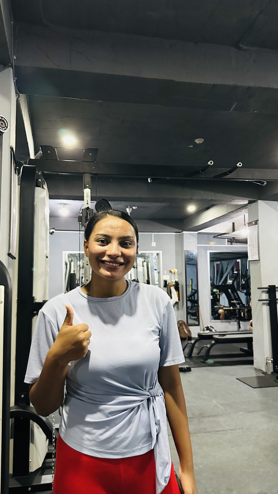

If you are a woman thinking about joining a gym, you are not alone in feeling nervous. The most common worries we hear are **"everyone will stare," "I don't know what to do,"** and **"I'll get bulky."** The good news: within two or three weeks, almost every woman who keeps coming feels at home. This guide makes those first weeks much easier.

## Before your first visit

- **Visit or call first.** Ask about timings, women's changing rooms, and whether a trainer can show you around.
- **Pick a quieter time.** Mid-morning and early afternoon are usually less busy than early mornings and evenings.
- **Bring:** water bottle, small towel, indoor shoes, a hair tie, and your phone with music.
- **Wear:** comfortable leggings or track pants and a T-shirt you can move in. Clean sports shoes with a flat sole are best for lifting.

## What to do on day one

1. **Tour the gym** and ask a trainer to show you 4 or 5 machines and where the dumbbells are.
2. **Warm up** for 5 to 10 minutes on a bike, treadmill or cross-trainer.
3. **Try a short beginner workout** (below) with light weights.
4. **Finish with 5 minutes of stretching.**
5. **Leave feeling good, not exhausted.** The goal of day one is to come back on day two.

*A member after her session at Apex Fitness Centre, Urlabari. The first few visits are the hardest; after that it becomes your routine.*

## A simple plan for your first month

Train **3 days a week**, for example Sunday, Tuesday and Thursday.

| Exercise | Sets x reps | What it trains |
|---|---|---|
| Goblet squat or leg press | 3 x 10 | Thighs and glutes |
| Hip thrust or glute bridge | 3 x 12 | Glutes |
| Lat pulldown | 3 x 10 | Back and posture |
| Dumbbell chest press | 3 x 10 | Chest and arms |
| Seated cable row | 3 x 10 | Upper back |
| Plank | 3 x 20–30 sec | Core |

Add **20 minutes of walking or cycling** at the end if you have time. When all sets feel easy, choose the next weight up.

For the full 3-month version, see our [beginner gym workout plan](../beginner-gym-workout-plan-first-3-months/).

## The 5 fears, answered honestly

### "I'll get bulky"

Very unlikely. Women have much lower levels of testosterone than men and build muscle slowly. What weight training gives most women is a **firmer, toned shape, better posture and stronger bones**. The "bulky" look you see online usually takes years of specialised training and diet.

### "Everyone will look at me"

In reality, most people in a gym are focused on themselves and their own sets. Headphones help you stay in your own world. After a few visits, you will be one of the regulars.

### "I don't know how to use the machines"

Nobody does at first. Ask a trainer. That is what they are there for. Most machines also have a picture guide on the side.

### "I'm too unfit to start"

The gym is exactly where you get fit. Start light, and every week you will notice you can do a little more.

### "Weights are for men, cardio is for women"

No. Both are for everyone. Strength training is especially valuable for women because it protects **bone density**, which naturally declines with age.

## Food and results

- Most women need **more protein** than they eat. Aim for protein at every meal: eggs, dal, curd, paneer, chicken, fish. See [how much protein you need](../how-much-protein-do-you-need/).
- For fat loss, the [weight loss diet plan with Nepali food](../weight-loss-diet-plan-nepali-food/) works for women too.
- Expect to **feel** better in 2 to 3 weeks and **see** changes in 6 to 10 weeks.

## Frequently asked questions

### Can women lift heavy weights?

Yes. Lifting progressively heavier weights with good form is safe and effective for women. Heavy is relative: it means challenging for you.

### What should a woman wear to the gym in Nepal?

Anything comfortable that lets you move freely: leggings or track pants, a T-shirt or sports top, and flat sports shoes.

### Can I go to the gym during my period?

Yes, if you feel well. Many women find light exercise eases cramps. Listen to your body and train lighter on difficult days.

### How many days a week should a beginner woman train?

Three days a week of strength training plus some walking is an excellent start.

*Thinking about joining? See plans and timings at [Apex Fitness Centre](../../gym/), with a friendly front desk team to help you get started.*
