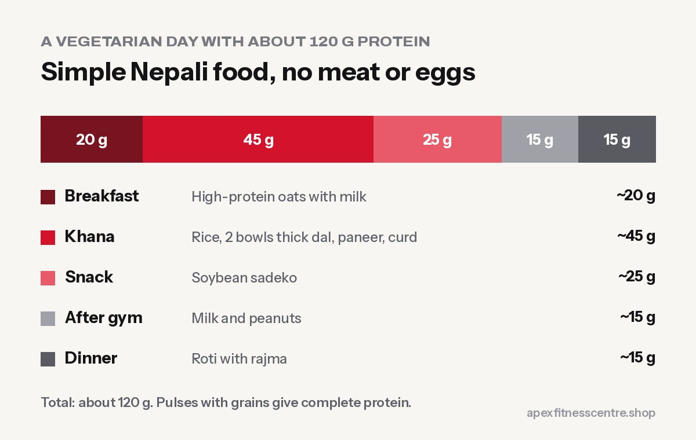

Vegetarians in Nepal can easily eat enough protein to build muscle and stay healthy. The trick is to **eat a protein food at every meal**, not just rice with a little dal. Here are 15 protein-rich vegetarian foods you can buy in any Nepali bazaar, with rough protein amounts.

*Protein amounts are approximate and vary with brand, recipe and portion.*

## Dairy (the vegetarian's best friend)

### 1. Paneer: about 18 g per 100 g

The most protein-dense vegetarian food in most kitchens. Paneer tarkari, chilli paneer or simply grilled paneer cubes with salt and pepper.

### 2. Curd (dahi): about 7 g per bowl (200 g)

Easy, cheap and good for digestion. Have it with lunch, or as a snack with fruit.

### 3. Milk: about 8 g per glass (250 ml)

One or two glasses a day adds a lot. Use it in oats or make a banana shake after training.

### 4. Hung curd or Greek-style yogurt: about 10 g per 100 g

Strained curd is thicker and higher in protein. You can make it at home by hanging curd in a cloth for a few hours.

### 5. Cheese: about 6 to 7 g per slice

Useful, but higher in fat and salt. Small amounts.

## Pulses and legumes

### 6. Soybean chunks: about 25 g per 50 g dry

Among the cheapest and richest protein sources in Nepal. Soak, boil and use in sadeko, curry or with rice.

### 7. Thick dal: about 8 to 10 g per bowl

Make it thicker than usual and have two bowls instead of one.

### 8. Chana (chickpeas): about 12 to 15 g per cooked bowl

Chana chatpate, chana curry, or boiled with onion and lemon.

### 9. Rajma (kidney beans): about 12 to 15 g per cooked bowl

Rajma with rice is a complete, filling meal.

### 10. Kwati (mixed sprouted beans): about 10 to 14 g per bowl

Traditional, nutritious, and not just for Janai Purnima. Sprouting makes beans easier to digest.

### 11. Sprouted moong: about 6 to 8 g per bowl

Great raw in salads or lightly cooked as a snack.

## Nuts, seeds and others

### 12. Peanuts: about 7 g per 30 g handful

Cheap and high in energy, so watch portions if you are losing weight.

### 13. Peanut butter: about 7 to 8 g per 2 tablespoons

On roti or bread for a quick breakfast.

### 14. Tofu: about 8 to 15 g per 100 g (depending on firmness)

Becoming easier to find in cities. Firm tofu works like paneer in curries.

### 15. High-protein oats: about 26 g per 100 g (Pintola, per pack)

A quick breakfast option, especially for people training in the morning.

## A full vegetarian day with about 110 g protein

| Meal | Food | Protein |
|---|---|---|
| Breakfast | High-protein oats with milk | ~20 g |
| Khana | Rice, 2 bowls thick dal, paneer tarkari, curd | ~45 g |
| Snack | Soybean sadeko | ~25 g |
| After gym | Glass of milk + peanuts | ~15 g |
| Dinner | Roti with rajma | ~15 g |
| **Total** | | **~120 g** |

For more ideas, see our [high-protein Nepali diet plan for muscle gain](../high-protein-nepali-diet-plan-for-muscle-gain/).

## Combining proteins

Plant proteins differ in their amino acids. The good news: you do **not** need to combine them at every meal. Eating a variety of pulses, grains and dairy across the day covers your needs. Dal bhat itself is a classic combination of a pulse and a grain.

## Frequently asked questions

### Can vegetarians build muscle?

Yes. With enough total protein from dairy, pulses and soy, plus regular strength training, vegetarians build muscle just as well.

### What is the highest protein vegetarian food in Nepal?

Per serving, soybean chunks and paneer are the richest. Soybean chunks are also one of the cheapest.

### Is soy safe to eat regularly?

Normal food amounts of soy, such as soybean chunks a few times a week, are considered safe for both men and women based on human studies.

### Do vegetarians need protein powder?

Not necessarily. Whey is a dairy product and suits lacto-vegetarians if food alone is not enough. Many reach their target with food alone.

## Sources

- [International Society of Sports Nutrition position stand: protein and exercise](https://pubmed.ncbi.nlm.nih.gov/28642676/) (Jäger et al., 2017)
- [Protein supplementation and resistance training gains: systematic review and meta-analysis](https://bjsm.bmj.com/content/52/6/376) (Morton et al., *British Journal of Sports Medicine*, 2018)

*General information, not medical advice.*
