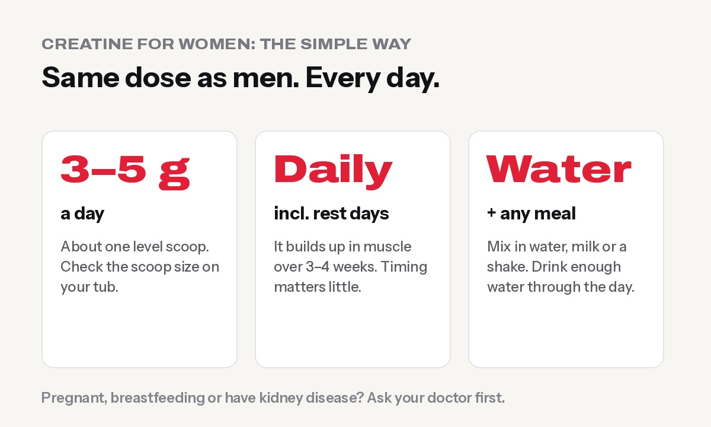

**Yes, creatine works for women, and for most healthy women it's safe. Take 3–5 g of creatine monohydrate every day, including rest days.** It helps you get stronger in the gym and recover between sets. Research suggests it may also support women through menopause and possibly mood. It won't make you bulky, and the small weight gain at the start is water inside your muscles, not fat.

For years creatine was marketed as a "men's bodybuilding supplement". That's changing fast. Worldwide, women are now one of the main reasons creatine sales are at their highest in decades, and scientists have started studying creatine for women specifically.

## What creatine actually does

Your muscles use a molecule called **phosphocreatine** to quickly make energy for short, hard efforts: a heavy squat, a sprint, the last reps of a set. Creatine supplements top up that store, so you can do a little more work each session. Over weeks, that extra work adds up to more strength and muscle.

Your body makes some creatine, and you get some from meat and fish. Women generally eat less meat than men, and many Nepali women eat little or none. So many women start with smaller creatine stores, and supplements can make a real difference.

## Benefits of creatine for women

A major 2021 review, [Creatine Supplementation in Women's Health: A Lifespan Perspective](https://pmc.ncbi.nlm.nih.gov/articles/PMC7998865/) (Smith-Ryan et al., *Nutrients*), summarised the evidence across life stages:

### 1. Strength and gym performance

Combined with strength training, creatine usually helps women improve strength, power and exercise performance, typically **without big changes in body weight**. Not every study found an extra benefit over training alone, but the overall picture is positive.

### 2. During and after menopause

After menopause, falling oestrogen speeds up loss of muscle and bone. In studies of older women, creatine **combined with resistance training** has fairly consistently helped muscle and strength. Results for bone are mixed: some studies showed benefits, others didn't. Creatine is not a treatment for osteoporosis, but alongside training it may help you stay strong.

### 3. Mood and the brain

Your brain uses creatine too. Small studies found that adding creatine (about 5 g a day) to antidepressant treatment improved depressive symptoms faster in women. The research is promising but early. **Creatine is not a treatment for depression**, and anyone with depression should work with their doctor.

### 4. Vegetarian women

Vegetarians usually have lower creatine stores, because creatine comes mainly from meat and fish. That's why vegetarians often notice a bigger effect. If you're vegetarian, read our guide to [protein-rich vegetarian foods in Nepal](../protein-rich-vegetarian-foods-nepal/) too.

## How much creatine should women take?

- **Dose:** 3–5 g of creatine monohydrate a day. That's the same as men; there's no special "women's dose".
- **Every day, including rest days.** It builds up in your muscles over 3–4 weeks.
- **Timing doesn't matter much.** Pick a time you'll remember: with breakfast, or in your post-workout shake.
- **Loading is optional.** Some people take about 20 g a day (split into 4 doses) for 5–7 days to fill up faster. It isn't necessary and can cause stomach upset, so most women do better starting straight at 3–5 g.

For a full step-by-step, see [how to take creatine](../../guides/how-to-take-creatine/).

## Myths about creatine for women

### "Creatine will make me bulky"

No. Muscle is built by training, eating enough protein and time, not by a supplement. Creatine helps you train a little harder; it doesn't add bulk by itself. Women also naturally build muscle more slowly than men, so "accidentally bulky" isn't a real risk.

### "Creatine causes bloating and weight gain"

Some people gain **0.5–1.5 kg in the first few weeks**. That's water pulled **into your muscles**, which is part of how creatine works. It's not fat, and it isn't the puffy "bloat" under the skin. Loading doses make this more noticeable, so skip loading if it bothers you. If you're tracking weight loss, compare your waist measurement and photos, not just the scale. Here's [why the scale can mislead you](../why-am-i-not-losing-weight/).

### "Creatine causes hair loss"

This comes from **one small 2009 study** in male rugby players, which found a rise in a hormone (DHT) but **did not measure hair loss**. No study has shown creatine causes hair loss in women or men. If you're worried, there's no harm in talking to a doctor.

### "Creatine is bad for your kidneys"

In healthy people, research at normal doses hasn't shown kidney damage. Creatine can raise a blood marker called **creatinine**, which can look like a kidney problem on a blood test, so tell your doctor you take it. If you **already have kidney disease**, don't take creatine without medical advice. More detail: [creatine side effects: myths and facts](../creatine-side-effects-myths-and-facts/).

### "Women should buy special pink creatine"

Plain **creatine monohydrate** is the most researched and cheapest form. "Women's" products often cost more for the same ingredient, sometimes with less creatine per scoop. Check that the label says creatine monohydrate and look at the grams per serving.

## Who should avoid creatine or ask a doctor first

- **Pregnant or breastfeeding women.** There aren't human studies yet, so it's best to ask your doctor.
- **Anyone with kidney or liver disease.**
- **Teenagers.** Ask a doctor or a qualified coach, and focus on food and training first.
- **Anyone on regular medication** for a medical condition.

## Choosing creatine in Nepal

- **Buy creatine monohydrate** from a trusted seller. Fake supplements are a real problem in Nepal, so check seals, batch numbers and the importer's sticker. See [how to spot fake supplements](../fake-supplements-in-nepal-how-to-spot-them/).
- **Micronised** creatine mixes more easily in water, which many people prefer.
- **Unflavoured** is easiest to add to any drink; flavoured is nicer on its own.
- Compare by **cost per serving**: see [creatine prices in Nepal](../../guides/creatine-price-in-nepal/).

## Creatine vs protein: which first?

They do different jobs. Protein helps you reach your daily protein target to build and repair muscle. Creatine helps you train harder. If your diet is low in protein, fix that first. Here's the full comparison: [creatine vs whey: which should you buy first?](../creatine-vs-whey-which-first/)

## Frequently asked questions

### Is creatine good for women?

Yes. With strength training, creatine helps most women gain strength and train harder. Research also suggests possible benefits around menopause and for mood, though those need more study.

### How much creatine should a woman take a day?

3–5 g of creatine monohydrate a day, every day. Loading isn't necessary.

### Will creatine make me gain weight?

You may gain 0.5–1.5 kg of water inside your muscles in the first weeks. It's not fat, and it usually levels off.

### Does creatine cause hair loss in women?

There's no evidence it does. The claim comes from one small study in men that didn't measure hair loss.

### Can I take creatine during my period?

Yes, you can take it every day of your cycle. Some women notice a little extra water retention around their period anyway, which is normal.

### Can I take creatine for weight loss?

Creatine doesn't burn fat. It can help you keep strength and muscle while dieting, which makes the weight you lose more likely to be fat. Watch your waist measurement rather than daily scale changes.

### What is the best time for women to take creatine?

Any time. Taking it daily matters much more than timing. Many people take it after training or with breakfast.

*General information, not medical advice. Talk to a doctor if you are pregnant, breastfeeding or have a medical condition. Have questions about which creatine to buy? WhatsApp Apex Fitness Centre on 9708819605.*
