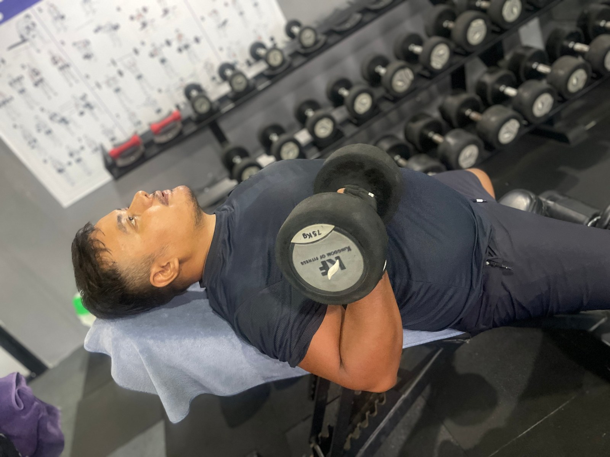

The bench press builds your **chest, shoulders and triceps**, and it is the lift most people want to get better at. It is also the lift where beginners most often hurt their shoulders, almost always because of setup, not because of the exercise itself. Learn the setup once, and the bench press becomes safe and satisfying.

## Before you start: safety first

- **Use a spotter** or a rack with **safety bars** set just below your chest height when you go heavy.
- **Never use collars** (clips) if you are benching alone without safety bars, so you can tilt the plates off in an emergency.
- **Warm up:** a few sets with the empty bar or light dumbbells.

## Step-by-step setup

### 1. Position on the bench

Lie down so your **eyes are directly under the bar**. Feet flat on the floor, a little wider than hip-width.

### 2. Grip

Grip the bar so that, at the bottom, your **forearms are roughly vertical**. For most people, that is a little wider than shoulder width. Wrap your thumbs around the bar. The "thumbless grip" is risky.

### 3. Shoulder blades back and down

Squeeze your shoulder blades together and **down towards your back pockets**, as if trying to put them in your trouser pockets. Keep them there for the whole set. This protects your shoulders and gives you a stable base.

### 4. Small arch, firm feet

Keep a natural small arch in your lower back, with your **bum and upper back on the bench**. Press your feet into the floor.

### 5. Unrack and breathe

Lift the bar out with straight arms and hold it over your shoulders. **Take a breath** and hold it.

## The lift

1. **Lower the bar under control** to your **lower chest**, roughly in line with your nipples or slightly below.
2. Keep your **elbows about 45 to 70 degrees** from your body, not flared straight out to the sides.
3. **Touch your chest lightly.** No bouncing.
4. **Press up and slightly back** towards your shoulders, breathing out near the top.
5. Keep your shoulder blades pinched the whole time.

## Common mistakes

| Mistake | Why it's a problem | Fix |
|---|---|---|
| Elbows flared at 90° | Stresses the shoulders | Tuck elbows to about 45–70° |
| Bouncing off the chest | Less control, risk of injury | Pause lightly on the chest |
| Bum lifting off the bench | Strains the lower back | Feet planted, lighter weight |
| Shoulder blades loose | Shoulders roll forward | Re-set the blades before each set |
| Bar too high (neck) | Shoulder strain | Lower to the lower chest |
| Ego lifting | Bad reps, injuries | Leave 1–2 reps in reserve |

## Dumbbell bench press: great for beginners

*Dumbbell work on the bench at Apex. Bring the weights to your chest under control before you press.*

Dumbbells let each arm move naturally, are easier on the shoulders, and you can simply drop them to the side if you fail a rep. Many beginners should start here, then add the barbell.

## How to progress

- Start with **3 sets of 8 to 10**.
- When all sets feel solid, add the **smallest weight** possible (1 to 2.5 kg total).
- Bench **2 times a week** as a beginner, for example in our [beginner gym workout plan](../beginner-gym-workout-plan-first-3-months/).

## Shoulder pain while benching?

Stop the set. Common causes are elbows flaring, bar touching too high, and loose shoulder blades. Lighter weight and better setup fixes most cases. If pain continues or hurts at rest, see a doctor or physiotherapist.

## Frequently asked questions

### How much should a beginner bench press?

There is no set number. Start with a weight you can lift for 10 clean reps, even if that is the empty bar (usually 20 kg) or light dumbbells.

### Should I arch my back on the bench?

A natural, small arch with your bum on the bench is normal and safe. Extreme arching is a competition technique and not necessary for beginners.

### Do I need a spotter?

For heavy sets, yes, or use a rack with safety bars. For light warm-up sets, you can bench alone carefully.

### Is incline bench better for the upper chest?

Incline pressing puts more emphasis on the upper chest and shoulders. Both flat and incline are useful.

*Want a trainer to check your setup? Ask the team at [Apex Fitness Centre](../../gym/).*
