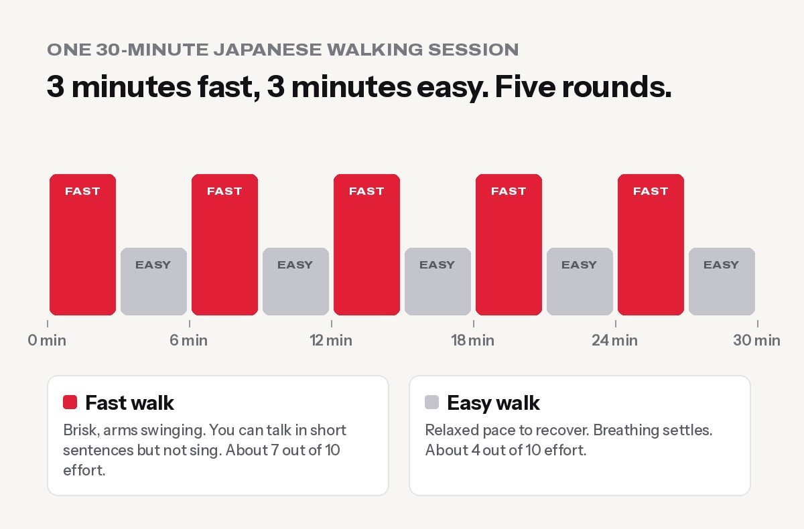

**Japanese walking is interval walking: 3 minutes of fast, brisk walking, then 3 minutes of easy walking, repeated 5 times for a 30-minute session, at least 4 days a week.** It comes from research at Shinshu University in Japan, where Professor Hiroshi Nose's team found that alternating fast and slow walking improved fitness, leg strength and blood pressure more than walking at one steady pace.

It went viral in 2025: in the UK alone, Google searches for "Japanese walking" rose by [nearly 3,000% in a year](https://athletechnews.com/fitness-trends-2026-walking-workouts-google-data/). Unlike most viral workouts, this one is backed by years of real studies. It needs no equipment, no gym and no special shoes, and it works on a village road, a riverside path or a gym treadmill.

## What exactly is Japanese walking?

Researchers call it **interval walking training (IWT)**. One session looks like this:

| Part | Time | How it should feel |
|---|---|---|
| Fast walk | 3 minutes | Brisk, arms swinging. You can speak in short sentences but couldn't sing. About 7 out of 10 effort |
| Easy walk | 3 minutes | Relaxed pace. Your breathing settles. About 4 out of 10 effort |
| Repeat | 5 rounds | 30 minutes in total |
| How often | 4+ days a week | Spread through the week |

In the original studies, "fast" meant **about 70% or more of your maximum aerobic capacity**, and "easy" about 40%. You don't need a lab test to find this. The talk test works well: on the fast part, talking should feel like effort, but you shouldn't be gasping.

## What the research actually found

The method has been tested on thousands of people, mostly middle-aged and older adults in Matsumoto, Japan. Some key findings:

- **Better fitness, stronger legs, lower blood pressure.** In a study of middle-aged and older men and women, 4 months of interval walking (at least 4 days a week, 5 or more sets of 3 minutes fast and 3 minutes slow) improved aerobic fitness and thigh muscle strength. Body weight, body fat, blood pressure and blood glucose also fell ([Morikawa et al., British Journal of Sports Medicine](https://bjsm.bmj.com/content/45/3/216)).
- **The least fit gained the most.** People who started with the lowest fitness improved the most. That's good news if you're starting from zero.
- **It beat steady walking.** In the Shinshu research, interval walkers improved fitness and leg strength more than people who walked the same amount at a steady, moderate pace.
- **Benefits lasted.** A long-term follow-up found that people who kept up interval walking for years [held on to their fitness much better than expected for their age](https://cir.nii.ac.jp/crid/1360579820049246720).

**What it can't do:** it isn't a magic fat burner. Walking helps weight loss by burning extra energy every day, but food still decides most of the result. Pair it with a sensible diet, like our [weight loss diet plan with Nepali food](../weight-loss-diet-plan-nepali-food/). It also doesn't replace strength training for building muscle: it strengthens the legs, but not your back, chest or arms.

## Why it works better than a normal walk

A steady stroll at a comfortable pace doesn't challenge your heart and legs much after the first few weeks. Your body adapts, and progress stalls.

The fast intervals push your heart and thigh muscles harder, which is the signal your body needs to improve. The easy intervals let you recover, so you can repeat the effort five times without exhausting yourself. That's the same idea as interval running, but gentle enough for almost everyone, including people who can't or don't want to run.

## How to do Japanese walking (step by step)

1. **Warm up for 2–3 minutes** at an easy pace. Roll your shoulders and loosen your ankles.
2. **Fast for 3 minutes.** Lengthen your stride slightly, swing your arms, stand tall and look ahead, not down at your phone.
3. **Easy for 3 minutes.** Slow down, but keep walking. Don't stop.
4. **Repeat** until you've done 5 fast and 5 easy blocks.
5. **Cool down** with a couple of minutes of slow walking and some light calf and thigh stretches.

**Timing tip:** set a repeating 3-minute timer on your phone, or use a song playlist (one song is often about 3 minutes, so alternate one fast and one easy song).

### Doing it on a treadmill

On a gym treadmill, change the speed every 3 minutes, for example **5.5–6.5 km/h for fast and 3.5–4.5 km/h for easy**. These are only starting points: use whatever speeds match the effort described above. A small incline (1–3%) can make the fast part harder without walking faster. Hold the handrails only for balance, not to support your weight.

## A 4-week plan for beginners

| Week | Sessions | What to do |
|---|---|---|
| 1 | 3 days | 3 rounds (18 min). Learn the paces |
| 2 | 4 days | 4 rounds (24 min) |
| 3 | 4 days | 5 rounds (30 min) |
| 4 | 4–5 days | 5 rounds, slightly faster "fast" blocks, or add a small slope |

Missed a day? Just continue. Consistency over months matters far more than any single session.

## Japanese walking in Nepal: making it work here

- **Early morning is ideal.** The air is cooler, the roads are quieter, and it's a calm way to start the day. If you're out before sunrise, wear something bright.
- **Pick a safe route.** A quiet road, a school ground or a riverside path is better than a busy highway with dust and traffic. Loops of about 300–500 m make it easy to keep going.
- **Monsoon and winter fog:** use a treadmill on those days, or walk fast and easy indoors on a long corridor or around the roof.
- **Shoes:** any comfortable sports shoe with a cushioned sole works. Thin slippers aren't good for fast walking.
- **Walking with family:** it's a great activity for parents and grandparents, since everyone can do it at their own pace on the same path.

## Who should be careful

Japanese walking is safe for most people, but check with a doctor first if you have **heart disease, chest pain, very high blood pressure, recent surgery, or serious joint problems**, or if you get dizzy or breathless with mild effort. If you have **diabetes**, ask your doctor how to time walks with medicine and meals.

Stop and seek help if you feel **chest pain, severe breathlessness, dizziness or an irregular heartbeat** while walking.

## Japanese walking vs other workouts

| | Japanese walking | Steady walking | Running | Gym strength training |
|---|---|---|---|---|
| Equipment | None | None | Running shoes | Gym or weights |
| Joint impact | Low | Low | High | Low–moderate |
| Improves heart fitness | ✅ Well | ✅ Some | ✅ Very well | Some |
| Builds leg strength | ✅ Some | Little | Some | ✅ Most |
| Builds whole-body muscle | ❌ | ❌ | ❌ | ✅ |
| Good for beginners and seniors | ✅ | ✅ | Not always | ✅ with guidance |

The best combination for most people is **Japanese walking 4 days a week plus strength training 2–3 days a week**. If you're new to the gym, start with our [beginner gym workout plan](../beginner-gym-workout-plan-first-3-months/).

## Frequently asked questions

### What is Japanese walking?

It's interval walking: 3 minutes fast and 3 minutes easy, repeated 5 times for 30 minutes, at least 4 days a week. It was developed and studied by researchers at Shinshu University in Japan.

### Is Japanese walking good for weight loss?

It helps by burning extra energy and improving fitness, and studies showed small drops in body weight and body fat. For real fat loss, combine it with a moderate calorie deficit and enough protein.

### How fast should the fast part be?

Fast enough that talking is an effort: you can say short sentences but couldn't sing. That's roughly 7 out of 10 effort. The easy part should feel relaxed, about 4 out of 10.

### Can I do Japanese walking every day?

Yes, most healthy people can. The research used at least 4 days a week. If your legs feel very tired, take an easy walking day.

### Is Japanese walking better than 10,000 steps?

They work differently. Steps measure how much you move. Japanese walking adds intensity, which improves fitness and leg strength more. Doing both is ideal: hit your daily steps, and make 30 minutes of them intervals.

### Can older people do Japanese walking?

Yes. Most of the original research was on middle-aged and older adults, and those who started least fit improved the most. Start with fewer rounds and check with a doctor if you have heart or joint problems.

## Sources

- [Physical fitness and indices of lifestyle-related diseases before and after interval walking training](https://bjsm.bmj.com/content/45/3/216) (Morikawa et al., British Journal of Sports Medicine, 2011)
- [WHO fact sheet: physical activity](https://www.who.int/news-room/fact-sheets/detail/physical-activity) (World Health Organization)

*General information, not medical advice. Train at Apex Fitness Centre, Urlabari: our treadmills and trainers can help you set your paces. WhatsApp 9708819605.*
