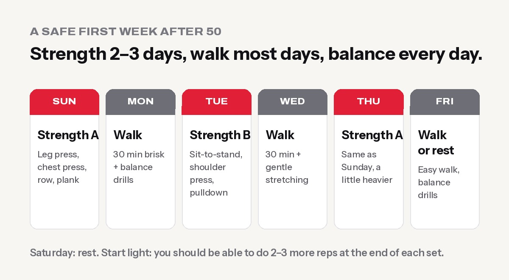

**After 50, strength training is one of the most valuable things you can do for your health. Aim for at least 2 days a week of exercises for all major muscles, plus regular walking and balance work.** You don't need heavy weights or any gym experience. Starting light, moving with good form and adding a little more over time is enough to rebuild strength, protect your bones and joints, and stay independent as you age.

This is one of the biggest fitness trends in the world right now. The American College of Sports Medicine ranks fitness programmes for older adults among its **top trends for 2026**. In Nepal too, gyms are seeing more retirees, homemakers and office workers in their 40s and 50s, often [sent by their doctors](https://kathmandupost.com/art-culture/2026/08/04/how-nepal-s-gym-culture-is-growing-beyond-the-young-generation).

## Why muscle matters more as you age

From around your 30s, you slowly lose muscle every decade if you don't use it. The loss speeds up after about 60, and it's called **sarcopenia**. Less muscle means:

- Getting up from the floor or a low stool gets harder
- Climbing stairs and carrying shopping or water gets tiring
- Balance gets worse, and **falls** become more likely and more dangerous
- Metabolism slows, so weight creeps up more easily
- Blood sugar control gets harder, because muscle is where much of your blood sugar goes

The good news: muscle responds to training **at any age**. People in their 60s, 70s and even 80s get stronger when they train regularly.

## How much exercise do you need after 50?

The [World Health Organization](https://who.int/initiatives/behealthy/physical-activity) recommends, for adults and older adults:

- **150–300 minutes a week of moderate aerobic activity**, such as brisk walking, or 75–150 minutes of vigorous activity
- **Muscle-strengthening activities on at least 2 days a week**, working all major muscle groups
- For older adults, **balance and strength activities on 3 or more days a week** to help prevent falls

In practice: **strength training 2–3 days, walking most days, and a few minutes of balance work every day.**

## The best strength exercises after 50

Focus on movements you use in daily life. Machines are a great place to start because they guide the movement and are easy to adjust.

| Exercise | Daily life benefit | Easier version |
|---|---|---|
| Sit-to-stand (chair squat) | Getting up from chairs, the floor and the toilet | Use a higher chair, push with your hands |
| Leg press machine | Strong legs for stairs and walking | Light weight, small range |
| Chest press machine | Pushing, getting up from the floor | Light weight |
| Seated row / lat pulldown | Posture, pulling, carrying | Light weight |
| Shoulder press (seated) | Lifting things onto shelves | Very light, or skip if your shoulders hurt |
| Step-ups (low step) | Stairs, uneven paths | Hold a rail |
| Plank on a bench, or bird dog | Core strength for a healthy back | Knees down, short holds |
| Farmer's carry | Carrying shopping, buckets of water | Light dumbbells |
| Calf raises | Balance and walking | Hold a wall |

To learn the squat pattern properly, see [how to squat properly](../how-to-squat-properly/).

## A safe first week

**Strength A:** leg press, chest press, seated row, plank on a bench.
**Strength B:** sit-to-stand, shoulder press, lat pulldown, farmer's carry.

For each exercise, do **2 sets of 10–12 reps**, resting 1–2 minutes between sets.

**How heavy?** Start with a weight you could lift **2–3 more times** at the end of each set. It should feel like work, but never like a struggle. When all your sets feel easy for two sessions in a row, increase the weight a little. That steady progress is what builds strength. Not sure when to fit it in? See [the best time to go to the gym](../best-time-to-go-to-the-gym/).

### Easy balance drills (2–5 minutes a day)

- **Stand on one foot** next to a wall or counter for 10–30 seconds each side
- **Heel-to-toe walk** in a straight line, 10–20 steps
- **Sit-to-stand without hands**, 5–10 reps
- **Walk on your toes, then on your heels**, 10 steps each

Do them near something you can hold.

## Walking: the perfect partner

On non-strength days, walk briskly for about 30 minutes. For a more effective walk, try [Japanese walking](../japanese-walking-interval-walking/): 3 minutes fast and 3 minutes easy, 5 times. The research behind it was done mostly with middle-aged and older adults.

## Eat for muscle

Older muscles need **more protein** to respond to training than younger ones. Many older Nepalis eat a lot of rice and little protein.

- Aim for a **protein food at every meal**: eggs, curd, paneer, dal, chana, soybeans, fish or chicken.
- **Milk or curd** daily also helps with calcium for your bones.
- Get some **morning sun**, which helps vitamin D.

See [how much protein you need](../how-much-protein-do-you-need/) for simple targets.

## Safety: check these first

See a doctor before starting if you have:

- **Heart disease**, chest pain, or high blood pressure that isn't controlled
- **Diabetes** on insulin or medicines that can cause low blood sugar
- **Osteoporosis**, recent fractures or recent surgery
- **Severe joint pain** or a joint replacement
- Dizziness or fainting

**While training:**

- **Breathe out on the effort**, and don't hold your breath, especially with high blood pressure.
- **No sudden jerks.** Lift and lower slowly with control.
- **Pain is a stop sign.** Muscle tiredness is normal, but sharp or joint pain isn't.
- **Warm up for 5–10 minutes** with easy walking or cycling first.
- **Stop immediately** and seek help with chest pain, unusual breathlessness, dizziness or palpitations.

## Common mistakes

- **Starting too heavy, too fast.** Your muscles adapt faster than your tendons and joints. Go slowly for the first month.
- **Only walking.** Walking is great for the heart, but it doesn't build much upper-body or leg strength. You need both.
- **Skipping the legs.** Leg strength matters most for independence: getting up, stairs and avoiding falls.
- **Giving up after a sore week.** Muscle soreness in the first weeks is normal and fades as your body adapts.
- **Training without guidance.** A trainer can check your form and set safe starting weights. That's worth it in the first few weeks.

## Frequently asked questions

### Is it safe to start strength training after 50?

For most people, yes. Strength training is one of the best things you can do as you age. Start light, learn good form, and check with a doctor first if you have heart problems, uncontrolled blood pressure, diabetes on medication, or joint or bone problems.

### How many days a week should I lift weights after 50?

At least 2 days a week, working all major muscles. 3 days is great if you recover well. Walk on most other days.

### Can you build muscle after 60?

Yes. Studies show people in their 60s, 70s and older gain strength and muscle with regular training. You may build it more slowly than a 25-year-old, but the improvements in strength and daily life are real.

### Should older adults lift heavy weights?

"Heavy" is relative. Start light, then gradually use weights that feel challenging for 8–12 reps with good form. You don't need to lift as much as possible.

### Is walking enough after 50?

Walking is excellent for your heart, but on its own it doesn't build enough muscle. Combine it with strength training at least 2 days a week.

### What are the best exercises for seniors?

Sit-to-stand, leg press, rows, chest press, step-ups, carries, planks and simple balance drills. They match the movements you use every day.

## Sources

- [How Nepal's gym culture is growing beyond the young generation](https://kathmandupost.com/art-culture/2026/08/04/how-nepal-s-gym-culture-is-growing-beyond-the-young-generation) (The Kathmandu Post, 2026)
- [WHO fact sheet: physical activity](https://www.who.int/news-room/fact-sheets/detail/physical-activity) (World Health Organization)
- [ACSM position stand: progression models in resistance training for healthy adults](https://pubmed.ncbi.nlm.nih.gov/19204579/) (American College of Sports Medicine, 2009)
- [The LIFTMOR trial](https://pubmed.ncbi.nlm.nih.gov/28975661/) (Watson et al., Journal of Bone and Mineral Research, 2018)

*General information, not medical advice. At Apex Fitness Centre, Urlabari, our trainers help older members start safely on machines, morning and evening. Sunday to Friday, 4:30 AM – 8:30 PM. WhatsApp 9708819605.*
