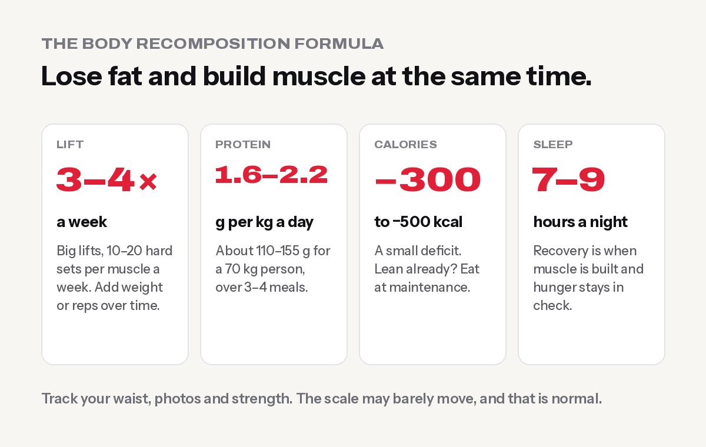

**Body recomposition ("recomp") means losing fat and gaining muscle at the same time, so your body changes shape even if the scale barely moves. To recomp: lift weights 3–4 days a week with progressive overload, eat 1.6–2.2 g of protein per kg of body weight daily, keep calories at maintenance or a small deficit (about 300–500 kcal a day), and sleep 7–9 hours.** It works best for beginners, people returning after a break, and people with more body fat, but research shows trained lifters can do it too.

"Recomp" is one of the fastest-growing fitness searches in the world. Global searches for the term have grown by [more than 400% in two years](https://explodingtopics.com/fitness-topics). Most people are tired of the old cycle of "bulk" (gain weight, get fat) then "cut" (diet hard, lose muscle). Recomp is the middle path.

## What is body recomposition?

Your weight is made up of fat, muscle, bone, water and everything else. Most diets only look at the total. Body recomposition looks at **what that weight is made of**.

Here's an example. Two people both go from 75 kg to 74 kg in three months:

| | Person A (crash diet) | Person B (recomp) |
|---|---|---|
| Weight change | −1 kg | −1 kg |
| Fat change | −2 kg | −3 kg |
| Muscle change | −1 kg | +2 kg |
| Waist | Slightly smaller | Clearly smaller |
| Looks and strength | Softer, weaker | Leaner, stronger |

On the scale they look the same. In the mirror, Person B is the success story. That's why recomp is often called "the scale doesn't move but my clothes fit better".

## Is recomp real? What the research says

Yes. For years people believed you must be in a calorie surplus to build muscle. Research has shown otherwise:

- A review by [Barakat and colleagues (2020)](https://lida.sport-iat.de/ta/Record/4066252) in the *Strength and Conditioning Journal* asked whether trained people can build muscle and lose fat at the same time. They concluded that **yes, it happens even in resistance-trained lifters**, not only beginners. The key factors were hard training and high protein intake.
- A 2024 editorial in *Frontiers in Nutrition* on [new advances in body recomposition](https://www.frontiersin.org/articles/10.3389/fnut.2024.1467406/full) noted that recomposition has been documented in **untrained, trained and highly trained people of different ages**. It also argued against long, aggressive calorie deficits.
- A large meta-analysis by [Morton and colleagues](https://bjsm.bmj.com/content/52/6/376) in the *British Journal of Sports Medicine* found that protein intake helped muscle gains from resistance training up to **about 1.6 g per kg of body weight a day**. Some people benefit from going a bit higher.

## Who can recomp (and who is better off bulking or cutting)

| You are… | Recomp? | Why |
|---|---|---|
| New to the gym | ✅ Best candidate | Your muscles respond fast to a new training stimulus |
| Coming back after months off | ✅ Great | "Muscle memory" helps you regain muscle quickly |
| Carrying extra body fat | ✅ Great | Stored fat can fuel the process while you build muscle |
| Training for years, fairly lean | ⚠️ Possible but slow | Progress is small. A focused bulk or cut may be faster |
| Very skinny, struggling to gain | ❌ Bulk instead | You need a calorie surplus. See [how to gain weight fast for skinny people](../how-to-gain-weight-fast-for-skinny-people/) |
| Very overweight, main goal is health | Mostly cut | Focus on fat loss with strength training, which is still recomp in practice |

## The recomp formula

### 1. Calories: maintenance or a small deficit

Find your maintenance calories with our [calorie calculator](../../calculators/). Then:

- **More body fat (most men over ~20% body fat, most women over ~30%):** eat about **300–500 kcal below maintenance**.
- **Already fairly lean:** eat at **maintenance**, or just 100–200 kcal below.

Don't crash diet. A big deficit means your body has less energy to build muscle and is more likely to break down the muscle you have. If fat loss stalls, see [why you might not be losing weight](../why-am-i-not-losing-weight/).

### 2. Protein: the non-negotiable

Aim for **1.6–2.2 g of protein per kg of body weight a day**. For a 70 kg person, that's about **110–155 g a day**. Spread it over 3–4 meals with roughly 25–40 g each.

With Nepali food, that looks like:

- **Breakfast:** 3 eggs + a glass of milk (about 25 g)
- **Lunch:** dal + chicken or paneer curry + curd, with a smaller portion of rice (about 35–40 g)
- **Snack:** roasted chana, or a whey shake (about 20–25 g)
- **Dinner:** fish, chicken, soybean or paneer + dal + vegetables (about 35 g)

Vegetarian? See [protein-rich vegetarian foods in Nepal](../protein-rich-vegetarian-foods-nepal/). A whey shake can make the target much easier, but food comes first. More detail: [how much protein do you need](../how-much-protein-do-you-need/).

### 3. Training: lift heavy enough, and progress

Cardio alone won't recomp you. **Resistance training is what tells your body to keep and build muscle while you lose fat.**

- Train **3–4 days a week**, working each muscle group about 2 times a week.
- Focus on big lifts: squats or leg press, deadlifts or hip hinges, bench press or push-ups, rows, pull-ups or pulldowns, overhead press.
- Do **about 10–20 hard sets per muscle group per week**, mostly in the 6–15 rep range, finishing each set with 1–3 reps left in the tank.
- **Progressive overload is the engine.** Add a little weight or a rep or two over time. Get your form right first with [how to squat properly](../how-to-squat-properly/) and [how to bench press safely](../how-to-bench-press-safely/).

### 4. Cardio: helpful, not the main event

Walking is the best "extra" for recomp. Aim for **7,000–10,000 steps a day**, or add 2–3 sessions of [Zone 2 cardio](../zone-2-training/). Too much hard cardio can eat into your recovery for lifting.

### 5. Sleep: where the muscle is built

Aim for **7–9 hours**. Poor sleep makes you hungrier and makes it harder to keep muscle while losing fat.

## A simple 3-day recomp workout plan

| Day | Workout |
|---|---|
| **Day 1: Full body A** | Squat or leg press 3×8–10 · Bench press 3×8–10 · Seated row 3×10–12 · Romanian deadlift 2×10 · Plank 3×30–45 s |
| **Day 2: Full body B** | Deadlift or trap-bar deadlift 3×5–6 · Overhead press 3×8–10 · Lat pulldown 3×10–12 · Walking lunges 2×10 each leg · Cable crunch 3×12 |
| **Day 3: Full body C** | Leg press 3×10–12 · Incline dumbbell press 3×10 · Pull-ups or assisted pull-ups 3×6–10 · Hip thrust 3×10 · Biceps curl + triceps pushdown 2×12 each |

Rest at least one day between sessions. On other days, walk. If you're completely new, start with our [beginner gym workout plan](../beginner-gym-workout-plan-first-3-months/) and add the recomp nutrition.

## How to track recomp (don't trust the scale alone)

Because fat goes down while muscle goes up, **the scale is a poor judge of recomp**. Track these instead:

1. **Waist measurement** every 2 weeks, at the navel, first thing in the morning. Here's [how to measure your waist](../how-to-lose-belly-fat/).
2. **Progress photos** every 4 weeks, in the same light, the same place and the same pose.
3. **Strength:** if your lifts are going up while your waist goes down, you're recomping.
4. **Weekly average weight:** weigh yourself 3–4 mornings a week and compare averages, not single days.
5. **How your clothes fit.**

Body-fat scales and handheld devices can swing by several percent with water and food, so use them only for rough trends.

## How long does recomp take?

Recomp is slower than a pure cut or bulk, but the results last. As a rough guide:

- **4–6 weeks:** strength going up, clothes fitting a little better
- **8–12 weeks:** visible change in photos, waist down a few centimetres
- **6–12 months:** a clearly different body shape

## Do supplements help?

They're optional, but two have strong evidence:

- **Whey protein** makes your daily protein target easier to hit. See [best whey protein in Nepal](../best-whey-protein-in-nepal/).
- **Creatine monohydrate (3–5 g a day)** helps you train harder and gain strength. The water it pulls into muscle can add 0.5–1.5 kg on the scale at first, which is another reason to watch your waist, not just your weight. See [creatine side effects: myths and facts](../creatine-side-effects-myths-and-facts/).

Fat burners don't recomp anyone.

## Common recomp mistakes

- **Eating too little.** A huge deficit kills your training and costs muscle.
- **Not eating enough protein.** This is the most common reason recomp fails.
- **Doing only cardio.** Without lifting, you lose fat and muscle together.
- **No progressive overload.** The same weights for months means no reason to build muscle.
- **Quitting when the scale doesn't move.** That's exactly what recomp is supposed to look like. Check your waist and photos.
- **Changing plans every week.** Give one program at least 8–12 weeks.

## Frequently asked questions

### Can you lose fat and build muscle at the same time?

Yes. It's called body recomposition. It works best for beginners, people returning to training and people with more body fat, but research shows trained lifters can do it too with hard training and high protein.

### Should I eat at maintenance or in a deficit to recomp?

If you have a fair amount of fat to lose, eat about 300–500 kcal below maintenance. If you're already lean, eat at maintenance or slightly below.

### How much protein do I need for recomp?

About 1.6–2.2 g per kg of body weight a day. A 70 kg person needs roughly 110–155 g, spread over 3–4 meals.

### Why is my weight the same but I look leaner?

You're likely losing fat and gaining muscle at a similar rate. That's successful recomp. Track your waist, photos and strength instead of the scale.

### Is recomp better than bulking and cutting?

For beginners, returning lifters and people with extra fat, recomp is usually the best choice. For lean, experienced lifters, separate bulk and cut phases are often faster.

### How long does body recomposition take?

You'll usually feel stronger in 4–6 weeks, see changes in photos in 8–12 weeks, and look clearly different in 6–12 months.

## Sources

- [New advances in body composition assessment and body recomposition](https://www.frontiersin.org/articles/10.3389/fnut.2024.1467406/full) (Frontiers in Nutrition, 2024)
- [ISSN position stand: protein and exercise](https://pubmed.ncbi.nlm.nih.gov/28642676/) (Jäger et al., 2017)

*General information, not medical advice. Want a recomp plan that fits your body and schedule? Our trainers at Apex Fitness Centre, Urlabari can set up your program and check your form. Sunday to Friday, 4:30 AM – 8:30 PM. WhatsApp 9708819605.*
