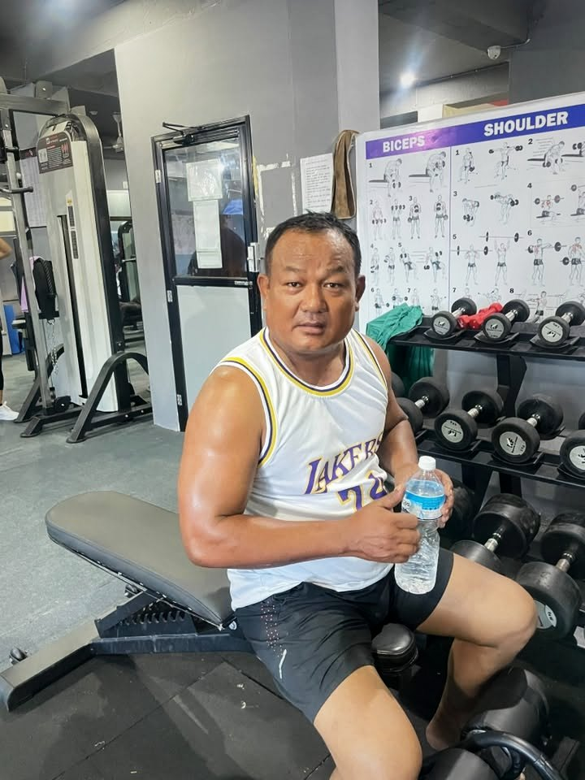

For most healthy adults, a good everyday target is about **2 litres of total water a day for women and 2.5 litres for men**, which is what the European Food Safety Authority recommends. That includes water from food, so in practice it means **about 1.5 to 2 litres of drinks** for most people, more when it is hot or when you exercise.

The simplest check is your urine: **pale yellow means you are drinking enough.**

## Where the numbers come from

EFSA advises a total water intake of **2.5 litres a day for men and 2.0 litres for women**, with roughly **70 to 80% coming from drinks** and the rest from food such as rice, dal, fruit and vegetables ([summary](https://www.caw.ac.uk/eandd/health-and-fitness-tip-of-the-week-water/)).

These are averages. You need more if you are larger, very active, sweating a lot, or in hot weather.

## Water when you exercise

- **Before training:** a glass of water in the hour before.
- **During training:** sip regularly, roughly **a few hundred millilitres every 20 to 30 minutes** of hard exercise, more in summer.
- **After training:** drink to replace what you sweated out. If you weigh yourself before and after a long session, the weight lost is mostly water.

For sessions under an hour, **plain water is enough**. Sports drinks are only useful for long, sweaty sessions, such as a 2-hour football match in the Terai heat.

## Signs you need more water

- Dark yellow urine
- Thirst, dry mouth
- Headache or tiredness
- Dizziness when standing up
- Feeling weak during workouts

## Nepal-specific tips

**Hot summers (Terai and inner valleys):** You can lose a lot of sweat. Drink before you feel thirsty, carry a bottle, and add a pinch of salt and some lemon or ORS on very sweaty days.

**Dry winters and high altitude:** You lose water through breathing in cold, dry air without noticing. Many people drink much less in winter. Warm water or herbal tea counts.

**Trekking:** At altitude you need more water. Drink regularly and treat water from taps and streams before drinking. See our [Everest Base Camp training plan](../everest-base-camp-trek-training-plan/).

## Does tea count?

Yes. Tea, coffee, milk, soup and dal all count towards your total. Caffeine has only a mild effect on urine, so normal amounts of tea still hydrate you. Just watch the sugar.

## Can you drink too much water?

It is possible but rare. Drinking huge amounts very quickly (many litres in a few hours) can dangerously lower salt levels in the blood. Normal drinking spread across the day is safe for healthy people.

## Easy ways to drink more

1. **Start the day with a glass of water** before tea.
2. **Keep a 1-litre bottle** at work and aim to finish it twice.
3. **Drink a glass with every meal.**
4. **Add lemon, mint or cucumber** if plain water bores you.
5. **Eat water-rich foods:** cucumber, watermelon, oranges, soups.

## Does water help weight loss?

Water does not burn fat, but **replacing cold drinks and sweet tea with water** cuts a lot of calories. Some people also feel fuller if they drink a glass before meals. See our [weight loss diet plan with Nepali food](../weight-loss-diet-plan-nepali-food/).

## Frequently asked questions

### Is 3 litres of water a day too much?

For an active adult, especially in summer, 3 litres of drinks a day is usually fine. Spread it through the day.

### Should I drink water during a workout?

Yes, sip regularly. You do not need to force huge amounts.

### Does drinking water help muscle growth?

Being well hydrated helps you train and recover well. It will not build muscle by itself.

### Is it bad to drink water right after eating?

No. Drinking water with or after meals is fine for healthy people.

*General information, not medical advice. People with kidney or heart conditions may need different amounts. Follow your doctor's advice.*
