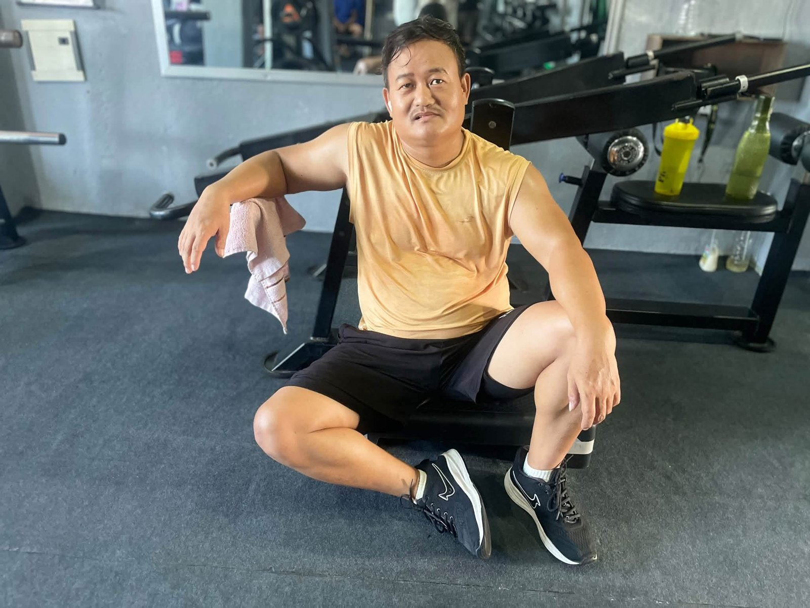

Feeling sore one or two days after a workout is **normal**, especially when you are new or try a new exercise. It is called **DOMS (delayed onset muscle soreness)**. It usually peaks **24 to 72 hours** after training and fades within a few days.

Sharp, sudden or one-sided pain is different. That can be an injury, and you should treat it differently.

## Why muscles get sore

When you challenge your muscles in a new way, especially with the **lowering part of a movement** (walking downstairs, lowering a weight, downhill hiking), you create small amounts of muscle damage. Your body repairs it, and that repair process brings soreness and stiffness.

The good news: soreness **reduces quickly** once your body gets used to an exercise. After 2 to 3 weeks of regular training, most beginners are barely sore anymore.

## Normal soreness vs injury

| Normal soreness (DOMS) | Possible injury |
|---|---|
| Starts 12–24 hours after training | Starts suddenly, during the exercise |
| Dull, achy, stiff feeling | Sharp, stabbing or burning pain |
| Both sides, whole muscle | One spot or one side |
| Better with gentle movement | Worse with movement |
| Fades in 2–5 days | Lasts longer than a week or gets worse |
| No swelling or bruising | Swelling, bruising, a pop sound, or weakness |
| Joints feel fine | Pain in the joint itself (knee, shoulder, back) |

**See a doctor urgently** if you have very severe muscle pain with weakness, swelling, or **dark (cola-coloured) urine** after an extreme workout. That can be a sign of a rare but serious condition called rhabdomyolysis.

*Rest, food and sleep are when your muscles actually recover. Photo: Apex Fitness Centre, Urlabari.*

## How to recover faster

- **Keep moving.** Light walking, cycling or an easy workout of the same muscles increases blood flow and often helps more than rest.
- **Sleep 7 to 9 hours.** Your body repairs muscle while you sleep.
- **Eat enough protein** across the day. See [how much protein you need](../how-much-protein-do-you-need/).
- **Drink water.**
- **Gentle stretching or foam rolling** can make you feel better, even if the effect on recovery is small.
- **A warm shower** relaxes stiff muscles.

## Should you train while sore?

- **Mild soreness:** yes, train as normal or train a different muscle group. Soreness usually eases once you warm up.
- **Very sore:** do a lighter session or train a different body part.
- **Pain that feels like an injury:** stop and rest that area, and get it checked if it does not improve.

## How to avoid being extremely sore

1. **Start light** in your first weeks. Your first workout should feel almost too easy.
2. **Add volume gradually.** Do not jump from nothing to 25 sets for legs.
3. **Train regularly.** Soreness is worst after long breaks.
4. **Be careful with new exercises,** especially lunges, deadlifts and downhill walking.

## Does soreness mean the workout was good?

No. Soreness is not a measure of progress. You can build muscle and strength without being sore. The real signs of progress are **lifting more weight, doing more reps, and better form** over time.

## Frequently asked questions

### How long does muscle soreness last?

Usually 2 to 5 days, peaking around 1 to 2 days after training.

### Is it okay to go to the gym with sore muscles?

Yes, with mild soreness. A light session often helps. Avoid training hard on very sore muscles.

### Do painkillers help soreness?

They can reduce discomfort, but regular use just to train through soreness is not recommended. Ask a doctor or pharmacist if you need them.

### Why am I more sore 2 days after the gym than the next day?

That is typical of DOMS. Soreness usually peaks 24 to 72 hours after exercise.

## Sources

- [Delayed onset muscle soreness: treatment strategies and performance factors](https://pubmed.ncbi.nlm.nih.gov/12617692/) (Cheung et al., *Sports Medicine*, 2003)
- [ACSM position stand: progression models in resistance training for healthy adults](https://pubmed.ncbi.nlm.nih.gov/19204579/) (American College of Sports Medicine, 2009)

*General information, not medical advice. If pain is severe, sharp or lasts more than a week, see a doctor or physiotherapist.*
