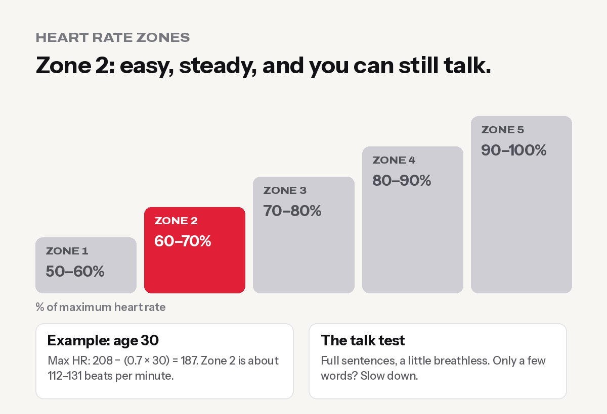

**Zone 2 training is steady, easy cardio at a pace where you can still talk in full sentences, roughly 60–70% of your maximum heart rate. Most people should aim for 2–3 sessions of 30–60 minutes a week (about 150 minutes in total) on a brisk walk, incline treadmill, bike, elliptical or slow jog.** It builds your aerobic base, helps your heart and blood sugar, and is easy to recover from, so it fits around strength training.

Zone 2 has gone from a pro cyclist's secret to one of the [biggest fitness trends](https://www.aspenpublicradio.org/2025-10-13/zone-2-training-explaining-the-latest-trend-in-fitness) in the world, pushed by longevity doctors, podcasts and smartwatches that show your "zones" on every workout. Here's what it really is, how to find your number, and what the science does and doesn't say.

## What are heart rate zones?

Exercise intensity is often split into **five zones**, based on a percentage of your maximum heart rate (HRmax):

| Zone | % of max heart rate | How it feels | Talk test |
|---|---|---|---|
| Zone 1 | 50–60% | Very easy, warm-up | Chat freely |
| **Zone 2** | **60–70%** | **Easy but purposeful, steady** | **Full sentences, a little breathless** |
| Zone 3 | 70–80% | Moderate, "comfortably hard" | Short sentences |
| Zone 4 | 80–90% | Hard, threshold | A few words |
| Zone 5 | 90–100% | All-out sprint | Can't talk |

Different apps and watches use slightly different zone formulas, so your watch's "Zone 2" might not match exactly. That's normal.

## How to find your Zone 2 heart rate

### Step 1: Estimate your max heart rate

The old formula is **220 − age**. A more accurate one for most adults is the **Tanaka formula: 208 − (0.7 × age)**.

### Step 2: Take 60–70%

| Age | Max HR (Tanaka) | Zone 2 (60–70%) |
|---|---|---|
| 20 | 194 | about 116–136 bpm |
| 30 | 187 | about 112–131 bpm |
| 40 | 180 | about 108–126 bpm |
| 50 | 173 | about 104–121 bpm |
| 60 | 166 | about 100–116 bpm |

These are estimates. Real max heart rate can differ by 10 or more beats per minute between people of the same age.

### Step 3: Check it with the talk test

The **talk test** is free and surprisingly accurate. In Zone 2:

- You can speak in **full sentences**, but you'd rather not give a speech.
- Your breathing is deeper than normal but **controlled**, through the nose or mouth.
- You feel you could keep going for an hour.

If you can only get out a few words at a time, slow down: you've drifted into Zone 3. If you could sing, speed up a little.

**Taking blood pressure or heart medicines like beta-blockers?** They lower your heart rate, so heart-rate zones won't be accurate. Use the talk test, and check with your doctor before starting.

## What does Zone 2 actually do? (The science, honestly)

In the lab, Zone 2 sits just below your **first lactate threshold**: the highest intensity where your body clears lactate as fast as it makes it. At this effort, you burn a high share of fat for fuel and can train for a long time without wrecking your recovery.

What's well supported:

- **Lots of easy aerobic training builds endurance.** Researcher Stephen Seiler found that elite endurance athletes in many sports spend around **80% of their training at low intensity** and about 20% hard. That's the "80/20" rule.
- **Moderate aerobic exercise is excellent for health.** It improves heart and lung fitness, blood pressure and blood sugar control. The [World Health Organization](https://www.who.int/news-room/fact-sheets/detail/physical-activity) recommends **150–300 minutes of moderate activity a week** for adults, and Zone 2 is exactly that kind of activity.
- **It's easy to recover from.** You can do it on the same day as lifting or the day after without feeling wrecked.

What's **overhyped**:

- **"Zone 2 is the only cardio that matters."** Not true. Some hard intervals (like the [Japanese walking](../japanese-walking-interval-walking/) method or HIIT) improve fitness fast, especially when you're short on time. The best plans mix easy and hard.
- **"Zone 2 is the best way to burn fat."** You burn a higher *percentage* of fat in Zone 2, but total calories burned and your diet matter more for fat loss. See [why you might not be losing weight](../why-am-i-not-losing-weight/).
- **"You need a lab test or it doesn't count."** Lab tests are precise, but the talk test works well for everyday training.

## How much Zone 2 do you need?

| Your goal | Zone 2 per week |
|---|---|
| General health, beginner | 2–3 sessions × 30–45 min (90–150 min) |
| Fat loss alongside lifting | 2–4 sessions × 30–45 min, plus daily steps |
| Running, trekking or endurance events | 3–5 hours, building up slowly |

Most of the benefit comes from **simply doing it consistently**. Going from zero to 2 hours a week makes a much bigger difference than going from 4 to 6 hours.

## The best Zone 2 workouts in the gym (and outside)

- **Incline treadmill walk:** 3–8% incline at a speed where you can talk. Great for beginners and people who can't run.
- **Elliptical:** low impact, easy on knees and back.
- **Stationary bike:** easiest to keep a steady heart rate.
- **Brisk walk or easy jog outside:** for many beginners a brisk uphill walk is already Zone 2; for fitter people it's a slow jog.
- **Rowing machine:** works the whole body, but keep the stroke rate low.
- **Hiking:** the hills around Urlabari and a trek day in the mountains are natural Zone 2. See our [Everest Base Camp trek training plan](../everest-base-camp-trek-training-plan/).

## A 6-week Zone 2 plan for beginners

| Week | Sessions | Duration | Tip |
|---|---|---|---|
| 1 | 2 | 25 min | Learn the talk test. Go slower than you think |
| 2 | 2 | 30 min | Note your heart rate if you have a watch |
| 3 | 3 | 30 min | Try two different machines |
| 4 | 3 | 35–40 min | Keep the effort steady, not the speed |
| 5 | 3 | 40–45 min | One session can be outside |
| 6 | 3 | 45 min | Retest: same heart rate should feel faster or easier |

Add Zone 2 **after your weights or on non-lifting days**. If you only have time for one, lift first. Strength training matters at every age, as our guide to [strength training after 50](../strength-training-after-50/) explains.

## How to know Zone 2 is working

- The **same pace feels easier** after a few weeks.
- Your **heart rate at the same speed drops**: for example, brisk walking at 5.5 km/h used to be 135 bpm and is now 125.
- Your **resting heart rate** in the morning slowly goes down.
- You recover faster between sets in the gym and between hills on a trek.

## Common Zone 2 mistakes

- **Going too hard.** Most people drift into Zone 3. If talking is a struggle, slow down. Walk the hills if needed.
- **Trusting a wrist watch blindly.** Wrist sensors can be off, especially on the elliptical or when your arms move a lot. A chest strap is more accurate; the talk test is a good back-up.
- **Only doing Zone 2.** Keep some strength training and occasional harder intervals.
- **Giving up because it feels "too easy".** That's the point. The benefits come from consistent, comfortable volume.

## Frequently asked questions

### What is Zone 2 cardio?

Steady, easy cardio at roughly 60–70% of your max heart rate, where you can still speak in full sentences. It builds your aerobic base and is easy to recover from.

### How do I calculate my Zone 2 heart rate?

Estimate max heart rate with 208 − (0.7 × age), then take 60–70% of it. For a 30-year-old, that's about 112–131 bpm. Confirm with the talk test.

### How long should a Zone 2 session be?

At least 30 minutes is a good target, and 45–60 minutes if you have time. Beginners can start with 20–25 minutes.

### Is walking Zone 2?

For many beginners, a brisk or uphill walk is Zone 2. If you're fitter, you may need an incline, a faster pace or a slow jog to reach it.

### Is Zone 2 good for weight loss?

It helps by burning extra calories without hurting your recovery, but diet decides most of fat loss. Combine Zone 2 with strength training and a modest calorie deficit.

### Can I do Zone 2 every day?

Yes, most healthy people can, because it's low stress. Just make sure you still have energy for your strength workouts.

*General information, not medical advice. Check with a doctor before starting if you have heart disease, high blood pressure or take heart medicines. At Apex Fitness Centre, Urlabari, our treadmills, bikes and ellipticals are perfect for Zone 2, and our trainers can help you find your pace. Sunday to Friday, 4:30 AM – 8:30 PM. WhatsApp 9708819605.*
