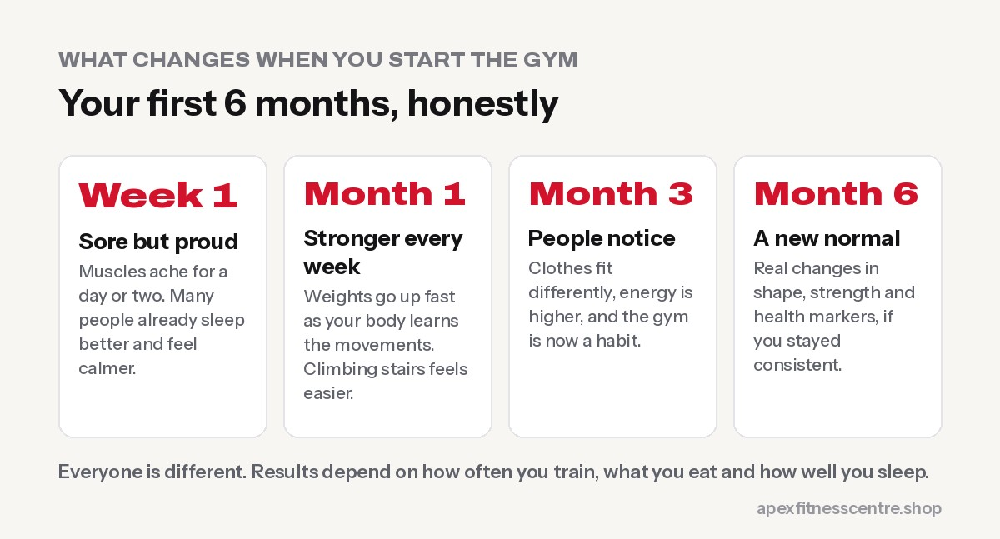
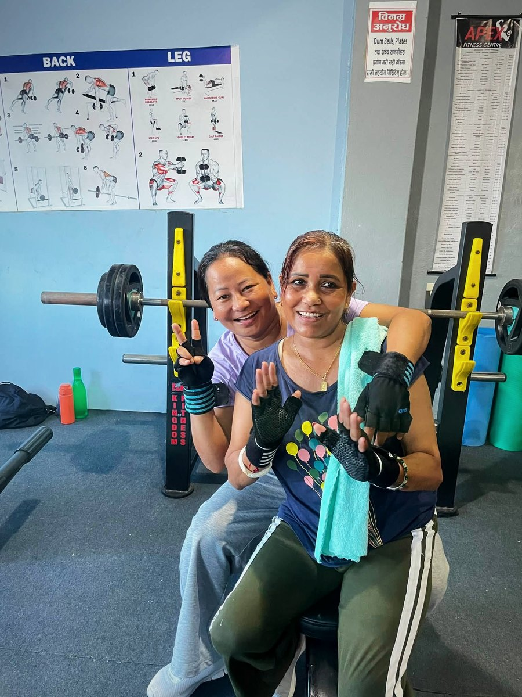

**Going to the gym regularly is one of the best things you can do for your body and your mind. Strength training at least 2 days a week, plus regular movement, builds muscle and bone, improves blood sugar and heart health, lifts your mood, helps you sleep and keeps you independent as you age.** You don't need to be fit, young or confident to start. You only need to walk in, learn a few basic exercises and keep coming back.

If you've been thinking about joining a gym for months, this post is for you.

## Why the gym is worth it

### 1. Your body gets stronger at any age

Muscle responds to training whether you are 16 or 66. Stronger legs make stairs, hills and carrying water easier. A stronger back and core help protect you from everyday aches. See our guide to [strength training after 50](../strength-training-after-50/) if you think you're "too old".

### 2. Your health markers improve

The [World Health Organization](https://www.who.int/news-room/fact-sheets/detail/physical-activity) recommends muscle-strengthening activity on at least 2 days a week, plus 150–300 minutes of moderate activity. Regular exercise helps lower the risk of heart disease, type 2 diabetes and high blood pressure, which are all common in Nepal.

### 3. Your mind feels better

The WHO also notes that physical activity reduces symptoms of depression and anxiety. For many people, the hour in the gym is the one time in the day their mind is quiet, and they walk out with more energy than they walked in with.

### 4. You sleep better

Training tires your body in a good way. Many people fall asleep faster and wake up more refreshed within the first couple of weeks.

### 5. You change your shape, not just your weight

Lifting weights while eating well helps you lose fat and keep, or build, muscle. That's why people often look very different even when the scale moves slowly. Track your waist and photos, not just the scale. See [why you might not be losing weight](../why-am-i-not-losing-weight/).

### 6. You build discipline that spills into everything

Showing up three times a week, even on cold mornings, teaches you that you can keep a promise to yourself. That confidence follows you to work, study and family life.

## What changes in your first 6 months

One of our members, **Sewak Bhujel, went from 136 kg to 85 kg** after joining Apex. He didn't do it in one month, and he didn't do it with a magic supplement. He did it by showing up again and again, eating better and training hard.

## The fears that stop most people (and the truth)

### "Everyone will look at me."

Most people in a gym are busy with their own workout, headphones on, counting their reps. And everyone you see lifting heavy was once a beginner too.

### "I don't know what to do."

That's what trainers are for. At Apex, a trainer is on the floor every session to show you how to use each machine and how to do each exercise safely. You can also follow our [beginner gym workout plan](../beginner-gym-workout-plan-first-3-months/).

### "I need to lose weight before I join."

You don't get fit before the gym. The gym is how you get fit. Start where you are.

### "I'm too skinny. I'll look weak."

The gym is exactly where skinny people build muscle. Pair training with more food, see [how to gain weight fast for skinny people](../how-to-gain-weight-fast-for-skinny-people/).

### "I'm a woman. Weights will make me bulky."

They won't. Weights make you strong and toned. Read our [first-visit gym guide for women](../gym-guide-for-women-first-visit/).

### "I don't have time."

Three sessions of 45–60 minutes a week is enough to change your body. We open at **4:30 AM** for people who train before work, and stay open until **8:30 PM** for those who come after.

## How to start this week

1. **Visit the gym.** Look around, see the equipment and meet the trainers. No pressure to join on the spot.
2. **Pick your time.** Morning or evening, whichever you can repeat. See [the best time to go to the gym](../best-time-to-go-to-the-gym/).
3. **Start with 3 days a week.** Full-body sessions with a rest day in between.
4. **Start light.** Learn the movement first. The weights will go up quickly.
5. **Eat protein at every meal.** See [how much protein you need](../how-much-protein-do-you-need/).
6. **Pack your bag.** Water bottle, towel and clean indoor shoes.
7. **Give it 12 weeks.** Don't judge your progress in week one. Judge it at month three.

## Joining Apex Fitness Centre

- **Where:** Urlabari-9, Durgapuri, Morang
- **When:** Sunday to Friday, 4:30 AM to 8:30 PM (closed on Saturday)
- **Trainers:** Suman Limbu in the morning (4:30 AM to 12:30 PM) and Sanju Phombo Limbu in the evening (4:30 PM to 8:30 PM)
- **Membership:** from Rs. 1,500 a month, with longer plans costing less per month. See [plans and prices](../../gym/#plans).

## Frequently asked questions

### How often should a beginner go to the gym?

Three days a week is a great start, with a rest day between sessions. Walk on the other days if you can.

### How long before I see results?

Most people feel stronger within 2–4 weeks and see visible changes in 8–12 weeks of consistent training and better eating.

### Do I need supplements to start?

No. Food, training and sleep come first. Supplements are optional extras later.

### Can I join the gym if I have a health condition?

Usually yes, and exercise often helps. Check with your doctor first if you have heart problems, uncontrolled blood pressure, diabetes on medication or a recent injury, and tell your trainer.

### Is it too late to start at 40 or 50?

No. People gain strength at every age. Start light and progress steadily.

## Sources

- [WHO fact sheet: physical activity](https://www.who.int/news-room/fact-sheets/detail/physical-activity) (World Health Organization)
- [ACSM position stand: progression models in resistance training for healthy adults](https://pubmed.ncbi.nlm.nih.gov/19204579/) (American College of Sports Medicine, 2009)

*Ready for your first day? Message Apex Fitness Centre on WhatsApp at 9708819605, or just walk in. Built through consistency.*
