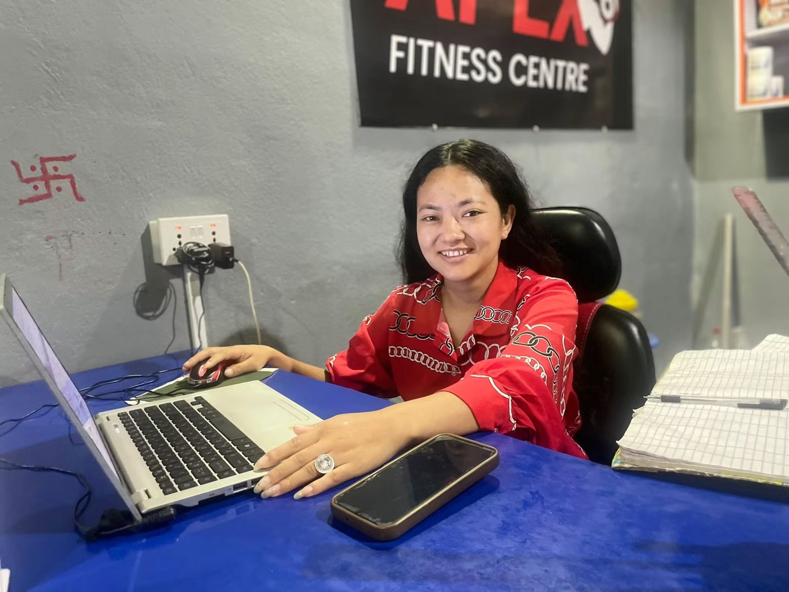

A good gym is one you will **actually keep going to**: close enough, open when you are free, with trainers who help and equipment that works. Shiny photos on Facebook do not tell you that. A **free trial visit** and the checklist below will.

## The 12-point checklist

### 1. Location and travel time

If the gym is more than 10 to 15 minutes away, you will skip it on busy or rainy days. Closer beats fancier.

### 2. Opening hours that match your life

Check the **exact opening and closing times**, and whether they change on Saturdays, public holidays and festivals like Dashain and Tihar. If you work office hours, you need early mornings or evenings.

### 3. Trainers on the floor

Are trainers actually **walking around and helping**, or sitting at the desk on their phones? Ask:

- Will someone show me how to use the machines?
- Will I get a basic plan for my goal?
- Are trainers present in both morning and evening shifts?

### 4. Equipment: the basics matter most

You do not need 50 machines. A good gym has:

- Dumbbells in a wide range (light to heavy)
- At least one squat rack or power rack, barbells and plates
- Adjustable benches
- Cable machine and lat pulldown
- A few leg machines (leg press, leg curl or extension)
- Some cardio: treadmill, bike or cross-trainer

### 5. Is it crowded at your time?

Visit **at the exact time you plan to train**. Waiting 15 minutes for every machine kills motivation.

### 6. Cleanliness and hygiene

Check the floor, the equipment, the washrooms and the changing area. Is there drinking water? Do people wipe benches? Is there fresh air or proper fans and ventilation?

### 7. Safety

Are heavy weights stored properly? Is the flooring rubber? Are there mirrors, enough space between machines, and someone who knows basic first aid?

### 8. Facilities for women

Ask about a **women's changing room and washroom**, and whether women trainers or front desk staff are available. Notice if women members train comfortably there. See our [gym guide for women](../gym-guide-for-women-first-visit/).

*A staffed front desk makes joining, renewing and asking questions easy. Front desk at Apex Fitness Centre, Urlabari.*

### 9. The atmosphere

Do members look relaxed and friendly? Loud music and a serious crowd suit some people; others prefer a calm, welcoming place. Trust your feeling.

### 10. Clear pricing

Ask for the **full price list in writing**: monthly, 3, 6 and 12-month plans, admission fees, and anything extra (T-shirt, locker, personal training). Longer plans are cheaper per month but only worth it if you are sure you will go.

### 11. Freeze and refund policy

What happens if you get sick, travel for Dashain, or go abroad for a few weeks? A fair gym lets you **freeze your membership** and add the paused days back.

### 12. A free trial

A confident gym will let you try one session. Use it to check everything above.

## Red flags

- Pressure to pay for a full year **today** with a "special offer".
- No price list, or prices that change when you ask twice.
- Trainers selling supplements aggressively, or pushing "fat burner" products.
- Broken equipment that has been "out of order" for months.
- Nobody can explain the freeze or renewal rules.

## Questions to ask at the front desk

1. What are your exact hours, including Saturdays and festivals?
2. What is the total cost for 1, 3, 6 and 12 months, including admission?
3. Can I freeze my membership if I travel or get sick?
4. Will a trainer help me with a starting plan?
5. When is the gym least busy?
6. Can I try one session first?

## Frequently asked questions

### How much does a gym membership cost in Nepal?

It varies widely by city, facilities and plan length. Small local gyms are much cheaper than premium city gyms. Always compare the total cost, including admission fees, and price per month on longer plans.

### Is it better to pay monthly or yearly?

Monthly if you are new and not sure you will stick with it. Longer plans save money once you know the gym suits you.

### What should a beginner look for in a gym?

Helpful trainers, convenient hours, basic equipment that works, a clean space, and a location close to home or work.

### Do I need a personal trainer?

Not always. A good gym should give you basic guidance. A personal trainer helps if you want faster progress, have an injury, or need motivation.

*In Urlabari or nearby? Visit [Apex Fitness Centre](../../gym/) for a look around. Open 4:30 AM to 8:30 PM, Sunday to Friday, with trainers on both shifts.*
