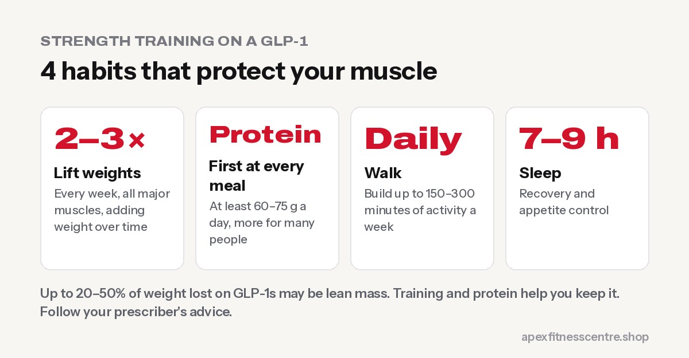
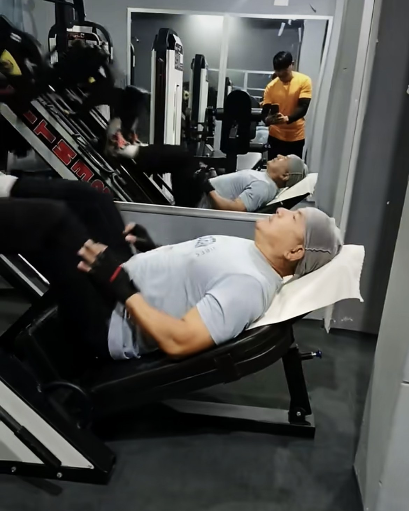
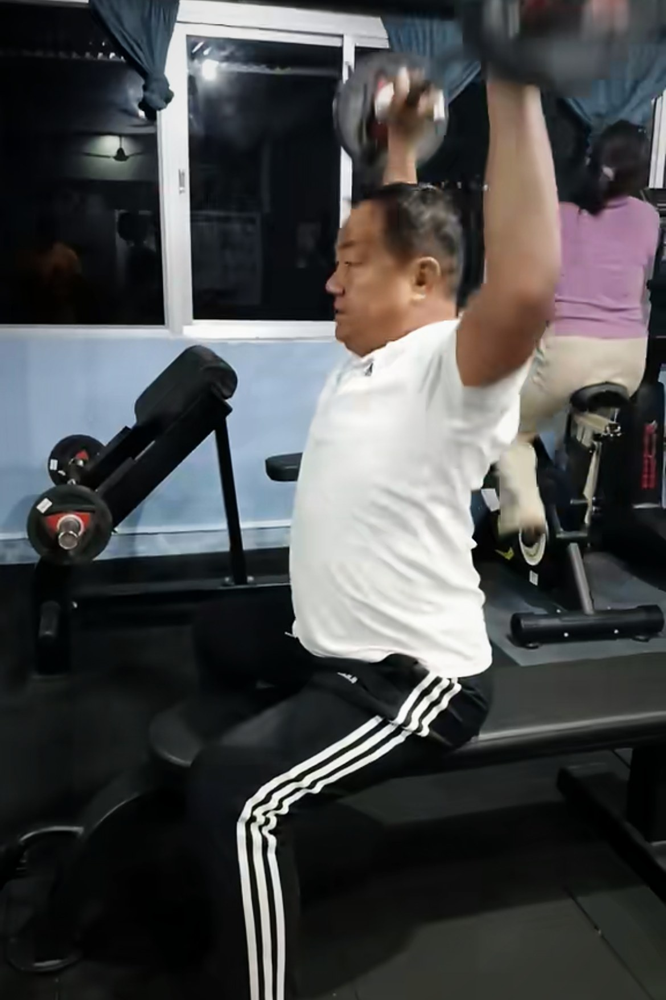

**If you're taking a GLP-1 medicine such as Ozempic, Wegovy, Mounjaro or Zepbound, strength training is the most important thing you can add. These drugs make it much easier to eat less, but a large share of the weight you lose can be muscle, not fat. Lifting weights 2–3 times a week, eating enough protein and moving every day helps you keep that muscle, so you end up leaner and stronger, not just smaller.**

GLP-1 medicines have changed weight loss. In the United States, **12.4% of adults** now say they use them for weight loss, up from 5.8% in early 2024 ([Athletech News](https://athletechnews.com/fitness-stakeholders-urge-strength-training-for-glp-1-users/)). Fitness and health bodies are now urging people on these drugs to start strength training, and this guide shows you exactly how.

*This is general information, not medical advice. Always follow your prescriber's advice about your medicine.*

## Why muscle loss matters on GLP-1s

When you eat much less than your body burns, it takes energy from fat **and** from muscle. GLP-1 medicines can cut appetite so strongly that the calorie deficit becomes very large.

According to a review by ukactive and Les Mills, **between 20% and 50% of the weight GLP-1 users lose may be lean body mass** ([Athletech News](https://athletechnews.com/fitness-stakeholders-urge-strength-training-for-glp-1-users/)). That matters because muscle:

- **Keeps you strong** for stairs, carrying shopping and playing with your kids
- **Supports your metabolism**, so it's easier to keep weight off later
- **Protects your joints and balance**, especially as you get older
- **Shapes how you look**: losing fat but keeping muscle gives a firmer, healthier look

If you stop the medicine one day, people who kept their muscle are usually in a much better position than people who lost a lot of it.

## The plan: 3 habits that protect your muscle

### 1. Lift weights 2–3 times a week

Strength training sends your body a clear message: "we still need this muscle." The review above recommends **2–3 sessions a week**, working the large muscle groups, building up gradually over time.

### 2. Eat enough protein, even when you're not hungry

Low appetite is the point of the medicine, but it also makes it easy to eat too little protein. Put protein first on your plate at every meal. The ukactive and Les Mills review suggests at least 60–75 g a day. See [how much protein do you need](../how-much-protein-do-you-need/) for food ideas.

### 3. Keep moving every day

Daily walking helps with energy use, blood sugar and mood, without wearing you out for your strength sessions. Aim to build up to the WHO's recommended **150–300 minutes a week** of moderate activity ([WHO](https://www.who.int/news-room/fact-sheets/detail/physical-activity)). Japanese-style [interval walking](../japanese-walking-interval-walking/) is a great option.

## A beginner strength plan for GLP-1 users

This plan uses machines and dumbbells, which are easier to learn and control than barbells. Do it **2–3 days a week** with at least one rest day between sessions.

| Exercise | Sets × reps | What it trains |
|---|---|---|
| Leg press or goblet squat | 2–3 × 10–12 | Legs and glutes |
| Chest press machine or dumbbell bench press | 2–3 × 10–12 | Chest, shoulders, arms |
| Seated cable row | 2–3 × 10–12 | Upper back |
| Romanian deadlift with dumbbells | 2 × 10 | Hamstrings and glutes |
| Lat pulldown | 2–3 × 10–12 | Back and arms |
| Dumbbell shoulder press (seated) | 2 × 10–12 | Shoulders |
| Plank or dead bug | 2–3 × 20–40 sec | Core |

**How heavy?** Choose a weight you could lift 2–3 more times at the end of each set. When all sets feel easy for two sessions in a row, increase the weight a little. That's progressive overload, the engine of strength gains.

**Rest:** 1–2 minutes between sets.

**Never trained before?** Our [beginner gym workout plan](../beginner-gym-workout-plan-first-3-months/) and [how to squat properly](../how-to-squat-properly/) will help you learn the basics.

## Training tips for common GLP-1 side effects

GLP-1 medicines can cause nausea, low energy and stomach upset, especially after dose increases. These tips help:

- **Train when you feel best.** For many people that's a few hours after a small meal, not straight after a big one.
- **Eat a small snack 1–2 hours before training** if you feel weak or light-headed: a banana with yoghurt, or toast with eggs.
- **Drink water through the day.** Reduced appetite often means reduced drinking too.
- **Go lighter in the week of a dose increase.** Keep the habit, but lower the effort.
- **Stop and sit down** if you feel dizzy, shaky or faint, and tell your doctor if it keeps happening.

## Track the right things

The scale only shows total weight. To make sure you're losing **fat** and keeping **muscle**, also track:

1. **Strength:** are your lifts staying the same or going up? That's the best sign you're keeping muscle.
2. **Waist measurement** every 2 weeks.
3. **Progress photos** once a month.
4. **How you feel:** energy on stairs, carrying bags, getting up from the floor.

If your weight is falling fast but your strength is falling too, talk to your doctor and a qualified trainer. You may need more protein, a smaller deficit or a different training plan.

## Who should get medical advice first

Talk to your doctor before starting a strength programme if you have:

- **Heart disease**, chest pain or uncontrolled high blood pressure
- **Diabetes** treated with insulin or medicines that can cause low blood sugar
- **Kidney problems**, which may affect your protein needs
- **Recent surgery**, injury, or severe joint pain
- Frequent **dizziness or fainting**

## Frequently asked questions

### Do I really lose muscle on Ozempic or Wegovy?

You can. Any big calorie deficit can cause muscle loss, and estimates for GLP-1 users suggest 20–50% of the weight lost may be lean mass. Strength training and enough protein help reduce that.

### How often should I strength train on a GLP-1?

Two to three times a week, working the major muscle groups, with gradual increases in weight over time.

### Is cardio enough on a GLP-1?

Cardio is great for your heart, but it doesn't protect muscle as well as lifting weights. Do both: daily walking plus 2–3 strength sessions a week.

### Can I build muscle while on a GLP-1?

Beginners can often gain strength and sometimes muscle even while losing weight, especially with enough protein. The main goal for most people is to keep the muscle they have.

### What if I feel too sick to train?

Rest on bad days and go lighter during dose changes. Short, easy sessions still count. If side effects stop you from eating or training for long periods, talk to your prescriber.

## Sources

- [Fitness stakeholders urge strength training for GLP-1 users](https://athletechnews.com/fitness-stakeholders-urge-strength-training-for-glp-1-users/) (Athletech News, on the ukactive and Les Mills review)
- [WHO fact sheet: physical activity](https://www.who.int/news-room/fact-sheets/detail/physical-activity) (World Health Organization)
- [ACSM position stand: progression models in resistance training for healthy adults](https://pubmed.ncbi.nlm.nih.gov/19204579/) (American College of Sports Medicine, 2009)

*General information, not medical advice. Always follow the advice of the doctor who prescribes your medicine. At Apex Fitness Centre, Urlabari, our trainers can help you start strength training safely.*
