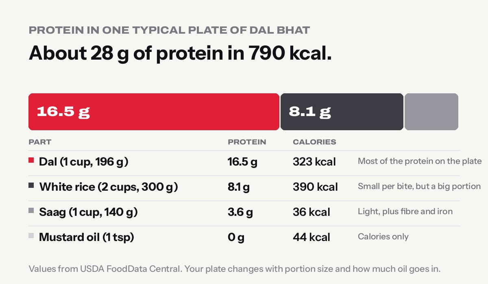
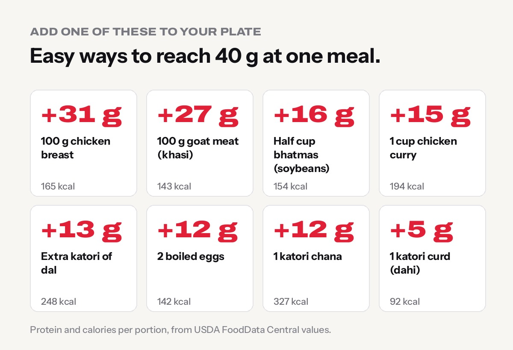

**A typical plate of dal bhat (2 cups of rice, 1 cup of dal and 1 cup of saag) has about 28 g of protein and about 790 calories.** More than half of that protein comes from the dal. That is a fair amount for one meal, but if you lift weights or want to lose fat without losing muscle, a few simple additions can take the same plate to 40 g or more.

Every number in this guide comes from [USDA FoodData Central](https://fdc.nal.usda.gov/), the US government's food composition database. Your own plate will change with portion size and how much oil goes in, so treat these as a good starting point.

## How much protein is in one plate of dal bhat?

| Part of the plate | Amount | Protein | Calories |
|---|---|---|---|
| Dal (cooked with oil) | 1 cup, 196 g | **16.5 g** | 323 kcal |
| White rice (bhat) | 2 cups, 300 g | **8.1 g** | 390 kcal |
| Saag (mustard greens) | 1 cup, 140 g | **3.6 g** | 36 kcal |
| Mustard oil for the saag | 1 teaspoon | 0 g | 44 kcal |
| **Total** | **1 plate** | **about 28 g** | **about 790 kcal** |

A few things stand out:

- **Dal does the heavy lifting.** One cup gives about 16.5 g of protein, roughly 60% of the plate's total.
- **Rice adds more than people expect.** Rice is low in protein per bite, but a big portion of 2 cups still adds about 8 g.
- **Protein is only about 14% of the calories.** Most of the energy comes from rice. That is why dal bhat fills you up and fuels hard work, but on its own it is not a "high-protein" meal.

See the full numbers on our [dal bhat calories](../../food/dal-bhat-calories/), [dal calories](../../food/dal-calories/) and [white rice calories](../../food/rice-white-calories/) pages.

## Is dal bhat a complete protein?

Together, yes, which is one reason it has fed Nepal for generations. Rice and other grains are low in the amino acid lysine. Lentils are low in methionine but rich in lysine. Eaten together across the day, rice and dal cover each other's gaps, so your body can use the protein well.

You do not have to eat them in the same bite or even the same meal. What matters is getting enough protein in total from a mix of foods.

## How much protein do you actually need?

It depends on your weight and your goal:

| Your goal | Protein per kg of body weight per day | For a 60 kg person | For a 75 kg person |
|---|---|---|---|
| General health, not training | about 0.8 g | 48 g | 60 g |
| Training regularly | 1.4–2.0 g | 84–120 g | 105–150 g |
| Building muscle (useful upper limit) | about 1.6 g | 96 g | 120 g |

The training range comes from the [International Society of Sports Nutrition position stand on protein](https://pmc.ncbi.nlm.nih.gov/articles/PMC5477153/), and the 1.6 g figure from a large [review of 49 studies in the British Journal of Sports Medicine](https://bjsm.bmj.com/content/52/6/376). Both suggest spreading it over the day, with roughly **20–40 g at each meal**.

So the honest answer: one normal plate of dal bhat covers a full meal's worth for most people. But if you train and eat dal bhat twice a day with little else, you probably land around 60–70 g a day, which is short of the 100 g or more many lifters need.

Not sure of your number? Use our free [protein calculator](../../calculators/protein-calculator/) or read [how much protein you really need](../how-much-protein-do-you-need/).

## 8 easy ways to get 40 g of protein from dal bhat

Add **one** of these to a normal plate and you are at or near 40 g:

1. **Chicken breast, 100 g cooked: +31 g protein** (165 kcal). The leanest big jump.
2. **Goat meat (khasi), 100 g cooked: +27 g** (143 kcal). Lean meat, lots of protein for very few calories.
3. **Bhatmas (soybeans), half a cup cooked: +16 g** (154 kcal). The best vegetarian booster on this list.
4. **Chicken curry, 1 cup with gravy: +15 g** (194 kcal). The gravy holds less protein than plain meat.
5. **An extra katori of dal: +13 g** (248 kcal). The easiest change at home.
6. **Two boiled eggs: +12.5 g** (142 kcal). Cheap, quick and easy to carry.
7. **A katori of chana: +12 g** (327 kcal). Filling, but higher in calories.
8. **A katori of curd (dahi): +5 g** (92 kcal). Small on its own, but good with any of the above.

If you are vegetarian, combining two works well: an extra katori of dal plus a katori of curd adds about 18 g. Our guide to [protein-rich vegetarian foods in Nepal](../protein-rich-vegetarian-foods-nepal/) has more ideas.

## Three higher-protein dal bhat plates

These swap a little rice for more protein, so calories stay sensible.

| Plate | What is on it | Protein | Calories |
|---|---|---|---|
| **Everyday plate** | 2 cups rice, 1 cup dal, 1 cup saag | about 28 g | about 790 kcal |
| **Fat-loss plate** | 1 cup rice, 1 cup dal, 2 boiled eggs, 1 cup saag | about 37 g | about 750 kcal |
| **Non-veg lifter's plate** | 1.5 cups rice, 1 cup dal, 1 cup chicken curry, 1 cup saag | about 41 g | about 905 kcal |
| **Veg lifter's plate** | 1.5 cups rice, 1 cup dal, half cup bhatmas, 1 katori curd, 1 cup saag | about 48 g | about 960 kcal |

The fat-loss plate has **more protein and fewer calories** than the everyday plate, just by trading one cup of rice for two eggs. If weight loss is your goal, that one swap does a lot. Our [weight loss diet plan with Nepali food](../weight-loss-diet-plan-nepali-food/) builds a full day around it.

Want to gain weight instead? Keep the rice and add the protein on top. See [how to gain weight fast for skinny people](../how-to-gain-weight-fast-for-skinny-people/).

## Simple tips that make a difference

- **Make the dal thicker.** Watery dal can have far less dal per ladle. A thicker dal gives you more protein in the same katori.
- **Mix your lentils.** Masoor, mung, rahar and mas (urad) all work. Variety helps with taste and nutrients.
- **Serve protein first.** Put dal, meat or eggs on the plate first, then fill the rest with rice. It is an easy way to cut rice without feeling hungry.
- **Watch the oil and ghee.** One teaspoon of oil adds about 44 kcal and no protein. A tablespoon of ghee on the rice adds about 125 kcal.
- **Add curd to the side.** It is cheap, cooling, and adds a few grams of protein.

## When a protein shake makes sense

Most people can reach their target with food. A scoop of whey can help if you train early and have no time to eat, you are vegetarian and struggle to get enough, or your appetite is small. One scoop usually adds 20–25 g of protein (check the label). Read [creatine vs whey: which to buy first](../creatine-vs-whey-which-first/) before you spend money on supplements.

## Frequently asked questions

**How much protein is in 1 plate of dal bhat?**
About 28 g for a typical plate of 2 cups of rice, 1 cup of dal and 1 cup of saag, based on USDA values. A bigger portion of dal, or adding meat, eggs or bhatmas, raises it.

**How much protein is in 1 katori of dal?**
About 12.6 g in a 150 g katori of cooked dal made with oil, and about 16.5 g in a full cup (196 g).

**Is dal bhat good for building muscle?**
Yes, as a base. It gives carbohydrate for energy and a fair amount of protein. To build muscle, most people need to add a protein source such as eggs, chicken, goat meat, bhatmas or an extra katori of dal, and train with weights consistently.

**Is dal bhat good for weight loss?**
It can be. Dal and saag are filling and nutritious. The main thing to watch is the rice portion and the oil. Halving the rice and adding eggs or dal raises protein and lowers calories.

**Does rice have protein?**
A little: about 2.7 g per 100 g of cooked white rice, or about 4 g per cup. Because people eat a lot of it, rice can add 8 g or more to a plate.

## Sources

- [USDA FoodData Central](https://fdc.nal.usda.gov/): [white rice, cooked](https://fdc.nal.usda.gov/food-details/168878/nutrients); [mustard greens, cooked](https://fdc.nal.usda.gov/food-details/169257/nutrients); lentils cooked with oil (FNDDS 339338)
- [ISSN position stand: protein and exercise](https://pmc.ncbi.nlm.nih.gov/articles/PMC5477153/) (Jäger et al., 2017)
- [A systematic review, meta-analysis and meta-regression of protein supplementation and muscle gains](https://bjsm.bmj.com/content/52/6/376) (Morton et al., British Journal of Sports Medicine, 2018)

*General information, not medical advice. If you have kidney disease or another medical condition, ask your doctor how much protein is right for you. Training in Urlabari? Our trainers at [Apex Fitness Centre](../../gym/) can help you plan meals around your training.*
