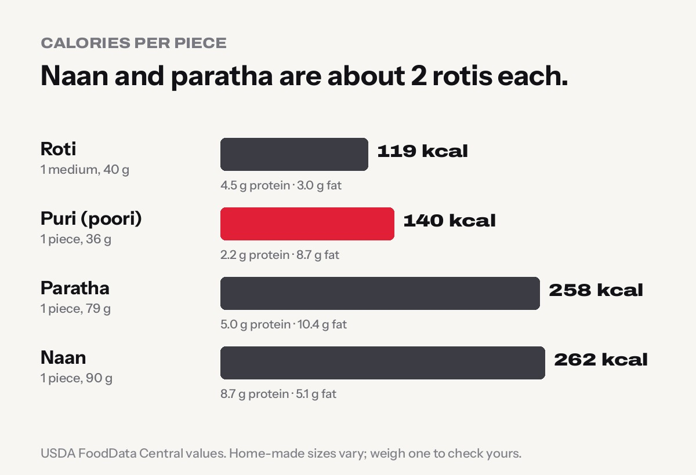
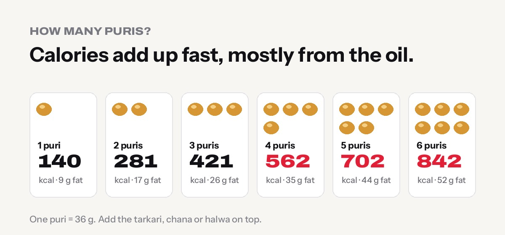

**One medium roti has about 119 calories, one puri about 140, one paratha about 258 and one naan about 262.** So a naan or a paratha is roughly the same as two rotis. Puri looks small, but it soaks up oil, and most people eat four to six at a time: that is 560 to 840 calories before the aloo tarkari or chana.

All numbers below come from [USDA FoodData Central](https://fdc.nal.usda.gov/). Home-made breads vary in size, so if you track calories closely, weigh one of yours once and adjust.

## Calories per piece: the quick answer

| Bread | One piece | Calories | Protein | Fat | Carbs |
|---|---|---|---|---|---|
| **Roti (chapati)** | 1 medium, 40 g | **119 kcal** | 4.5 g | 3.0 g | 18.5 g |
| **Puri (poori)** | 1 piece, 36 g | **140 kcal** | 2.2 g | 8.7 g | 13.9 g |
| **Paratha** | 1 piece, 79 g | **258 kcal** | 5.0 g | 10.4 g | 35.8 g |
| **Naan** | 1 piece, 90 g | **262 kcal** | 8.7 g | 5.1 g | 45.4 g |
| **Large restaurant naan** | about 130 g | **378 kcal** | 12.5 g | 7.3 g | 65.6 g |

## Per 100 g: the surprise

Gram for gram, roti and naan are almost the same:

| Bread | Calories per 100 g | Fat per 100 g |
|---|---|---|
| Naan | 291 kcal | 5.7 g |
| Roti | 297 kcal | 7.5 g |
| Paratha | 326 kcal | 13.2 g |
| Puri | 390 kcal | 24.2 g |

So naan is not "unhealthy" because of what it is made of. It is just **big**: one naan weighs about as much as two rotis. Puri is the real outlier. Because it is deep-fried, about 56% of its calories come from fat.

## How many calories in 4, 5 or 6 puris?

| Number of puris | Calories | Fat |
|---|---|---|
| 1 puri | 140 kcal | 9 g |
| 2 puris | 281 kcal | 17 g |
| 3 puris | 421 kcal | 26 g |
| **4 puris** | **562 kcal** | **35 g** |
| **5 puris** | **702 kcal** | **44 g** |
| **6 puris** | **842 kcal** | **52 g** |

Based on a 36 g puri. Bigger, thicker puris or ones that were not drained well can be higher.

Six puris have about the same calories as **seven medium rotis**, with more than double the fat. Add a bowl of aloo tarkari or chana and a festival breakfast can easily pass 1,000 calories. That is fine now and then. It is just good to know.

More detail on our [puri calories](../../food/puri-calories/) page.

## Naan: plain, butter and garlic

| Naan | Calories (approx.) |
|---|---|
| Half a naan (45 g) | 131 kcal |
| 1 plain naan (90 g) | 262 kcal |
| 1 butter naan (plain + 1 tsp butter) | about 300 kcal |
| 1 garlic butter naan (plain + 2 tsp butter) | about 335 kcal |
| 1 large restaurant naan (130 g) | 378 kcal |
| 2 plain naans | 524 kcal |

A teaspoon of butter or ghee adds roughly 35–45 calories. Restaurant naans are often brushed generously, so butter and garlic naan can be higher than this. See our [naan calories](../../food/naan-calories/) page for the full breakdown.

## Paratha and roti in more detail

- **Roti:** a medium home roti of about 40 g has 119 kcal. Three rotis are about 356 kcal. A thin phulka with no ghee is the lightest bread on this list. Full numbers on the [roti calories](../../food/roti-calories/) page.
- **Paratha:** the layers are made with oil or ghee, so one plain paratha has about 258 kcal and 10 g of fat. Stuffed parathas (aloo, gobi, paneer) are higher again. Full numbers on the [paratha calories](../../food/paratha-calories/) page.

## Which bread is best for weight loss?

**Roti, by a clear margin.** It has the fewest calories per piece, the most fibre, and a good amount of protein for a bread. Here is how the others compare if you swap them for rotis:

| Instead of | You could eat | Calories |
|---|---|---|
| 1 naan (262 kcal) | 2 medium rotis | 238 kcal |
| 1 paratha (258 kcal) | 2 medium rotis | 238 kcal |
| 4 puris (562 kcal) | 4 medium rotis | 475 kcal, with 23 g less fat |

Simple ways to enjoy the others without overdoing it:

- **Count your puris.** Decide on two or three before you start, and fill the rest of the plate with chana or salad.
- **Share the naan.** One restaurant naan between two people is usually plenty alongside a curry.
- **Skip the ghee on top.** A spoon of ghee on a roti or paratha can add 45–125 calories.
- **Add protein.** Pair any bread with dal, chana, eggs, chicken or paneer so the meal keeps you full longer.

For a full day of eating, see our [weight loss diet plan with Nepali food](../weight-loss-diet-plan-nepali-food/), and find your daily target with the [calorie deficit calculator](../../calculators/calorie-deficit-calculator/).

## Which bread has the most protein?

Per piece, **naan** (8.7 g), mostly because it is the biggest. Per 100 g, **roti** wins (11.3 g), and it does that with fewer calories. Puri has the least protein per piece (2.2 g). If you want more protein with your bread, it is the dal, chana, eggs or meat on the side that really count; see [how much protein is in dal bhat](../dal-bhat-protein/) for easy numbers.

## Frequently asked questions

**How many calories in 1 roti?**
About 119 calories for a medium home-made roti of 40 g. A large 68 g roti has about 202 calories.

**How many calories in 4 puris?**
About 562 calories and 35 g of fat for four 36 g puris, before any tarkari.

**How many calories in 6 puris?**
About 842 calories and 52 g of fat.

**How many calories in 1 naan?**
About 262 calories for a 90 g plain naan. A large restaurant naan of about 130 g has about 378 calories, and butter or garlic naan adds more.

**Is naan healthier than roti?**
Not really. Per 100 g they are similar, but roti is made from whole wheat (more fibre) and a naan is about twice the size, so one naan has about twice the calories of one roti.

**Is puri bad for you?**
Not in moderation. It is just high in fat because it is deep-fried. Keep it for festivals or the occasional breakfast, and count how many you eat.

## Sources

- USDA FoodData Central: [roti/chapati](https://fdc.nal.usda.gov/food-details/171844/nutrients); [naan, plain](https://fdc.nal.usda.gov/food-details/171845/nutrients); [paratha, whole wheat](https://fdc.nal.usda.gov/food-details/174076/nutrients); puri or poori (FNDDS 339617, [FoodData Central datasets](https://fdc.nal.usda.gov/download-datasets/))

*Calories are averages from USDA data; home-made breads vary with size, flour and oil. Want help with your diet and training? Visit [Apex Fitness Centre](../../gym/) in Urlabari, or check the full [South Asian food calorie chart](../../food/).*
