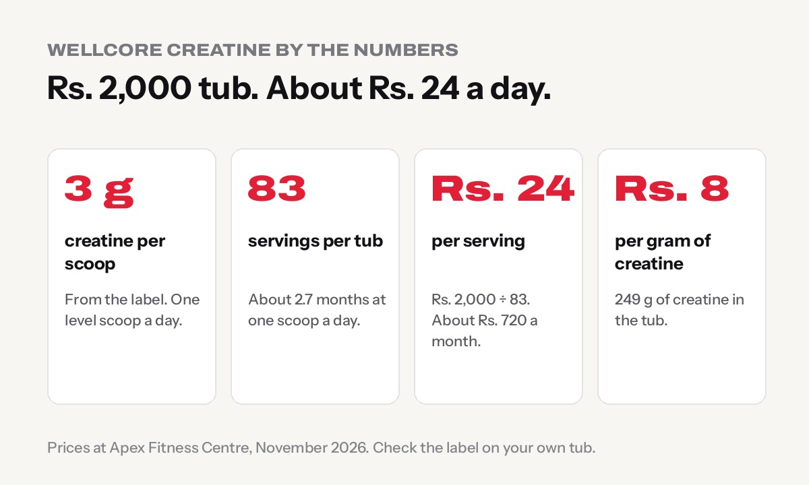

**Wellcore Micronised Creatine Monohydrate costs Rs. 2,000 in Nepal for a 307 g tub with 83 servings of 3 g creatine each.** That works out to about **Rs. 24 a day**, or around Rs. 720 a month at one scoop a day. It comes in a Fruit Fusion flavour, so it is easy to drink in plain water.

This review sticks to what is printed on the label and what research says about creatine. We sell Wellcore at Apex Fitness Centre, so we have kept the comparison to facts you can check yourself.

## Wellcore creatine at a glance

| | Wellcore Micronised Creatine |
|---|---|
| **Pack size** | 307 g |
| **Servings** | 83 per tub (from the label) |
| **Creatine per serving** | 3 g creatine monohydrate (from the label) |
| **Form** | Micronised (fine powder that mixes more easily) |
| **Flavour** | Fruit Fusion |
| **Price at Apex** | Rs. 2,000, free delivery all over Nepal |
| **Cost per serving** | about Rs. 24 |
| **Cost per gram of creatine** | about Rs. 8 |

307 g divided by 83 servings is about 3.7 g of powder per scoop, of which 3 g is creatine. The rest is most likely the flavour and sweetener; check the ingredient list on your tub.

## Is 3 g of creatine a day enough?

Yes, for most people. The [International Society of Sports Nutrition position stand on creatine](https://pmc.ncbi.nlm.nih.gov/articles/PMC5469049/) says a daily dose of about 3 g fills your muscles' creatine stores over about 3–4 weeks. After that, 3–5 g a day keeps them full.

There are two ways to start:

- **The simple way (what we recommend):** one 3 g scoop every day. Your muscles are fully loaded in about a month. The tub lasts about 83 days.
- **The fast way (loading):** about 0.3 g per kg of body weight for 5–7 days, split over the day, then 3–5 g a day. For a 70 kg person that is about 20 g a day for a week, which uses more than half the tub in the first week. It works faster, but some people get an upset stomach.

Bigger, heavier lifters sometimes use 5 g a day. With Wellcore, that is about one and two-thirds scoops, and the tub lasts about 50 days (around Rs. 1,200 a month).

## How to take Wellcore creatine

1. **One level scoop a day,** every day, including rest days. Creatine works by building up in your muscles, not as a quick hit before training.
2. **Mix it in water, milk or a shake.** The flavour means water is fine for most people.
3. **Timing matters little.** Before or after training, or with any meal. Pick the time you will not forget.
4. **Drink enough water** through the day. See [how much water to drink a day](../how-much-water-should-you-drink/).
5. **Give it 4 weeks.** Most people notice a few extra reps or slightly heavier lifts after the first month, not in the first week.

Our guide on [how to take creatine](../../guides/how-to-take-creatine/) covers this step by step.

## How it compares with other creatine in Nepal

These are the three creatines we stock, with prices at Apex Fitness Centre:

| | Wellcore 307 g | MuscleBlaze 320 g | BPI Sports 300 g |
|---|---|---|---|
| **Price** | Rs. 2,000 | Rs. 2,000 | Rs. 5,000 |
| **Flavour** | Fruit Fusion | Citrus Blast | Unflavoured |
| **Servings on label** | 83 | check the label | 60 |
| **Price per gram of powder** | Rs. 6.51 | Rs. 6.25 | Rs. 16.67 |
| **Best for** | Lots of servings, easy to drink | Most powder per rupee | Plain, mixes into anything |

All three are creatine monohydrate, the form with by far the most research behind it. The big differences are flavour, servings and price. If you want a flavoured creatine on a budget, **Wellcore and MuscleBlaze are both Rs. 2,000**. Wellcore states 83 servings of 3 g on the label, which makes cost per day easy to work out. If you prefer an unflavoured powder you can add to anything, BPI Sports costs more.

Compare all prices on our [creatine price in Nepal](../../guides/creatine-price-in-nepal/) guide.

## Who should take it, and who should not

**Good for:**

- Lifters and athletes who want a little more strength and power over time
- Anyone training for sports with short bursts: football, cricket, kabaddi, sprints, martial arts
- Women too: the dose is the same. See [creatine for women](../creatine-for-women/)
- Vegetarians, who usually have lower creatine stores to start with

**Ask a doctor first if you:**

- Have kidney disease or any kidney problem
- Are pregnant or breastfeeding
- Take regular medication or have a long-term medical condition

The label says it is a nutraceutical for adults, so it is not meant for anyone under 18.

Worried about side effects? Read [creatine side effects: myths and facts](../creatine-side-effects-myths-and-facts/). In short, the bloating, hair loss and kidney damage stories do not hold up for healthy people at normal doses.

## How to check your Wellcore tub is genuine

Fake supplements are a real problem in Nepal. Before you buy:

- **Check the seal** under the lid. It should be intact and not loose or re-glued.
- **Check the label print.** Look for blurry text, spelling mistakes or a different colour from the official product.
- **Check the dates and batch number.** They should be printed clearly, not on a sticker.
- **Buy from a seller you can find again,** with a real shop or gym address.
- **Be careful with prices far below normal.** A Rs. 2,000 tub selling for Rs. 1,000 is a warning sign.

Our full guide on [how to spot fake supplements in Nepal](../fake-supplements-in-nepal-how-to-spot-them/) shows what to look for.

## Is Wellcore creatine worth it?

If you want a flavoured creatine monohydrate that is easy to drink, with a clear 3 g dose and a low daily cost, yes. At about Rs. 24 a day it is one of the cheapest supplements that actually has strong research behind it. Remember it is a small extra on top of the basics: consistent training, enough protein and enough sleep do most of the work. If you are not sure whether to start with creatine or protein, read [creatine vs whey: which to buy first](../creatine-vs-whey-which-first/).

[See Wellcore creatine in our shop](../../products/wellcore-micronised-creatine-monohydrate-307g-fruit-fusion/), with free delivery all over Nepal.

## Frequently asked questions

**What is the price of Wellcore creatine in Nepal?**
Rs. 2,000 for the 307 g Micronised Creatine Monohydrate (Fruit Fusion) at Apex Fitness Centre, with free delivery all over Nepal.

**How many servings are in Wellcore creatine?**
83 servings per 307 g tub, with 3 g of creatine monohydrate per serving, according to the label.

**How long does a tub of Wellcore creatine last?**
About 83 days at one scoop a day, or about 50 days if you take 5 g a day.

**Should I take Wellcore creatine on rest days?**
Yes. Take one scoop every day so your muscles stay full.

**Can I mix creatine with whey protein?**
Yes. Add the scoop of creatine to your protein shake. It does not change how either works.

## Sources

- [ISSN position stand: safety and efficacy of creatine supplementation in exercise, sport, and medicine](https://pmc.ncbi.nlm.nih.gov/articles/PMC5469049/) (Kreider et al., 2017)
- Product label: Wellcore Micronised Creatine Monohydrate, 307 g, Fruit Fusion

*General information, not medical advice. Prices checked at Apex Fitness Centre, Urlabari, in November 2026. Questions about which creatine to buy? WhatsApp us on 9708819605.*
