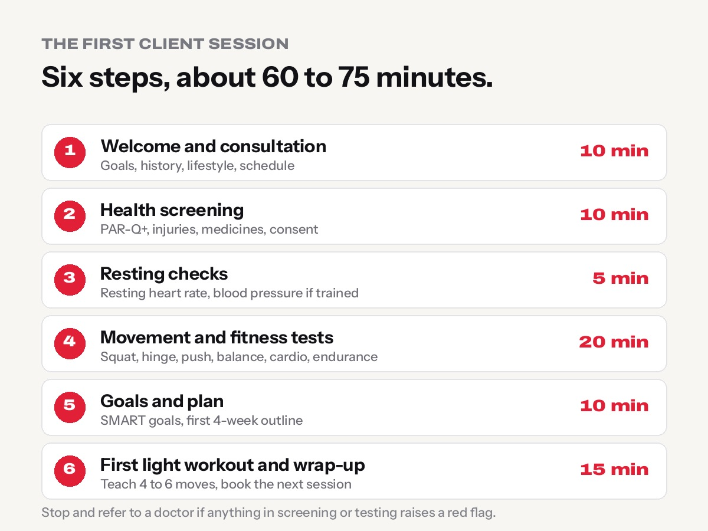
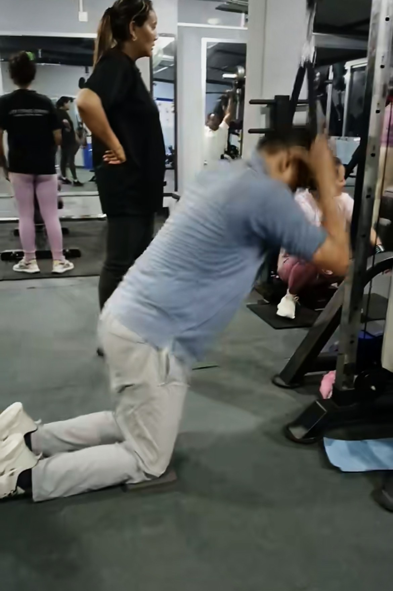

**Your first session with a new client is not really a workout. It is a conversation, a safety check and a set of simple tests that tell you where this person is starting from.** Do it well and the client trusts you, trains safely and comes back next week. Rush it, and even a good program can end with a sore back, a scared beginner or a client who quietly never returns.

This guide walks you through the whole first meeting, step by step: the consultation, health screening, fitness assessment, goal setting and the first workout. It is written for new personal trainers and gym instructors, but it is exactly how we like first sessions to run on the floor at Apex Fitness Centre in Urlabari.

One rule before we start: **a trainer screens, tests and coaches. A trainer does not diagnose.** If something worries you, the right move is to pause and refer the client to a doctor or physiotherapist.

## Why the first assessment matters

A proper first assessment does four jobs at once:

- **Safety.** You find out about heart problems, injuries, medicines or symptoms that change what the client should do, or whether they need a doctor's clearance first.
- **A real starting point.** "Beginner" means very different things for a 22-year-old footballer and a 58-year-old office worker. Simple tests show you the difference.
- **Trust.** When a client feels listened to, they follow the plan. People rarely quit a trainer who understood them.
- **Something to measure against.** In six weeks, your client will want to know if it is working. First-day results are how you show them.

Budget about **60 to 75 minutes** for this session. If you only have 30 minutes, do the consultation and screening on day one, and the tests at the start of the next session.

## Step 1: Welcome the client and hold a proper consultation

### Start with the basics

- **Introduce yourself** with your name, your role and how long you have been training people. Be honest if you are new; confidence comes from preparation, not from pretending.
- **Explain what will happen today:** "We'll talk for about 15 minutes, do a short health check, then some simple movement tests. No hard workout today." Nervous beginners relax when they know there is no surprise.
- **Choose a quiet spot.** Health questions are personal. Don't ask about medicines or weight in front of the squat rack.

### Ask open questions, then listen

The consultation is where you learn what the client wants, what they have tried and what gets in the way. Good questions to ask:

| Area | Example questions |
|---|---|
| **Goals** | "What made you decide to start now?" "If we were sitting here in three months, what would make you happy?" |
| **Training history** | "Have you trained in a gym before? What did you enjoy, and what made you stop?" |
| **Lifestyle** | "What does a normal day look like? Do you sit most of the day or are you on your feet?" |
| **Schedule** | "How many days a week can you realistically come? Mornings or evenings?" |
| **Sleep and stress** | "How many hours do you usually sleep? How stressful is work right now?" |
| **Food** | "What does a typical day of eating look like?" (Just to understand. Detailed meal plans for medical conditions are for a dietitian.) |
| **Preferences** | "Is there any exercise you love or hate? Anything you feel nervous about?" |

Write down their goal **in their own words**. "I want to play with my kids without getting out of breath" is far more motivating than "improve cardiovascular endurance", and you will use it when you set goals later.

A practical example: a client says they want to "lose weight before a wedding in two months". Ask *why* it matters, what they have tried before and how many days they can train. The real goal may be "feel confident in photos and have more energy", which shapes a better plan than chasing a number on the scale.

## Step 2: Health screening

Health screening tells you whether it is safe to start, and whether the client should see a doctor first.

### Use a standard questionnaire

The most widely used tool is the **[PAR-Q+](https://www.healthlinkbc.ca/living-well/physical-activity/general-information-and-tools/tools-and-resources/par-q-and-eparmed-x)** (Physical Activity Readiness Questionnaire for Everyone). It asks simple yes/no questions about heart conditions, chest pain, dizziness, bone or joint problems, medicines and other health issues. If the client answers "yes" to any question, the form leads them through follow-up questions and tells you when a doctor's advice is needed.

The **American College of Sports Medicine (ACSM)** [preparticipation screening recommendations](https://digitalcommons.uri.edu/kinesiology_facpubs/180) base the decision on three things:

1. **Is the client already exercising regularly?**
2. **Do they have known heart, metabolic (for example diabetes) or kidney disease?**
3. **Do they have signs or symptoms that could point to heart disease?** Examples are chest pain or discomfort, unusual shortness of breath, dizziness or fainting, ankle swelling, or a racing or irregular heartbeat.

In simple terms, medical clearance is recommended:

- **Before any exercise** for anyone with signs or symptoms like those above.
- **Before starting** for inactive people with known heart, metabolic or kidney disease.
- **Before stepping up to vigorous exercise** for active people with known disease.

Most healthy people with no symptoms can start light to moderate exercise and build up gradually.

### Also ask about

- **Previous injuries and surgeries:** back pain, knee or shoulder problems, fractures. Ask what makes it worse and what their physio or doctor told them.
- **Medicines:** some blood pressure medicines change heart rate response, and insulin and other diabetes medicines can cause low blood sugar during exercise. You don't need to know the pharmacology; you need to know to plan around it and ask the client to follow their doctor's advice.
- **Pregnancy or recent birth**, if relevant and the client is comfortable sharing.
- **Current pain:** where, how bad and when.

### Informed consent and records

Before you test anything, explain what you will do and that the client can stop at any time. Ask them to sign a simple **informed consent** form and the PAR-Q+. Keep these records private and secure, as you would want your own health information kept.

**When in doubt, refer out.** Telling a client "Let's get a quick go-ahead from your doctor before we push harder" is professional, not a failure.

## Step 3: Resting checks

### Resting heart rate

Have the client sit quietly for about five minutes, then count the pulse at the wrist for 30 seconds and double it, or use a reliable monitor. For most adults, a resting heart rate between **60 and 100 beats per minute** is considered normal. Fit people are often lower. Record it, because it often drops as fitness improves.

### Blood pressure, if you are trained and equipped

Only measure blood pressure if you have been trained to do it and have a validated automatic cuff. Seat the client with their back supported, feet flat and arm resting at heart level, after a few minutes of rest. The [American Heart Association's categories](https://heart.org/bplevels) are a helpful guide:

| Reading (top / bottom number) | AHA category | What you do |
|---|---|---|
| Below 120 **and** below 80 | Normal | Carry on |
| 120–129 **and** below 80 | Elevated | Carry on; mention healthy habits |
| 130–139 **or** 80–89 | High blood pressure, stage 1 | Carry on with moderate exercise; suggest they check with a doctor |
| 140 or higher **or** 90 or higher | High blood pressure, stage 2 | Suggest a doctor's check before hard training; keep today light |
| Higher than 180 **and/or** higher than 120 | Severe (hypertensive crisis level) | **Do not exercise.** Re-check after a few minutes; if still this high, advise medical help |

One high reading is not a diagnosis. Nerves, coffee and rushing to the gym all push blood pressure up. Your job is to note it and refer if needed.

## Step 4: The initial fitness assessment

Keep tests **simple, safe and repeatable**. You want a fair snapshot, not an exam. Choose the tests that match the client's goals and health; you do not need every test for every person.

### Basic movement patterns

Watch how the client moves before you add load. Five patterns cover most of what they will do in the gym:

| Pattern | Simple test | What to look for |
|---|---|---|
| **Squat** | Bodyweight squat, or the [overhead squat assessment](https://www.nasm.org/resource-center/blog/training/how-to-perform-an-overhead-squat-assessment-osa) for more detail | Knees caving in, heels lifting, chest falling forward, pain |
| **Hinge** | Hip hinge with a stick along the back | Can they push the hips back while the back stays flat? |
| **Push** | Wall or incline push-up | Hips sagging, elbows flaring wide, shoulder discomfort |
| **Pull** | Light band or cable row | Shoulders shrugging, back arching |
| **Lunge or step** | Split squat holding a rail, or a low step-up | Knee wobbling, losing balance |

Film a short clip on your phone **only with permission**. It helps you coach, and it is a great "before" to show progress later.

For coaching cues on these movements, see [how to squat properly](../how-to-squat-properly/), [how to deadlift for beginners](../how-to-deadlift-for-beginners/) and [how to bench press safely](../how-to-bench-press-safely/).

### Mobility and flexibility

- **Sit-and-reach or toe touch:** a rough check of hamstring and lower-back flexibility.
- **Shoulder reach:** can they raise both arms straight overhead without arching the lower back?
- **Ankle mobility:** in a half-kneeling position, can the front knee move well past the toes with the heel down?

You are looking for big limitations that change exercise choice, for example a client who cannot lift their arms overhead may start with a landmine press or incline press instead of an overhead press.

### Balance and coordination

- **Single-leg stand:** time how long they can stand on each leg (up to 30 seconds), near a wall or rail for safety.
- **Older clients:** the **30-second chair stand** (how many times they can stand up from a chair without using their hands) is simple and very useful. See [strength training after 50](../strength-training-after-50/).

### Cardiovascular fitness

For a beginner, **submaximal** tests are safer and more practical than all-out efforts:

- **Talk test:** at a moderate pace on the treadmill or bike, the client should be able to talk but not sing.
- **Rating of perceived exertion (RPE):** ask them to rate effort from 0 (resting) to 10 (maximum). Moderate exercise usually feels like 5–6.
- **Step test or timed walk:** a 3-minute step test with heart rate recovery afterwards, or a timed walk, gives a number you can repeat in six weeks.

**Stop any test immediately** if the client has chest pain, severe breathlessness, dizziness, nausea, confusion or unusual pain, and get medical help if symptoms do not settle quickly.

### Muscular endurance

- **Push-ups:** as many as they can do with good form (from the knees or on a bench is fine). Stop when form breaks down.
- **Plank hold:** time until the hips sag or rise.
- **Wall sit:** time to form failure, a gentle test of leg endurance.

### Basic strength

**Do not test a one-rep max on day one.** For beginners it adds risk and tells you very little. Instead, find a **working weight**: a load they can lift for 10–12 good reps with about two or three reps still "in the tank". Do this on two or three key exercises, such as leg press, chest press machine and seated row.

If you need an estimate of maximum strength later, use our [one-rep max calculator](../../calculators/one-rep-max-calculator/) from a set of several reps rather than a true max lift.

### Body measurements (only with consent, and only if relevant)

Some clients want numbers; others find them stressful. **Always ask first**, explain why, and accept "no".

| Measurement | Useful for | Note |
|---|---|---|
| **Body weight** | Tracking change over time | Varies by 1–2 kg day to day with food and water |
| **Waist circumference** | Tracking fat loss around the middle | Measure at the same point each time |
| **Progress photos** | Seeing change the scale misses | Private, same lighting and pose, only if the client agrees |
| **Body fat estimate** | Interest and tracking | All quick methods are estimates; see our [body fat calculator](../../calculators/body-fat-calculator/) |

Never comment on a client's body unprompted. Talk about the measurements as data for tracking, not judgement.

## Step 5: Understanding the results

Assessment results are not a grade. They tell you **where to start and what to watch**.

| What you see | What it suggests | How it changes the plan |
|---|---|---|
| Knees cave in on the squat | Weak hips or poor control | Box squats, glute bridges, band work; light load |
| Can't keep the back flat in a hinge | Hip hinge not learned yet | Hinge drills before any deadlift variation |
| 0–5 knee push-ups | Low upper-body endurance | Incline push-ups, chest press machine |
| Out of breath quickly in the talk test | Low aerobic fitness | Start with 10–20 min easy cardio, build up |
| Single-leg stand under 10 seconds | Balance needs work | Supported balance drills, step-ups with a rail |
| Pain in a specific movement | Possible injury or issue | Skip that movement, choose a pain-free option and **refer** if pain persists |

Note the **two or three most important things to work on**. A client with ten "problems" on a list feels broken. A client with three clear priorities feels like they have a plan.

**Never diagnose.** Say "Your knee seems to hurt when we squat deep. Let's keep it shallow for now and I'd like you to get it checked by a physio." Don't say "You have a meniscus tear."

## Step 6: Set realistic SMART goals

Turn the client's words into goals using **SMART**:

| Letter | Meaning | Example |
|---|---|---|
| **S** | Specific | "Do 10 full push-ups" instead of "get stronger" |
| **M** | Measurable | Count reps, minutes, centimetres or kilograms |
| **A** | Achievable | Possible for this person, with their schedule and health |
| **R** | Relevant | Linked to *their* reason for joining |
| **T** | Time-bound | "In 8 weeks" |

Set **short-term** goals (4–6 weeks) and **long-term** goals (3–6 months or more), and add **habit goals** the client fully controls:

- **Habit goal:** "Train three times a week for the next four weeks."
- **Short-term goal:** "Walk 30 minutes at a brisk pace without stopping by week 6."
- **Long-term goal:** "Lose 4 cm from my waist and do 10 push-ups in three months."

Avoid promising results. Say "This is a realistic target if we stay consistent," not "You will lose 10 kg."

## Step 7: Design the first workout

The first workout should leave the client feeling **capable, not crushed**. A little muscle soreness the next day is normal; being unable to walk downstairs is a sign you overdid it (see [muscle soreness after the gym](../muscle-soreness-after-gym/)).

### A simple structure

| Part | What to do | Time |
|---|---|---|
| **Warm-up** | Easy cardio, then mobility for the joints you will train | 5–10 min |
| **Main exercises** | 4–6 exercises covering legs, push, pull and core | 25–35 min |
| **Cool-down** | Easy walking and gentle stretching | 5 min |

### Exercise selection, sets, reps and rest

- **Choose simple, stable exercises first:** machines and supported movements (leg press, chest press machine, seated row, lat pulldown, goblet squat to a box, glute bridge, plank on a bench).
- **Sets and reps:** 1–2 sets of 10–15 reps is plenty for most beginners on day one.
- **Intensity:** finish each set with about three or four reps still "in the tank" (an effort of roughly 5–6 out of 10).
- **Rest:** 60–90 seconds between sets, longer if they need it.

The [WHO physical activity guidelines](https://www.who.int/news-room/fact-sheets/detail/physical-activity) recommend that adults do muscle-strengthening activity on two or more days a week, alongside 150–300 minutes of moderate aerobic activity. Two or three strength sessions a week is a sensible starting target.

### Teach technique properly

Use the **tell, show, do** method:

1. **Tell:** one short explanation of what the exercise is for.
2. **Show:** demonstrate slowly, from the side and from the front.
3. **Do:** let the client try with very light weight, and give **one cue at a time**, for example "chest up", then "push through your heels".

Praise what they do well before correcting. A beginner who hears five corrections at once usually remembers none.

Our [beginner gym workout plan](../beginner-gym-workout-plan-first-3-months/) shows a full three-day plan you can adapt.

## Step 8: Build the individual training program

After the first session, turn everything into a 4–6 week plan. Consider:

- **Goals:** fat loss, strength, muscle, sport, health or a trek. A client training for the Annapurna Circuit needs a different focus from one preparing for a bodybuilding show.
- **Experience:** true beginners progress fastest with simple, consistent programs.
- **Schedule:** a program built for five days is useless for a client who can come twice. Plan for the days they can actually train.
- **Recovery:** sleep, work stress, shift work and age all affect how much training a client can recover from.
- **Equipment:** use what your gym actually has, and what they can do at home on missed days.
- **Assessment results:** start from their weak points and avoid painful movements.
- **Health:** stay within any limits their doctor has set. Clients on weight-loss medicines, for example, have specific needs; see [strength training on GLP-1 medicines](../strength-training-on-glp-1/).

Write the plan down and share it, on paper, in WhatsApp or in an app. Clients follow a plan they can see.

## Step 9: Track progress

- **Workout records:** log every session's exercises, weights, sets, reps and how hard it felt. This is how you apply progressive overload (adding a little weight or reps over time) safely.
- **Check-ins:** a quick conversation every week: sleep, soreness, energy, anything new with their health.
- **Reassess every 4–8 weeks:** repeat the same tests in the same way. Show the client their improvements side by side.
- **Update the plan** when they hit a goal, stall for a few weeks, get injured or change their schedule.

Progress is not just the scale. More reps, better form, longer walks, better sleep and more confidence all count, and clients need you to point them out.

## Common mistakes new personal trainers make

1. **Skipping the screening because the client "looks fit".** Fitness and health are not the same thing. Screen everyone.
2. **Turning day one into a hard workout.** A beginner who vomits or can't walk for three days rarely comes back.
3. **Testing a one-rep max on a beginner.** High risk, little useful information.
4. **Talking more than listening.** Your knowledge matters less than understanding their goal.
5. **Giving too many cues at once.** One cue per set is enough.
6. **Copying their own program.** What works for a 25-year-old trainer rarely suits a 55-year-old beginner.
7. **Diagnosing pain or giving medical advice.** Refer to a doctor or physio when pain or symptoms appear.
8. **Giving strict diets for medical conditions.** General healthy-eating guidance is fine; diabetes, kidney disease or eating disorders need a professional.
9. **Not writing anything down.** Without records, you can't show progress or spot problems.
10. **Commenting on bodies.** Keep it professional and respectful, always.

## First-client assessment checklist

Use this on the gym floor, in order:

**Before the session**
- ☐ Book a quiet space and 60–75 minutes
- ☐ Print or prepare the PAR-Q+, consent form and assessment sheet
- ☐ Check equipment: stopwatch, tape measure, blood pressure cuff (if trained), step or box, chair

**Consultation**
- ☐ Introduce yourself and explain the session
- ☐ Ask about goals, history, lifestyle, schedule, sleep and preferences
- ☐ Write the main goal in the client's own words

**Health screening**
- ☐ PAR-Q+ completed and signed
- ☐ Injuries, surgeries, medicines and current pain noted
- ☐ Decide: OK to start, or medical clearance needed first
- ☐ Informed consent signed

**Resting checks**
- ☐ Resting heart rate recorded
- ☐ Blood pressure recorded (only if trained and equipped)

**Fitness assessment** (choose what fits)
- ☐ Movement: squat, hinge, push, pull, lunge or step
- ☐ Mobility: toe touch, shoulder reach, ankle
- ☐ Balance: single-leg stand (or chair stand for older clients)
- ☐ Cardio: talk test, RPE, step test or timed walk
- ☐ Endurance: push-ups, plank, wall sit
- ☐ Strength: working weight on 2–3 exercises (no 1RM)
- ☐ Measurements: only with consent

**Planning**
- ☐ Top 2–3 priorities written down
- ☐ SMART goals: habit, short-term and long-term
- ☐ First light workout taught (warm-up, 4–6 exercises, cool-down)
- ☐ Next session booked; reassessment date set (4–8 weeks)

## Conclusion

The best trainers are not the ones who know the most exercises. They are the ones who **listen carefully, screen properly, start at the right level and stay consistent**. A calm, organised first session shows a client that they are safe with you, and that you have a plan for them.

Keep your assessments simple, write everything down, never be afraid to refer to a doctor, and review progress regularly. Do that for every client, and your reputation will grow one person at a time.

Thinking about a career in fitness? Read [how to become a gym trainer in Nepal](../how-to-become-a-gym-trainer-in-nepal/) and our guide to [gym trainer jobs in the Gulf for Nepalis](../gym-trainer-jobs-in-gulf-for-nepalis/). And if you train in Urlabari, come and see how we coach at [Apex Fitness Centre](../../gym/).

## Frequently asked questions

### What should a personal trainer do in the first session with a client?
Hold a consultation about goals and lifestyle, complete health screening (such as the PAR-Q+) and informed consent, take resting measurements, run simple movement and fitness tests, set SMART goals and teach a light first workout. Book the next session before they leave.

### How long should a first client assessment take?
About 60 to 75 minutes. If you have less time, do the consultation and screening first, then the fitness tests at the start of the next session.

### When does a new client need medical clearance before exercise?
Following ACSM's screening guidance, clearance is recommended before exercise for anyone with signs or symptoms of heart disease, such as chest pain, unusual breathlessness or dizziness, and for inactive people with known heart, metabolic or kidney disease. Active people with known disease should get clearance before moving up to vigorous exercise. When in doubt, refer.

### Which fitness tests are best for beginners?
Simple, safe, repeatable tests: a bodyweight squat and hinge check, push-ups (from the knees if needed), a plank hold, a single-leg stand, the talk test or a step test for cardio, and finding a 10–12 rep working weight on a few machines. Avoid one-rep max tests on day one.

### How often should I reassess a client?
Every 4 to 8 weeks is common. Use the same tests in the same way so the results can be compared fairly.

### Can a personal trainer measure blood pressure?
Only if they have been trained to do it and have a validated monitor. A trainer can record readings and refer to a doctor when they are high, but should never diagnose high blood pressure or advise on medicines.

### Should I weigh a new client?
Only if it is relevant to their goal and they agree. Some clients prefer waist measurements, photos or performance goals instead, and that is completely fine.

## Sources

- [Updating ACSM's recommendations for exercise preparticipation health screening](https://digitalcommons.uri.edu/kinesiology_facpubs/180) (Riebe et al., Medicine & Science in Sports & Exercise, 2015)
- [PAR-Q+ and ePARmed-X+](https://www.healthlinkbc.ca/living-well/physical-activity/general-information-and-tools/tools-and-resources/par-q-and-eparmed-x) (HealthLinkBC)
- [Understanding blood pressure readings](https://heart.org/bplevels) (American Heart Association)
- [The overhead squat assessment: a step-by-step guide for trainers](https://www.nasm.org/resource-center/blog/training/how-to-perform-an-overhead-squat-assessment-osa) (NASM)
- [Physical activity fact sheet](https://www.who.int/news-room/fact-sheets/detail/physical-activity) (World Health Organization)

*This guide is general education for fitness professionals, not medical advice. Always work within your qualifications and local rules, and refer clients to a doctor or physiotherapist when needed.*
