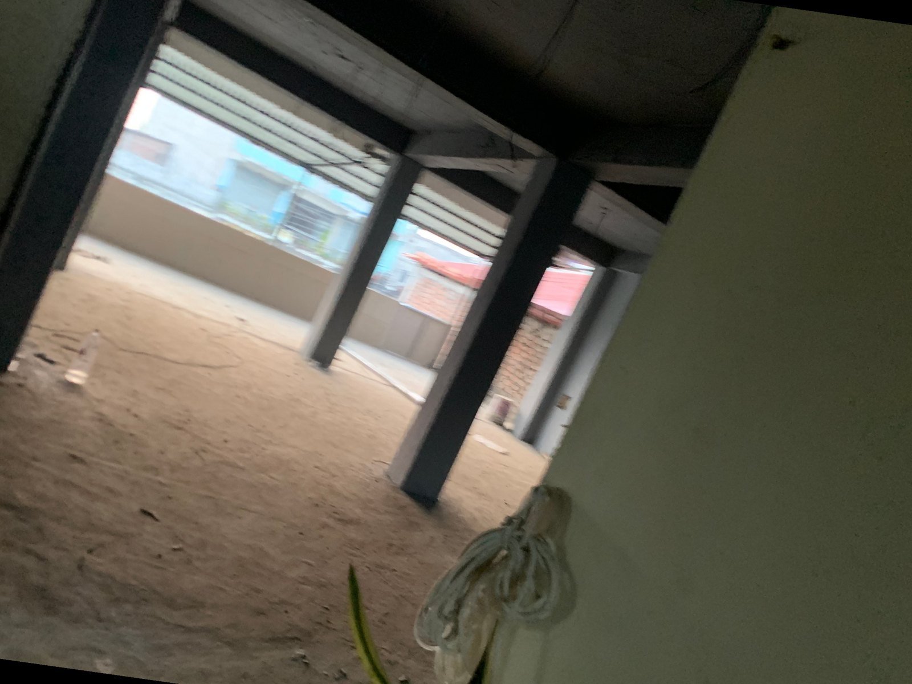
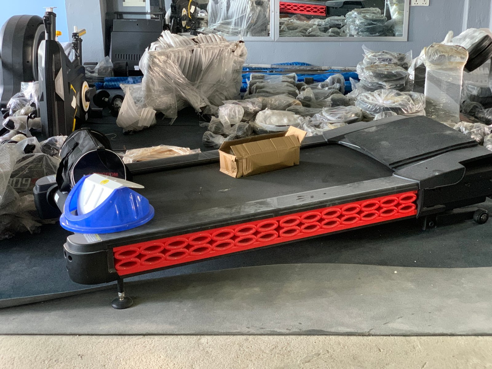
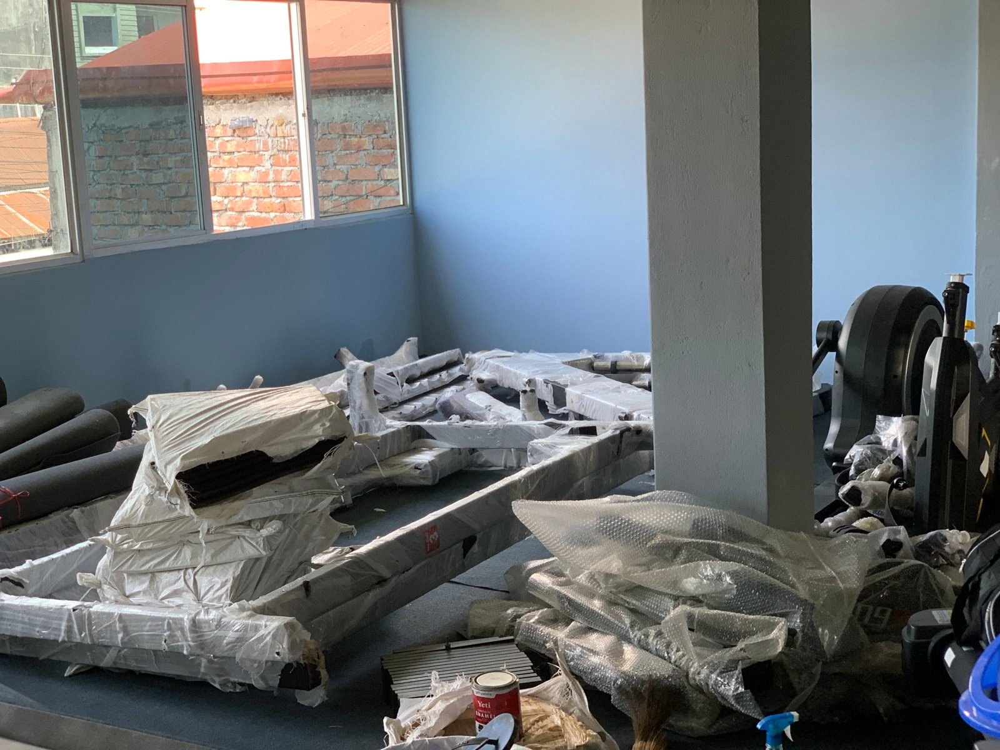

Opening a gym in Nepal comes down to six things: **the right location, legal registration, sensible equipment choices, good trainers, clear pricing, and systems to keep members coming back.** The equipment is the most visible cost, but most gyms that struggle do so because of **location, low member retention or poor cash management**, not because of the machines.

We have been through this process ourselves at Apex Fitness Centre in Urlabari. The photos in this guide are from our own setup, from an empty floor to a working gym.

*Where it starts: the empty floor before Apex Fitness Centre was built out.*

## Step 1: Choose the location carefully

- **Population and demand:** Is there a growing population of students, office workers and young families nearby?
- **Competition:** How many gyms are within 10 to 15 minutes? What do they charge and what do they lack?
- **Access:** Main road visibility, parking for bikes and scooters, safe for early-morning and evening visits.
- **Building:** Strong floor for heavy equipment, good ventilation and windows, enough ceiling height, reliable electricity and water, washrooms.
- **Rent:** Your rent must make sense compared with how many members the area can realistically give you.

## Step 2: Register the business

Gyms in Nepal generally need to be registered like any other business. The usual steps are:

1. **Register the business:** as a sole proprietorship or partnership (usually with the relevant government office in your area) or as a private limited company through the **Office of Company Registrar (OCR)**.
2. **Get a PAN** (Permanent Account Number) from the **Inland Revenue Department** for tax.
3. **Register with your local ward or municipality** and get any local business permit they require.
4. **VAT registration** may be required depending on your annual turnover. Check the current threshold with the Inland Revenue Office.
5. **Rent agreement** in writing, ideally registered, with a lock-in period that protects your investment.

Rules, fees and offices can change, so confirm the latest requirements with the relevant offices or a local business consultant before you start.

## Step 3: Plan your equipment

Buy for what members actually use, not for photos.

**Essentials for a small to medium gym:**

- Dumbbells (a full range, for example 2.5 kg up to 40 kg or more)
- Barbells, plates, and at least one power rack or squat rack
- Adjustable and flat benches
- Cable crossover or functional trainer
- Lat pulldown and seated row
- Leg press, leg extension and leg curl
- Smith machine (optional but popular)
- Cardio: treadmills, bikes, cross-trainers
- Rubber flooring and mirrors

*New equipment arriving at Apex. Commercial machines are heavy; plan delivery, assembly and floor protection.*

**Tips:**

- Commercial-grade equipment costs more but lasts much longer than home-grade.
- Ask suppliers about **warranty, spare parts and service** in Nepal.
- Plan **floor layout** before delivery: free weights, machines and cardio in separate zones.

*Unpacking and assembling equipment at Apex Fitness Centre. Budget time and labour for this step.*

## Step 4: Hire the right people

- **Trainers on every shift**, ideally certified and good with beginners. See [how to become a gym trainer in Nepal](../how-to-become-a-gym-trainer-in-nepal/).
- **Front desk staff** for memberships, payments and member questions.
- **Cleaning** every day. Hygiene is one of the first things new members judge.

## Step 5: Set clear pricing

- Monthly, 3-month, 6-month and 12-month plans, with longer plans cheaper per month.
- A one-time admission fee if you charge one.
- A **written freeze policy** for illness and travel.
- Personal training as an optional extra.

Research local gyms so your prices are competitive for the facilities you offer.

## Step 6: Systems that keep members

Most gyms lose many new members within the first few months. Retention is where profit lives.

- **Track every member:** start date, expiry, payments, dues and attendance.
- **Remind members** before renewal and follow up when someone stops coming.
- **Give beginners a plan** and check in with them in their first weeks.
- **Keep the place clean and the equipment working.**

We built our own software, [Apex Gym Management](../../software/), for exactly this: members, renewals, dues, WhatsApp reminders and attendance in one place.

## Running costs to plan for

- Rent
- Salaries (trainers, front desk, cleaning)
- Electricity (cardio machines, lights, fans or AC)
- Equipment maintenance and repairs
- Marketing (social media, signboards, offers)
- Taxes, fees and renewals
- A **cash reserve** for slow months, such as festival seasons

## Common mistakes new gym owners make

- Spending everything on equipment and having no money left for the first 6 months.
- Choosing a cheap location with no foot traffic.
- No written rules for membership, refunds and freezes.
- Weak follow-up with members who stop coming.
- Trying to compete only on price.

## Frequently asked questions

### How much does it cost to open a gym in Nepal?

It varies hugely with size, location and equipment quality: from a modest local gym to a large premium facility. Make a detailed budget covering rent deposit, renovation, equipment, staff and at least 6 months of running costs.

### Do I need a licence to open a gym in Nepal?

You need to register your business and get a PAN, plus any local permits your municipality requires. Confirm the current requirements with the relevant government offices.

### How long does it take to set up a gym?

Commonly a few months, covering finding a location, registration, renovation, ordering and installing equipment, and hiring staff.

### Is a gym a profitable business in Nepal?

It can be, with the right location, good service and strong member retention. Profit depends heavily on keeping members for the long term.

*This guide is general information, not legal or financial advice. Check current registration and tax rules with the relevant authorities or a professional.*
