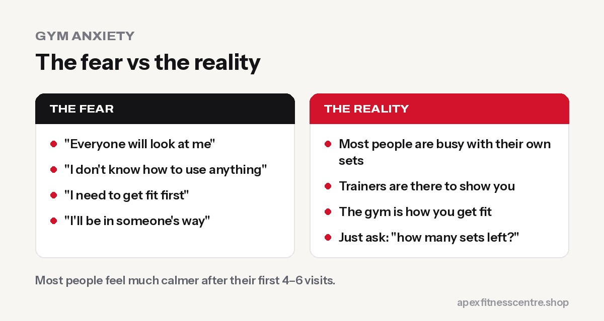
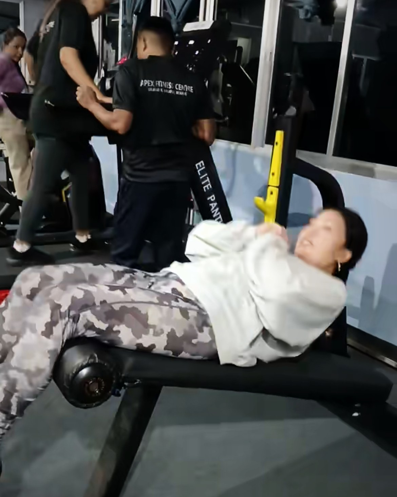
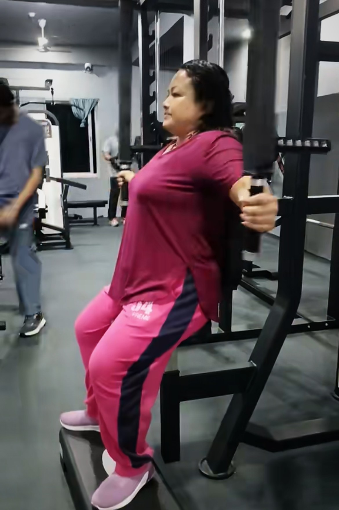

**Gym anxiety is the nervous, self-conscious feeling many people get about going to a gym: worrying that people will watch or judge you, that you won't know how to use the equipment, or that you'll look out of place. It's extremely common, especially for beginners, and it fades quickly with a simple plan: go at a quiet time, follow a written workout, start with machines, and ask a trainer to show you around.**

Trainers see it all the time: someone stands at the door, looks around, and almost turns back. A few months later, that same person is often the one helping a newcomer find the right machine. Here's how to get from day one to that point.

## What gym anxiety really is

Gym anxiety usually comes from a few specific fears:

- **"Everyone will look at me."**
- **"I don't know how to use the machines."**
- **"I'll do the exercises wrong and look stupid."**
- **"I'm too unfit, too heavy, too thin or too old to be here."**
- **"I'll be in someone's way."**

These feelings are normal. A gym is a new environment full of unfamiliar equipment, mirrors and people who look like they know exactly what they're doing. But almost all of those people once felt the same way.

## The truth about the fears

### "Everyone is watching me"

Most people in a gym are thinking about their own workout: counting reps, resting, choosing music. When people do look around, they usually notice a machine they want, not you.

### "I'll look like I don't know what I'm doing"

Experienced lifters remember being beginners. Most respect anyone who turns up and tries. And every good gym has trainers on the floor whose job is to show you how to use the equipment.

### "I need to get fit before I join"

This is the most common trap. You don't get fit and then go to the gym. The gym is how you get fit. Start where you are.

## 12 ways to beat gym anxiety

### Before you go

1. **Visit first, without training.** Ask for a tour. Seeing the layout takes away half the fear.
2. **Choose a quiet time.** Early mornings and mid-afternoons are usually calmer than the after-work rush.
3. **Write your workout down.** Walking in with a plan on your phone means you always know your next exercise. Try our [beginner gym workout plan](../beginner-gym-workout-plan-first-3-months/).
4. **Wear clothes you feel comfortable in.** You don't need branded gym wear. Clean shoes, comfortable clothes and a towel are enough.
5. **Make a playlist.** Headphones help you focus on yourself.

### At the gym

6. **Start on machines.** They guide the movement, show the muscles worked on a picture, and feel less exposed than the free-weights area.
7. **Ask a trainer for help.** "Can you show me how this works?" is the most normal question in any gym.
8. **Start lighter than you think.** Nobody can see the number on your machine. Good form looks impressive; heavy, shaky reps don't.
9. **Bring a friend for the first week** if it helps, but train at your own pace.
10. **Learn basic gym manners.** Re-rack weights, wipe the bench, ask "how many sets left?" if you want to share. Knowing the rules makes you feel like you belong.

### After the session

11. **Write down what you did.** Weights and reps. Next time you'll beat it, and the sense of progress builds confidence fast.
12. **Book your next session.** Same days each week. Anxiety drops sharply after the first few visits once the gym becomes familiar.

## A gentle first week

| Day | Plan |
|---|---|
| Visit 1 | Tour, 10-minute treadmill or bike, try 3 machines with light weight |
| Visit 2 | 10-minute warm-up, 5 machines (leg press, chest press, seated row, lat pulldown, shoulder press), 2 sets each |
| Visit 3 | Same as visit 2, a little heavier on anything that felt easy |

That's it. Three short, successful visits are worth more than one exhausting session that puts you off for a month.

## For women: feeling safe and comfortable

Many women feel extra pressure in the weights area. A few things help:

- **Train at times with more women** if that makes you comfortable, and ask the front desk when that is.
- **Ask a trainer** to set up a simple plan for you.
- **Remember:** lifting weights won't make you bulky. It makes you strong. See our [first-visit gym guide for women](../gym-guide-for-women-first-visit/).

## When anxiety is more than nerves

If anxiety is stopping you from leaving the house, or comes with panic attacks, talk to a doctor or mental health professional. Exercise can help mood and anxiety, and the [World Health Organization](https://www.who.int/news-room/fact-sheets/detail/physical-activity) notes that physical activity reduces symptoms of depression and anxiety, but it isn't a replacement for proper care.

## Frequently asked questions

### Is it normal to feel nervous at the gym?

Yes, very. Most beginners feel self-conscious at first. The feeling usually fades within a few weeks of regular visits.

### What should I do on my first day at the gym?

Ask for a tour, warm up on a treadmill or bike for 10 minutes, then try 3–5 machines with light weights. Keep it short and positive.

### What is the best time to go to the gym if I have gym anxiety?

Usually early morning or mid-afternoon on weekdays, when it's quieter. Ask the staff when the gym is least busy.

### Should I get a personal trainer if I'm nervous?

Even one or two sessions with a trainer can make a huge difference. They'll show you the equipment, correct your form and give you a plan.

### How long does gym anxiety last?

For most people it drops a lot after the first 4–6 visits, once the place and the routine feel familiar.

## Sources

- [WHO fact sheet: physical activity](https://www.who.int/news-room/fact-sheets/detail/physical-activity) (World Health Organization)

*Feeling nervous about your first visit? At Apex Fitness Centre, Urlabari, our trainers are on the floor every session to show you around. Just walk in and say it's your first time.*
