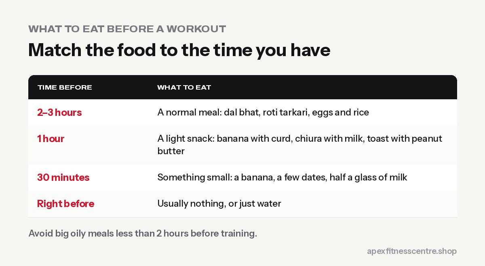

The best pre-workout meal gives you **energy (carbohydrates) plus a little protein**, is **easy to digest**, and is eaten at the right time: a **full meal 2 to 3 hours before**, or a **small snack 30 to 60 minutes before**.

You do not need special products. Ordinary Nepali food works perfectly.

## Timing guide

| Time before training | What to eat |
|---|---|
| 2–3 hours | A normal meal: dal bhat, roti tarkari, eggs and rice |
| 1 hour | A light snack: banana with curd, chiura with milk, toast with peanut butter |
| 30 minutes | Something small and easy: a banana, a few dates, half a glass of milk |
| Right before | Usually nothing, or just water |

## 12 pre-workout options

### For morning workouts (4:30 to 8 AM)

1. **Banana + a glass of milk:** quick energy and some protein.
2. **Chiura with curd:** traditional, light, easy on the stomach.
3. **Toast or roti with peanut butter.**
4. **Dates or raisins with a few nuts:** if you cannot eat much early.
5. **Oats cooked in milk:** if you have 60 to 90 minutes.
6. **Black coffee + banana:** a simple "pre-workout" many lifters swear by.

### For evening workouts (4 to 8 PM)

7. **Normal lunch at noon** followed by a small snack around 3 to 4 PM.
8. **Boiled chana chatpate:** carbs and protein together.
9. **Fruit with a bowl of curd.**
10. **Egg sandwich or 2 eggs with roti.**
11. **Sweet potato (sakarkhand) or boiled potatoes:** easy carbohydrates.
12. **High-protein oats** with milk.

## What to avoid right before training

- **Big, heavy meals** less than 2 hours before: you may feel sick or slow.
- **Very oily or fried food:** pakoda, samosa, sel roti fried in lots of oil.
- **Lots of fibre or beans just before** if they upset your stomach.
- **Fizzy drinks:** can cause bloating.
- **Trying a new food on an important day.**

## Can you train on an empty stomach?

Many people train fine in the morning without eating, especially for light cardio. But for **heavy lifting or long sessions**, most people perform better with a small snack. If you feel dizzy, weak or shaky when training fasted, eat something small.

## Do you need a pre-workout supplement?

No. A banana and some caffeine from black coffee or tea do much of the same job. If you do use a pre-workout product, read our guide on [whether pre-workout is safe](../is-pre-workout-safe/) first.

## Don't forget water

Drink a glass of water in the hour before training. See [how much water you should drink](../how-much-water-should-you-drink/).

## Sample timelines

**Early morning session (5:00 AM):**
- 4:30 AM: 1 banana and a few sips of water, or black tea with 2 biscuits
- 5:00–6:15 AM: train
- 6:30–7:00 AM: proper breakfast with protein (eggs, milk, or curd and chiura)

**Evening session (6:00 PM):**
- 1:00 PM: normal lunch (dal bhat with a protein side)
- 4:30 PM: small snack, such as roasted chana, a banana and milk, or bread with peanut butter
- 6:00–7:15 PM: train
- 8:00 PM: dinner

## For fat loss vs muscle gain

- **Fat loss:** keep the pre-workout snack small (about 100–200 kcal) and count it in your daily calories. A banana or a glass of milk is enough.
- **Muscle gain:** use the pre-workout meal to add calories: oats with milk and banana, or a larger serving of rice and dal 2–3 hours before.

In both cases, your **total food for the day** matters far more than the exact timing.

## Frequently asked questions

### Is banana good before a workout?

Yes. It is easy to digest and gives quick energy. Add milk or curd for some protein.

### Should I eat protein before the gym?

A little protein before training is helpful but not essential. What matters most is your total protein across the day.

### What should I eat before a morning gym session if I'm not hungry?

Something very small: a banana, a few dates, or half a glass of milk 20 to 30 minutes before.

### How long after eating can I work out?

About 2 to 3 hours after a full meal, or 30 to 60 minutes after a light snack.

### Is tea or coffee okay before the gym?

Yes. A cup of black tea or coffee 30–60 minutes before training can help you feel more alert. Avoid a lot of sugar, and don't have it late in the evening if it affects your sleep.

## Sources

- [International Society of Sports Nutrition position stand: nutrient timing](https://pubmed.ncbi.nlm.nih.gov/28919842/) (Kerksick et al., 2017)
- [International Society of Sports Nutrition position stand: protein and exercise](https://pubmed.ncbi.nlm.nih.gov/28642676/) (Jäger et al., 2017)

*General information, not medical advice. People with diabetes should plan workout meals with their doctor.*
