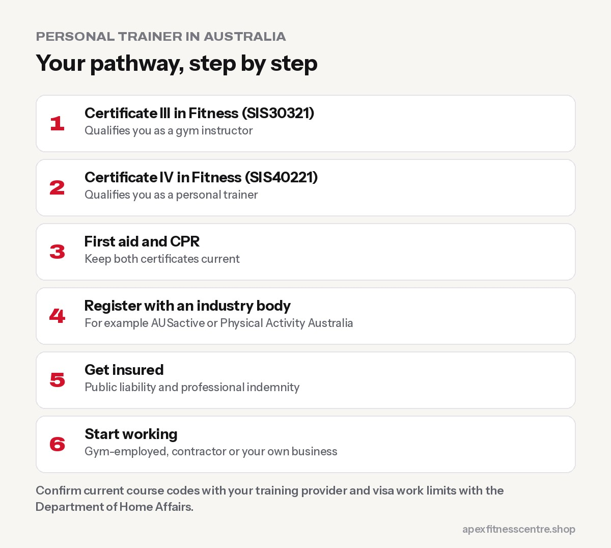
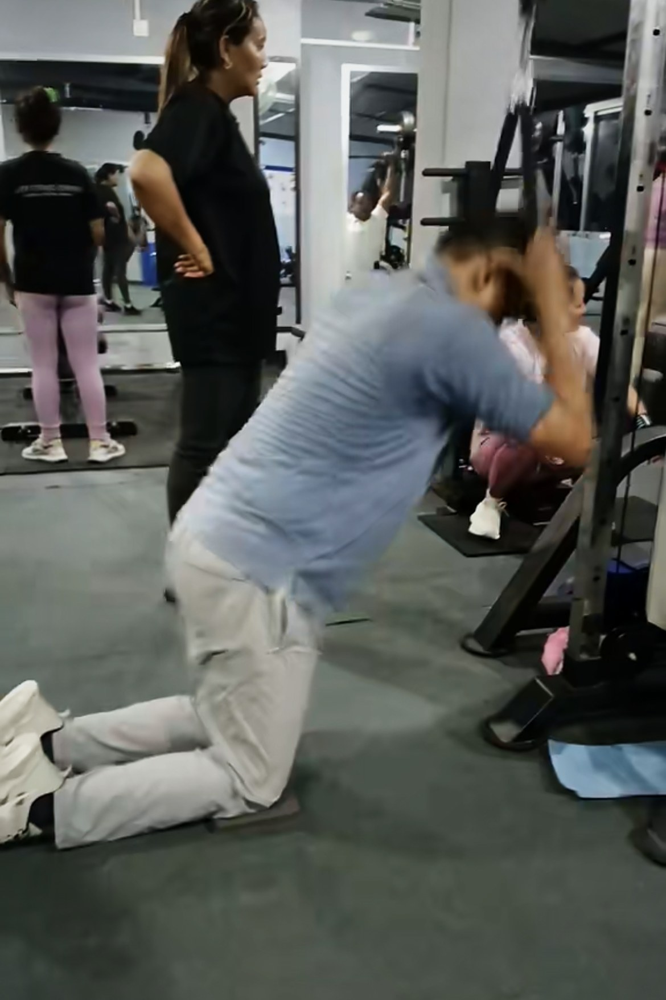

**To become a personal trainer in Australia, you need a Certificate III in Fitness (SIS30321) and a Certificate IV in Fitness (SIS40221) from a registered training organisation, current first aid and CPR certificates, registration with an industry body, and insurance. Many people finish the training in around 5 months to a year. Personal trainers typically earn about $30–$70+ an hour, depending on experience, clients and whether they're employed or self-employed.**

Australia is one of the most popular places in the world to work in fitness, and many international students, including thousands of Nepali students, look at personal training as a career that fits around study. This guide explains the full pathway.

*Rules, course codes and visa conditions change. Always confirm with your training provider and official government sources before you enrol.*

## The qualifications you need

| Qualification | What it lets you do | Course code |
|---|---|---|
| **Certificate III in Fitness** | Work as a gym or group fitness instructor | SIS30321 |
| **Certificate IV in Fitness** | Work as a personal trainer with one-to-one clients | SIS40221 |

The Cert III on its own qualifies you as a **gym instructor**, not a one-to-one personal trainer. Most people study both, often as a combined course ([Australian Institute of Fitness](https://fitness.edu.au/the-fitness-zone/how-to-become-a-personal-trainer/)).

Choose a **Registered Training Organisation (RTO)** and check that the course is nationally recognised. Ask about:

- Total cost, including books, uniform and assessment fees
- How much **practical, in-person** training is included
- Work placement or gym experience
- Whether you can study part-time around work or university

## Step-by-step: from zero to working PT

1. **Complete the Certificate III in Fitness.** Learn anatomy, exercise programming, gym instruction and client safety.
2. **Complete the Certificate IV in Fitness.** Learn to design individual programmes, work with specific populations and run a training business.
3. **Get first aid and CPR.** Current "Provide First Aid" and "Provide CPR" certificates are required.
4. **Register with an industry body.** Registration with an organisation such as AUSactive or Physical Activity Australia shows employers you meet industry standards and requires ongoing professional development.
5. **Get insured.** Public liability and professional indemnity insurance are needed to train clients.
6. **Check other requirements.** If you'll train under-18s, you may need a Working With Children Check in your state.
7. **Start working.** Most new PTs start in a commercial gym before building their own client base.

## How much do personal trainers earn in Australia?

Earnings vary widely. One major training provider puts typical PT earnings at **roughly $30–$70+ an hour** ([Australian Institute of Fitness](https://fitness.edu.au/the-fitness-zone/how-to-become-a-personal-trainer/)). What you actually take home depends on:

- **Employed vs contractor vs own business:** employees get steadier pay; contractors often pay "rent" to the gym but keep more per session
- **Number of regular clients:** a full diary is the biggest factor
- **Location:** big cities usually have more clients and higher rates
- **Specialisation:** strength coaching, older adults, pre- and post-natal, or rehab-related work can command higher rates

New trainers often take 6–12 months to build a steady client base. Have a plan for income while you grow.

## For international students

Many Nepali and other international students want to work in fitness while studying. Key points:

- **Work hour limits apply.** Student visa holders can generally work **up to 48 hours per fortnight** during study periods, with no limit during official course breaks ([One Planet Migration Law](https://oneplanetmigrationlaw.com.au/immigration-blog/student-visa-work-hours-australia-2026/)). Always check the latest rules with the Department of Home Affairs.
- **Studying fitness is not the same as a migration pathway.** Don't choose a course only because an agent says it leads to permanent residency. Check official sources yourself.
- **English matters.** Explaining exercises clearly and building rapport with clients is a big part of the job.
- **Start with gym-floor work.** Casual gym instructor or reception roles are a great way to learn the industry and meet potential clients.
- **Your background is a strength.** Many clients value trainers who understand different cultures, foods and languages, including other students from your community.

## Skills that make a PT successful

Certificates get you started; these keep you employed:

- **Coaching technique clearly** and safely
- **Programming** that progresses week by week
- **Communication and motivation:** clients stay with trainers they like and trust
- **Sales and marketing:** most PTs run a small business, even inside a gym
- **Continuing education:** specialise as you grow

## PT certifications in other countries

If you're thinking about working in the Gulf, Europe or North America, international certifications such as NASM, ACE, ISSA or NSCA are more common. Requirements differ by country and employer. If you're from Nepal, also see [how to become a gym trainer in Nepal](../how-to-become-a-gym-trainer-in-nepal/) and [gym trainer jobs in the Gulf for Nepalis](../gym-trainer-jobs-in-gulf-for-nepalis/).

## Frequently asked questions

### What qualification do I need to be a personal trainer in Australia?

A Certificate IV in Fitness (SIS40221), usually completed together with or after a Certificate III in Fitness (SIS30321). You'll also need first aid and CPR, registration and insurance.

### How long does it take to become a PT in Australia?

Some providers offer combined Cert III and IV courses that can be finished in around 5 months. Part-time study usually takes longer.

### Can international students become personal trainers in Australia?

Yes, many do. You can study fitness qualifications and work within your visa's work-hour limits. Check your visa conditions before starting work.

### How much does a personal trainer earn in Australia?

Typically around $30–$70+ an hour, depending on experience, number of clients and employment type.

### Is personal training a good career?

It can be rewarding and flexible, but income depends on building a client base. Treat it like running a small business.

## Sources

- [How to become a personal trainer](https://fitness.edu.au/the-fitness-zone/how-to-become-a-personal-trainer/) (Australian Institute of Fitness)
- [Student visa work hours in Australia](https://oneplanetmigrationlaw.com.au/immigration-blog/student-visa-work-hours-australia-2026/) (One Planet Migration Law)

*General career information, not migration or legal advice. Confirm course details with your training provider and visa rules with the Australian Department of Home Affairs.*
