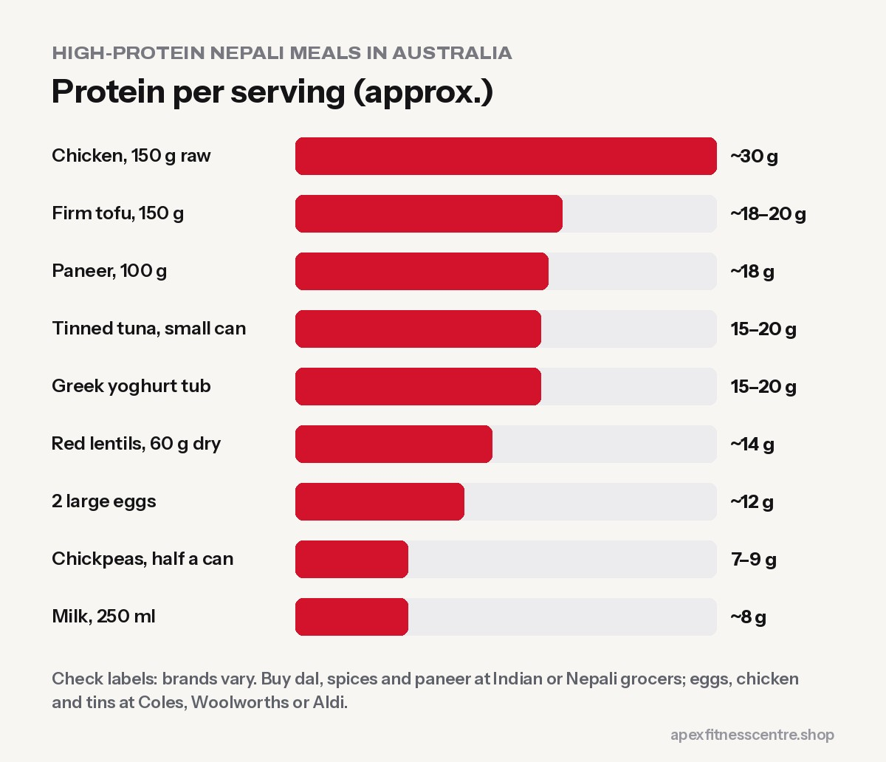

**You can eat Nepali-style food in Australia and still get plenty of protein. Build meals around eggs, chicken, dal and tinned legumes, paneer or tofu, Greek-style yoghurt and milk, with rice or roti on the side. With a simple weekly shop at Coles, Woolworths, Aldi or an Indian/Nepali grocery store, most people can reach 100–140 g of protein a day on a student or worker budget.**

Thousands of Nepalis live, study and work in Australia. Many go to the gym but struggle with food: long shifts, shared kitchens, unfamiliar supermarkets and a budget that disappears fast. This guide turns the food you grew up with into a high-protein plan using what's on Australian shelves.

## How much protein do you need?

For people who lift weights, research suggests about **1.6 g of protein per kg of body weight a day** is enough for most muscle gain, with some people benefiting from a little more ([Morton et al.](https://bjsm.bmj.com/content/52/6/376)). That's about:

| Body weight | Daily protein |
|---|---|
| 55 kg | ~90 g |
| 65 kg | ~105 g |
| 75 kg | ~120 g |
| 85 kg | ~135 g |

Spread it over 3–4 meals of about 25–40 g each. More detail: [how much protein do you need](../how-much-protein-do-you-need/).

## The Nepali high-protein shopping list (Australia)

Protein amounts are approximate. Always check the nutrition label, because brands vary.

| Food | Typical serving | Approx. protein |
|---|---|---|
| Eggs | 2 large | ~12 g |
| Chicken thigh or breast | 150 g raw | ~30 g |
| Tinned chickpeas or kidney beans | ½ can, drained | ~7–9 g |
| Red lentils (masoor dal), dry | 60 g | ~14 g |
| Paneer | 100 g | ~18 g |
| Firm tofu | 150 g | ~18–20 g |
| Tinned tuna | 1 small can | ~15–20 g |
| Greek-style or high-protein yoghurt | 170–200 g tub | ~15–20 g (check label) |
| Milk | 250 ml glass | ~8 g |
| Peanut butter | 1 tablespoon | ~4 g |

**Budget tips:**

- **Supermarket home brands** of eggs, tinned legumes, rice, oats and frozen vegetables are often much cheaper than name brands.
- **Buy dal, spices, paneer and achar from Indian or Nepali grocery stores**, which are often cheaper for these items.
- **Frozen chicken and frozen vegetables** last longer and reduce waste in shared fridges.
- **Cook big batches** of dal and curry on your day off.

## 7 high-protein Nepali-style meals

### 1. Anda bhurji with roti
3 eggs scrambled with onion, tomato, chilli and coriander, with 2 roti or wraps. **About 20–25 g protein.**

### 2. Chicken curry, dal and rice
150 g chicken in a simple masala, a bowl of thick masoor dal, and a normal plate of rice. **About 40–45 g protein.**

### 3. Chana tarkari with yoghurt
Tinned chickpeas cooked with potato and spices, a bowl of rice, and a tub of Greek yoghurt on the side. **About 25–30 g protein.**

### 4. Paneer or tofu sekuwa-style
Cubes of paneer or firm tofu marinated in yoghurt, garlic, ginger and chilli, then pan-fried or air-fried. With salad and roti. **About 25–30 g protein.**

### 5. Egg and chicken fried rice
Leftover rice with 2 eggs, shredded chicken and frozen mixed vegetables. **About 30–35 g protein.**

### 6. Tuna or egg "chatpate"
A quick snack: tinned tuna or boiled eggs with onion, tomato, lemon, chilli and a handful of puffed rice. **About 15–20 g protein.**

### 7. Overnight oats with milk and peanut butter
Oats soaked in milk and yoghurt overnight, topped with banana and a spoon of peanut butter. **About 20–25 g protein.** Great before a 6 AM shift.

## A full day of eating (about 120 g protein)

| Meal | Food | Protein |
|---|---|---|
| Breakfast | Overnight oats with milk, yoghurt and peanut butter | ~22 g |
| Lunch (work or uni) | Chicken curry, dal and rice from your batch cook | ~42 g |
| Snack | 2 boiled eggs and a piece of fruit | ~12 g |
| Dinner | Paneer or tofu sekuwa with roti and salad | ~28 g |
| Before bed | Glass of milk | ~8 g |
| **Total** | | **~112–120 g** |

## Meal prep for long shifts

- **Sunday batch cook:** a big pot of dal, a chicken or chickpea curry, and rice. Portion into containers for 3–4 days.
- **Keep emergency protein:** eggs, tinned tuna, tinned chickpeas, and yoghurt.
- **Use the freezer:** portions of curry freeze well for 2–3 months.
- **Pack snacks for work:** boiled eggs, yoghurt tubs, a banana, peanuts.

## Do you need protein powder?

No, but it can help if you work long hours or struggle to eat enough. A scoop of whey usually gives 20–25 g protein. Food comes first. See [creatine vs whey: which first?](../creatine-vs-whey-which-first/).

## Common mistakes Nepalis make with food abroad

- **Too much rice, too little dal or meat.** Keep rice, but make the protein portion bigger.
- **Living on instant noodles** during busy weeks. Add 2 eggs and frozen vegetables at minimum.
- **Skipping breakfast** before morning shifts, then overeating at night.
- **Too many takeaway meals and sugary drinks**, which add calories fast.

## Frequently asked questions

### How can I get enough protein as a vegetarian in Australia?

Use dal, tinned chickpeas and beans, paneer, tofu, Greek yoghurt, milk and eggs if you eat them. See [protein-rich vegetarian foods](../protein-rich-vegetarian-foods-nepal/) for more ideas.

### Where can I buy Nepali food in Australia?

Indian and Nepali grocery stores in most cities stock dal, spices, achar, beaten rice (chiura) and paneer. Big supermarkets also stock lentils, chickpeas, rice and spices.

### Is chicken thigh or breast better for muscle?

Both are good. Breast has slightly more protein and less fat; thigh is juicier and often cheaper. Choose what fits your budget.

### How much protein is in dal?

About 14 g in 60 g of dry red lentils, which makes a generous bowl. Thicker dal with less water gives you more per bowl.

## Sources

- [Protein supplementation and resistance training: systematic review and meta-analysis](https://bjsm.bmj.com/content/52/6/376) (Morton et al., *British Journal of Sports Medicine*, 2018)
- [International Society of Sports Nutrition position stand: protein and exercise](https://pubmed.ncbi.nlm.nih.gov/28642676/) (Jäger et al., 2017)

*General information, not medical advice. Protein amounts are approximate; check product labels.*
