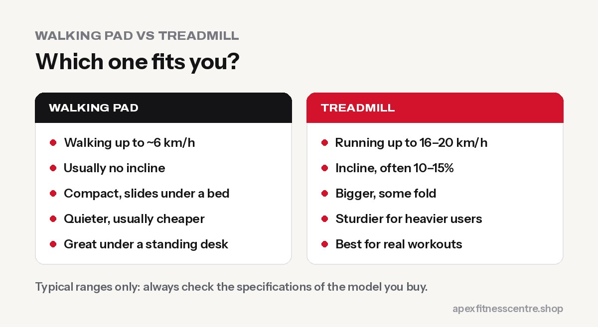
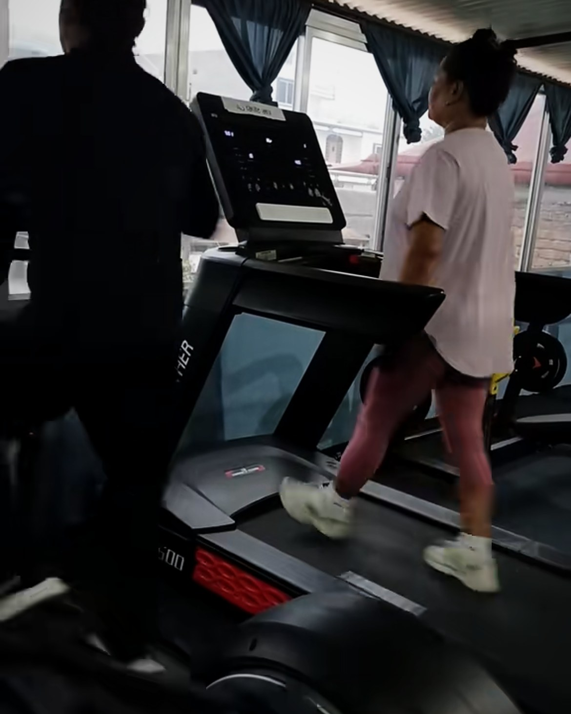

**Choose a walking pad if you mainly want to walk more at home or under a standing desk, have little space, and don't plan to run. Choose a treadmill if you want to run, train on an incline, or are a heavier user who needs a sturdier machine. Walking pads are smaller, quieter and usually cheaper; treadmills are faster, more powerful and more versatile.**

Walking pads have exploded in popularity thanks to remote work and "10,000 steps" goals. But many people buy one, then realise they wanted to jog or walk uphill. Here's how to choose the right one the first time.

## The quick comparison

| | Walking pad | Treadmill |
|---|---|---|
| **Typical top speed** | Around 6 km/h (some go faster with the rail up) | Often 16–20 km/h |
| **Incline** | Usually none | Usually yes, often 10–15% |
| **Size** | Flat and compact; slides under a bed or sofa | Large; some fold up |
| **Noise** | Generally quieter | Louder, especially when running |
| **Handrails** | Often none or a small fold-up bar | Full handrails and console |
| **User weight limit** | Often around 100–120 kg (check) | Often higher on sturdier models |
| **Price** | Usually lower | Usually higher |
| **Best for** | Walking, standing desks, small flats | Running, incline walking, serious training |

*These are typical ranges. Always check the exact specifications of the model you're considering.*

## Who should buy a walking pad?

A walking pad is a great choice if you:

- Want to **increase your daily steps** without going outside
- Work from home and want to **walk slowly at a standing desk**
- Live in a **small flat or shared house**
- Don't plan to run, and walk at a comfortable to brisk pace
- Want a **quieter** machine for apartments

### The walking-pad sweet spot

Walking at 2–4 km/h while working is a gentle way to add thousands of steps a day. It won't replace hard training, but extra daily movement is linked to better health. See [walking for weight loss](../walking-for-weight-loss-steps/) for step targets.

## Who should buy a treadmill?

Choose a treadmill if you:

- Want to **jog or run**, including [interval training](../japanese-walking-interval-walking/)
- Want **incline walking**, one of the most effective low-impact workouts for fitness and fat loss
- Are **heavier** and need a stronger motor, deck and frame
- Want **handrails** for balance and confidence
- Plan to do **Zone 2 cardio** or structured workouts. See our guide to [Zone 2 training](../zone-2-training/)

## The incline factor

This is the biggest difference most buyers overlook. Walking uphill raises your heart rate and works your legs and glutes harder **without the impact of running**. For many people, a brisk incline walk is the perfect cardio workout. Most walking pads can't do it.

## Buying checklist

Before you buy either machine, check:

1. **Maximum user weight**, ideally well above your own weight
2. **Belt size:** wider and longer is more comfortable and safer, especially for treadmills
3. **Motor rating:** look for continuous horsepower (CHP), not "peak"
4. **Speed range** for the way you'll actually use it
5. **Incline** if you want harder walking workouts
6. **Noise level** if you live in a flat
7. **Safety key / emergency stop**
8. **Space:** measure where it will go, and where it will be stored
9. **Warranty**, especially on the motor
10. **Reviews** that mention long-term reliability, not just the first week

## Safety tips

- **Always use the safety key** clip if your machine has one.
- **Start slowly** and step on before the belt speeds up.
- **Keep children and pets away** from moving belts.
- **Wear proper shoes.** Barefoot or socks increase the risk of slipping.
- **Don't walk too fast for the machine.** If your stride feels cramped or you're holding on tightly, slow down.

## Can't decide? Try both at a gym first

Most gyms have treadmills, and many people try a gym treadmill before buying. Walk at different speeds and inclines for a week. If you love incline walking or want to jog, buy a treadmill. If you mostly stroll, a walking pad will do.

## Frequently asked questions

### Is a walking pad as good as a treadmill?

For slow to brisk walking, yes. For running, incline training or heavier users, a treadmill is usually better.

### Can you lose weight with a walking pad?

Yes, extra daily walking burns energy, and it helps when combined with a sensible diet. Most fat loss still comes from what you eat.

### Can you run on a walking pad?

Most walking pads aren't designed for running. Some have a faster mode with the handle up, but check the specifications and weight limit.

### Is a walking pad good for a standing desk?

Yes, that's one of their best uses. Walk slowly (around 2–3 km/h) so you can still type and talk comfortably.

### What incline should I use on a treadmill?

Beginners can start at 2–5% and build up. Many people enjoy 8–12% at a brisk walking pace once they're fitter. Don't hold the handrails tightly; that reduces the work.

## Sources

- [WHO fact sheet: physical activity](https://www.who.int/news-room/fact-sheets/detail/physical-activity) (World Health Organization)

*General buying information. We don't sell treadmills or walking pads and aren't paid to recommend any brand. Check each model's specifications and safety instructions.*
