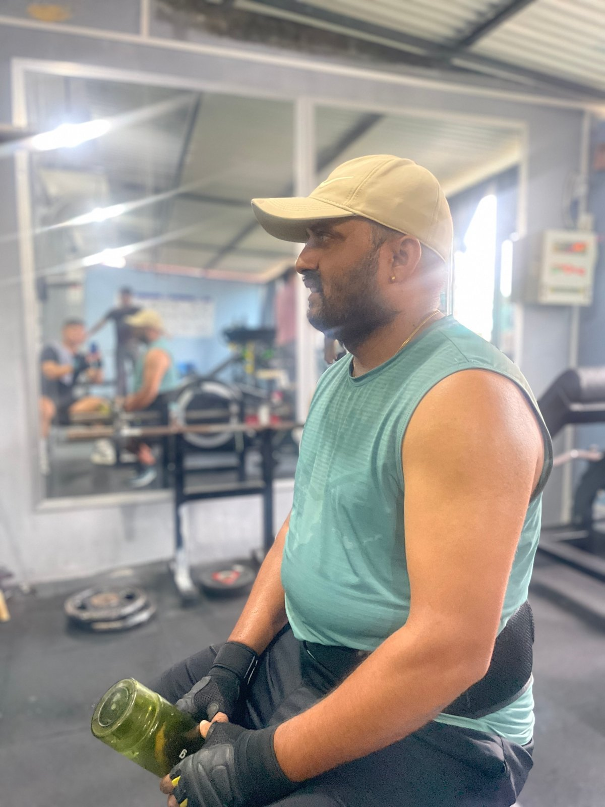

After training, your body needs **protein to repair muscle** and **carbohydrates to refill energy**. A normal Nepali meal like **dal bhat with eggs, chicken or paneer** is one of the best post-workout meals you can eat. You do not need anything special.

Eat a meal or snack **within a couple of hours** after training. The old idea of a 30-minute "anabolic window" is much less strict than people think. **Your total protein across the day matters most.**

## What a good post-workout meal includes

1. **Protein (20 to 40 g):** eggs, chicken, fish, paneer, dal, curd, milk, soybean chunks or whey.
2. **Carbohydrates:** rice, roti, chiura, potatoes, fruit.
3. **Vegetables** for vitamins and minerals.
4. **Water** to rehydrate.

## 12 post-workout options

### Full meals

1. **Dal bhat with chicken or egg curry** and saag
2. **Roti with paneer tarkari** and curd
3. **Rice with fish curry** and vegetables
4. **Soybean chunk curry with rice**
5. **Egg fried rice** made with little oil and extra eggs
6. **Rajma or chana with rice**

### Quick snacks (if your meal is later)

7. **Glass of milk + banana**
8. **Curd with chiura and fruit**
9. **2 to 3 boiled eggs + a roti**
10. **Banana-oats-milk shake**
11. **Whey shake + a fruit**
12. **Chana chatpate** with onion and lemon

*A shake is handy between sets or straight after training, but a proper meal later matters just as much. Photo: Apex Fitness Centre.*

## For muscle gain vs fat loss

| Goal | Post-workout approach |
|---|---|
| **Muscle gain** | Bigger portions: full meal with plenty of rice or roti, plus protein. A milk shake if you can't eat much. |
| **Fat loss** | Protein-focused meal with vegetables and a smaller portion of rice. Avoid "rewarding" yourself with junk food. |

For full day plans, see our [Nepali diet plan for muscle gain](../high-protein-nepali-diet-plan-for-muscle-gain/) or the [weight loss diet plan with Nepali food](../weight-loss-diet-plan-nepali-food/).

## How soon should you eat?

- If you **ate within a few hours before** training, there is no rush. Eat your next normal meal.
- If you **trained on an empty stomach** in the early morning, eat something with protein **soon after**, such as milk, eggs or a shake.

## Common mistakes

- **Skipping food after training** because you are "losing weight." You will be hungrier later and recover worse.
- **Only drinking a shake** and skipping real meals for the rest of the day.
- **Junk food rewards:** momo, chowmein and cold drinks after every session.
- **Not drinking water.** See [how much water you need](../how-much-water-should-you-drink/).

## Do you need a protein shake after the gym?

No. It is convenient if you cannot eat a meal soon, but food works just as well. If you use whey, see [creatine vs whey: which first?](../creatine-vs-whey-which-first/).

## Frequently asked questions

### What should I eat immediately after the gym?

Anything with protein and some carbohydrates: milk and banana, eggs and roti, curd and chiura, or your normal meal.

### Is dal bhat good after a workout?

Yes. Add a good portion of protein like eggs, chicken, fish or paneer, and it is an excellent post-workout meal.

### Should I eat carbs after a workout if I'm trying to lose fat?

A moderate amount helps recovery. Keep portions sensible and focus on protein and vegetables.

### Is it bad to eat late at night after an evening workout?

No. Your total daily intake matters more than the time. A balanced dinner after evening training is fine.

## Sources

- [International Society of Sports Nutrition position stand: nutrient timing](https://pubmed.ncbi.nlm.nih.gov/28919842/) (Kerksick et al., 2017)
- [International Society of Sports Nutrition position stand: protein and exercise](https://pubmed.ncbi.nlm.nih.gov/28642676/) (Jäger et al., 2017)
- [Protein supplementation and resistance training gains: systematic review and meta-analysis](https://bjsm.bmj.com/content/52/6/376) (Morton et al., *British Journal of Sports Medicine*, 2018)

*General information, not medical advice.*
