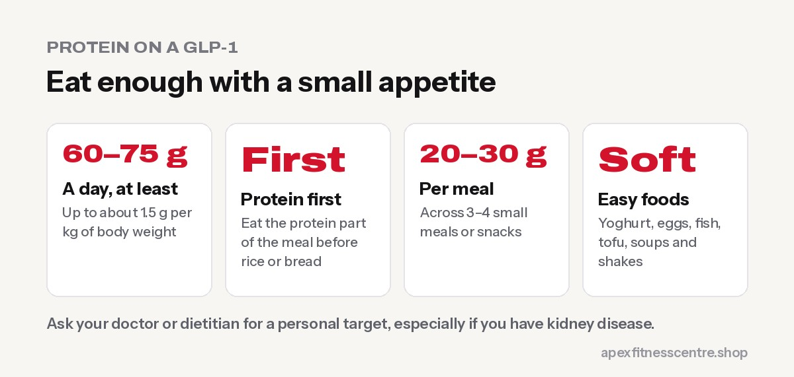

**On a GLP-1 medicine like Ozempic, Wegovy, Mounjaro or Zepbound, protein becomes your top food priority, because your appetite is low and muscle loss is a real risk. A review by ukactive and Les Mills suggests aiming for at least 60–75 g of protein a day, with up to about 1.5 g per kg of body weight as an upper guide. Eat protein first at every meal, choose soft, easy-to-eat protein foods, and pair it with strength training.**

*General information, not medical advice. If you have kidney disease or another medical condition, ask your doctor or a dietitian for your personal protein target.*

## Why protein matters more on a GLP-1

GLP-1 medicines reduce appetite and slow down how quickly your stomach empties. That's what helps you eat less. But it also means:

- **You eat smaller meals,** so it's easy to miss protein
- **Large calorie deficits** can cause muscle loss alongside fat loss
- **Some foods become unappealing,** especially heavy, fatty meals

Estimates suggest **20–50% of the weight lost on GLP-1s may be lean body mass** ([Athletech News](https://athletechnews.com/fitness-stakeholders-urge-strength-training-for-glp-1-users/)). Eating enough protein, together with [strength training on a GLP-1](../strength-training-on-glp-1/), is the best way to protect your muscle.

Major nutrition and obesity medicine organisations have also highlighted adequate protein as a key nutritional priority for people on GLP-1 therapy ([Joint advisory, ACLM, ASN, OMA and TOS](https://www.obesity.org/wp-content/uploads/2025/06/Joint_Nutritional-Priorities-to-Support-GLP-1-Therapy-for-Obesity.pdf)).

## How much protein should you aim for?

The ukactive and Les Mills review gives a practical guide: **60–75 g of protein a day**, with **up to about 1.5 g per kg of body weight** as a ceiling.

| Body weight | Practical daily target |
|---|---|
| 60 kg | 60–90 g |
| 75 kg | 75–110 g |
| 90 kg | 75–135 g |
| 110 kg | 75–165 g (ask your dietitian) |

If you're very heavy, ask a dietitian to calculate your target from a healthy goal weight rather than your current weight.

## How to eat enough protein with a small appetite

1. **Protein first.** Eat the protein part of your meal before rice, bread or vegetables.
2. **Aim for 20–30 g per meal**, across 3–4 small meals or snacks.
3. **Choose soft, easy foods:** yoghurt, eggs, fish, tofu, cottage cheese or paneer, lentil soups.
4. **Drink some protein:** milk, a protein shake or a yoghurt drink can be easier than solid food on bad days.
5. **Keep portions small and frequent** if large meals make you nauseous.
6. **Go easy on very fatty and fried foods**, which many people tolerate poorly on these medicines.

## Easy high-protein foods for GLP-1 users

| Food | Serving | Approx. protein |
|---|---|---|
| Greek or high-protein yoghurt | 170–200 g | 15–20 g |
| Eggs | 2 | ~12 g |
| Fish (e.g. salmon, tuna) | 100 g cooked | ~20–25 g |
| Chicken breast | 100 g cooked | ~30 g |
| Firm tofu | 150 g | ~18–20 g |
| Paneer or cottage cheese | 100 g | ~11–18 g |
| Lentil (dal) soup | 1 large bowl | ~10–15 g |
| Milk | 250 ml | ~8 g |
| Whey protein shake | 1 scoop | ~20–25 g |

*Values are approximate; check labels.*

## A sample day for a small appetite (~95 g protein)

| Time | Food | Protein |
|---|---|---|
| Breakfast | 2 scrambled eggs and half a slice of toast | ~14 g |
| Mid-morning | Greek yoghurt tub | ~17 g |
| Lunch | Small bowl of dal soup and 100 g chicken or tofu | ~35 g |
| Afternoon | Protein shake made with water or milk | ~22 g |
| Dinner | 100 g fish with a few vegetables | ~22 g |

You don't have to eat everything at once. On days with nausea, liquids and soft foods are fine.

## Don't forget these

- **Water:** many people drink less when their appetite drops. Sip regularly through the day.
- **Fibre:** vegetables, fruit, oats and pulses help with digestion and constipation, a common side effect.
- **Vitamins and minerals:** eating much less food can lead to shortfalls; a varied diet matters, and your doctor may check your levels.
- **Strength training 2–3 times a week:** protein works best when your muscles have a reason to stay.

## Is protein powder okay on a GLP-1?

For most people, yes. Shakes are an easy way to get 20–25 g of protein when solid food is hard. Choose a simple whey or plant protein with few added sugars, and check with your doctor if you have kidney problems.

## Frequently asked questions

### How much protein should I eat on Ozempic?

A practical guide is at least 60–75 g a day, and up to about 1.5 g per kg of body weight. Ask your doctor or dietitian for a personal target.

### What if I can't eat much at all?

Prioritise protein at every small meal, use protein drinks, and eat little and often. If you regularly can't eat enough, talk to your prescriber.

### Can I eat too much protein?

Healthy people usually tolerate higher protein intakes well. People with kidney disease should follow medical advice.

### Do I still need protein if I'm not lifting weights?

Yes. Protein helps protect muscle during weight loss even without training, but strength training makes a big difference.

### What's the easiest protein to eat when nauseous?

Many people find cold, soft foods easiest: yoghurt, protein drinks, eggs, tofu and soups.

## Sources

- [Fitness stakeholders urge strength training for GLP-1 users](https://athletechnews.com/fitness-stakeholders-urge-strength-training-for-glp-1-users/) (Athletech News, on the ukactive and Les Mills review)
- [Joint nutritional priorities to support GLP-1 therapy for obesity](https://www.obesity.org/wp-content/uploads/2025/06/Joint_Nutritional-Priorities-to-Support-GLP-1-Therapy-for-Obesity.pdf) (ACLM, ASN, OMA and The Obesity Society)
- [International Society of Sports Nutrition position stand: protein and exercise](https://pubmed.ncbi.nlm.nih.gov/28642676/) (Jäger et al., 2017)

*General information, not medical advice. Follow the advice of your prescriber, doctor or dietitian.*
