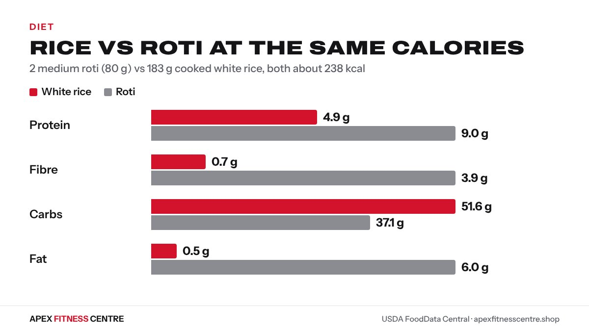

Roti is slightly better for weight loss, but you do not have to give up rice. **At the same calories, two medium rotis give about twice the protein and five times the fibre of white rice.** That can help you feel full for longer. Still, the size of your portion matters far more than which one you choose.

All numbers are USDA values, as shown on our [roti](../../food/roti-calories/) and [white rice](../../food/rice-white-calories/) pages.

## The numbers per serving

| Serving | Calories | Protein | Carbs | Fibre |
|---|---|---|---|---|
| 1 medium roti (about 40 g) | 119 kcal | 4.5 g | 18.5 g | 2.0 g |
| 2 medium rotis (80 g) | 238 kcal | 9.0 g | 37.1 g | 3.9 g |
| 3 medium rotis (120 g) | 356 kcal | 13.5 g | 55.6 g | 5.9 g |
| 1 cup cooked white rice (158 g) | 205 kcal | 4.3 g | 44.5 g | 0.6 g |
| 1 Nepali plate of rice (about 300 g) | 390 kcal | 8.1 g | 84.5 g | 1.2 g |

A typical [dal bhat plate](../../food/dal-bhat-calories/) often holds about 300 g of rice. That one portion has more calories than three rotis.

## Rice vs roti at the same calories

Comparing one roti with one cup of rice is not fair, because they are different amounts of food. Here is what you get for the same 238 kcal:

*Rice vs roti at the same calories. Source: USDA FoodData Central.*

| About 238 kcal of | Protein | Fibre | Carbs | Fat |
|---|---|---|---|---|
| White rice (183 g cooked) | 4.9 g | 0.7 g | 51.6 g | 0.5 g |
| Roti (2 medium, 80 g) | 9.0 g | 3.9 g | 37.1 g | 6.0 g |

Roti wins on protein and fibre, both of which help with fullness. Rice has almost no fat, and roti has a little more because USDA measured commercial roti made with some oil. Home-made roti without ghee is usually leaner.

## Which keeps you fuller?

For most people, roti. Whole wheat atta keeps the bran, so roti has much more fibre than white rice, plus more protein. Protein and fibre are the two parts of a meal that tend to keep hunger away.

But fullness also depends on what you eat with it. Rice with a thick katori of dal, saag and some egg or chicken will keep you fuller than two dry rotis on their own. See [how much protein is in dal bhat](../dal-bhat-protein/) for easy ways to build a more filling plate.

## Which is better for your goal?

| Your goal | Better choice | Why |
|---|---|---|
| Losing weight | Roti, or a smaller rice portion | More protein and fibre for the calories |
| Building muscle | Either | Total protein and calories matter more; add dal, eggs or meat |
| Long training days or hard physical work | Rice works well | Easy to eat a lot of energy quickly |
| Very busy | Whichever you will actually eat | Consistency beats the perfect choice |

## How much should you eat?

There is no single right number, because it depends on your size, activity and goal. Two simple ways to control it:

- **Use the plate method.** Fill a quarter of the plate with rice or roti, half with vegetables and saag, and a quarter with dal, eggs, chicken or paneer.
- **Count your rotis or measure your rice.** Decide on two or three rotis before you start. For rice, use the same katori or cup every day so you know your portion.

Find your daily calorie target with the [calorie deficit calculator](../../calculators/calorie-deficit-calculator/), then see our [Nepali diet plan for weight loss](../weight-loss-diet-plan-nepali-food/) for a full week of meals with both rice and roti.

## Mistakes that matter more than rice or roti

- **Ghee and butter on top.** A teaspoon of ghee on a roti adds about 45 kcal. On a plate of rice, a tablespoon adds about 125 kcal.
- **Second helpings.** A second plate of rice is easy to eat and adds hundreds of calories.
- **Fried breads.** Puri and paratha have far more fat than plain roti. See [roti vs naan vs puri calories](../roti-vs-naan-vs-puri-calories/).
- **Eating out.** Restaurant naan and rice portions are big. Our guide to [Indian restaurant calories](../indian-restaurant-calories-what-to-order/) shows what to order.

## Frequently asked questions

### Is rice fattening?
No food on its own makes you gain fat. You gain weight when you eat more calories than you use over time. Rice is easy to eat in large portions, so it is the portion size, not the rice, that usually causes the problem.

### Can I eat rice at night and still lose weight?
Yes. What matters is your total calories across the whole day, not the time you eat them. If rice at dinner helps you stick to your plan, keep it and keep the portion sensible.

### How many calories are in 1 roti?
A medium home-made roti of about 40 g has around 119 kcal and 4.5 g of protein. Larger or thicker rotis have more.

### Is brown rice better than roti?
A cup of cooked brown rice has about 3.2 g of fibre, closer to two rotis than white rice is. It is still a little lower in protein than the same calories of roti.

### Should I stop eating rice to lose weight?
You do not have to. Many people lose weight while still eating dal bhat every day, simply by eating a smaller portion of rice and more dal and vegetables.

### Is rice or roti better for diabetes?
This depends on your own condition and medicine. Ask your doctor or a dietitian how much rice or roti suits you.

## Sources

- Nutrition values from [USDA FoodData Central](https://fdc.nal.usda.gov/), as shown on our [food calorie chart](../../food/)
- [The Eatwell Guide](https://www.nhs.uk/live-well/eat-well/food-guidelines-and-food-labels/the-eatwell-guide/), NHS

*General information, not medical advice. If you have diabetes or another health condition, ask your doctor what suits you.*
