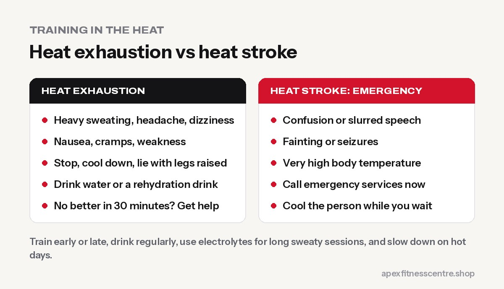
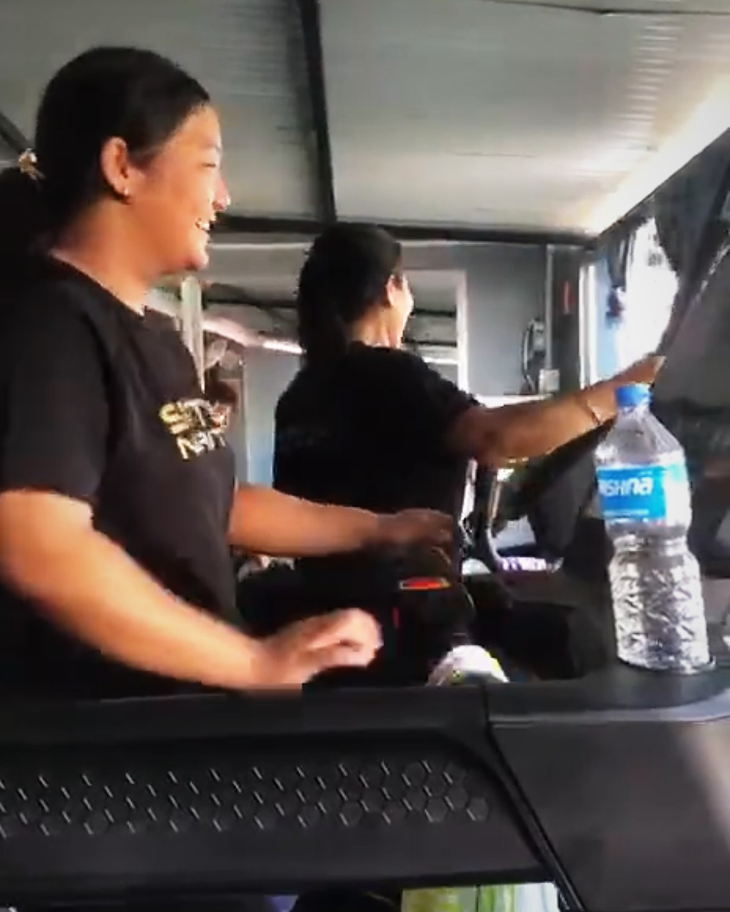

**To exercise safely in hot weather, train early in the morning or in the evening, drink water before, during and after, use electrolytes for long sweaty sessions, wear light clothing, and reduce your pace or intensity on hot days. Give your body 1–2 weeks to adapt. Stop immediately if you feel dizzy, confused, sick or stop sweating; heat stroke is a medical emergency.**

Whether you're training through a Terai summer, working in the Gulf, or running in an Australian heatwave, heat changes how your body handles exercise. Here's how to keep training without putting yourself at risk.

## Why heat makes exercise harder

When you exercise, your muscles produce heat. To cool down, your body sends more blood to your skin and sweats. In hot or humid weather:

- **Sweat evaporates less** (especially when humid), so you cool down less
- **Your heart works harder** to supply both muscles and skin
- **You lose fluid and salt** through sweat
- **The same pace feels harder**, and your heart rate is higher

## Heat exhaustion vs heat stroke

| | Heat exhaustion | Heat stroke |
|---|---|---|
| **Signs** | Heavy sweating, headache, dizziness, nausea, cramps, weakness, feeling very thirsty | Confusion, slurred speech, fainting, seizures, very high body temperature; skin may be hot and dry or still sweaty |
| **What to do** | Stop, move to a cool place, lie down with legs raised, drink water or a rehydration drink, cool the skin | **Call emergency services**, move to a cool place, cool the person quickly with water and fanning while waiting for help |

If someone with heat exhaustion doesn't improve within about 30 minutes, treat it as heat stroke and get medical help ([NHS](https://www.nhs.uk/conditions/heat-exhaustion-heatstroke/)).

## 10 rules for training in the heat

1. **Train at cooler times:** early morning or evening.
2. **Drink before you start:** a glass or two of water 1–2 hours before.
3. **Sip during training:** every 10–20 minutes, more in long sessions.
4. **Use electrolytes** if you sweat heavily or train for more than an hour. Oral rehydration salts are cheap and effective. See [how much water you should drink](../how-much-water-should-you-drink/).
5. **Wear light, loose, light-coloured clothing**, and a cap outdoors.
6. **Slow down.** Run or train by effort, not pace. Expect your heart rate to be higher. See [Zone 2 training](../zone-2-training/).
7. **Shorten hard sessions** on very hot days, or move them indoors.
8. **Acclimatise over 1–2 weeks:** start with shorter, easier sessions and build up.
9. **Avoid alcohol** and heavy meals before training in the heat.
10. **Train with a friend** outdoors and keep your phone with you.

## How to acclimatise to heat

Your body adapts to heat over about 1–2 weeks of regular exposure: you sweat earlier, lose less salt, and your heart rate is lower at the same effort.

| Days | What to do |
|---|---|
| 1–3 | 20–30 minutes of easy exercise in the heat |
| 4–7 | 30–45 minutes, still mostly easy |
| 8–14 | Build up to normal sessions, adding harder efforts gradually |

## Who is at higher risk?

- **Older adults and young children**
- **People who are overweight or unfit**
- **People with heart disease, diabetes, kidney disease or high blood pressure**
- **People taking certain medicines** (some blood pressure medicines, diuretics and others)
- **Outdoor workers** who also exercise after long shifts in the heat
- **Anyone who's ill**, especially with fever, vomiting or diarrhoea

If any apply to you, ask your doctor how to exercise safely in hot weather.

## Gym training in the heat

Indoor gyms can still get hot. Use fans, keep water nearby, take longer rests between sets on hot days, and don't push through dizziness. At Apex, we recommend early-morning or evening sessions during the hottest months.

## Frequently asked questions

### Is it safe to exercise in hot weather?

Yes, for most healthy people, if you train at cooler times, drink enough, slow down and know the warning signs.

### What temperature is too hot to exercise outside?

There's no single number, because humidity, sun, wind and your fitness all matter. When it's very hot and humid, move hard sessions indoors or to cooler times.

### Should I drink water or a sports drink?

Water is enough for most sessions under an hour. For long, very sweaty sessions, add electrolytes or oral rehydration salts.

### How long does heat acclimatisation take?

Most people adapt substantially within 1–2 weeks of regular exercise in the heat.

### What are the first signs of heat exhaustion?

Heavy sweating, headache, dizziness, nausea, cramps and feeling unusually tired or weak.

## Sources

- [Heat exhaustion and heatstroke](https://www.nhs.uk/conditions/heat-exhaustion-heatstroke/) (NHS)
- [Scientific opinion on dietary reference values for water](https://doi.org/10.2903/j.efsa.2010.1459) (European Food Safety Authority, 2010)

*General information, not medical advice. Heat stroke is a medical emergency: call for help immediately.*
