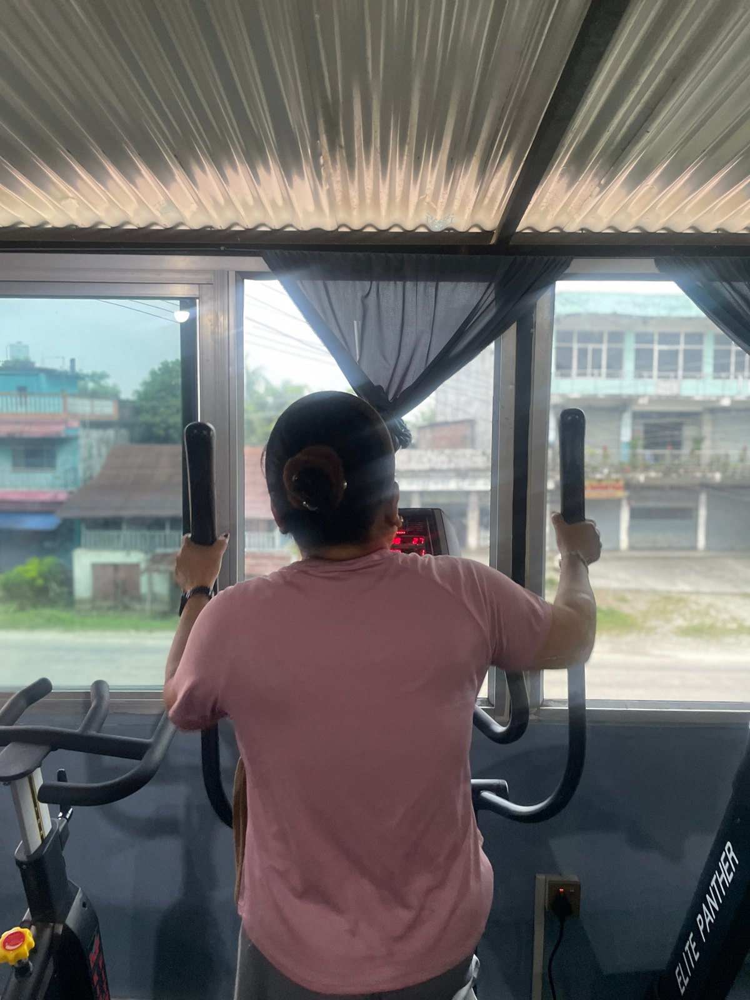

**For fat loss, the best plan uses both: weights to keep and build muscle, cardio to burn extra energy and keep your heart healthy, and a sensible diet to create the calorie deficit.** If you can only choose one, strength training is usually the better long-term choice, because it changes your body shape and protects muscle while you lose fat.

## What cardio does well

- **Burns energy during the session.** A 30 to 45 minute brisk walk, cycle or cross-trainer session adds up over a week.
- **Improves heart and lung fitness.** Stairs, hikes and daily life feel easier.
- **Easy to start** for beginners, with low injury risk when you start gently.

**Downsides:** your body becomes more efficient at the same cardio over time, and long cardio sessions can make some people very hungry.

## What weight training does well

- **Keeps muscle while you diet.** Without strength training, part of the weight you lose can be muscle, which leaves you looking "skinny-fat."
- **Changes your shape.** Building muscle in the right places makes you look firmer and leaner at the same weight.
- **Burns energy too,** both during the session and slightly afterwards during recovery.
- **Strengthens bones and joints,** especially important as we age.

**Downsides:** it takes some learning, and the scale may move more slowly at first because muscles hold more water.

*Cardio machines are a great way to add easy, low-impact activity. Photo: Apex Fitness Centre, Urlabari.*

## Head-to-head

| | Cardio | Weights |
|---|---|---|
| Calories burned during session | Higher | Moderate |
| Keeps muscle while dieting | Little | Strongly |
| Changes body shape | Some | A lot |
| Heart health | Excellent | Good |
| Beginner-friendly | Very | With guidance |
| Best for | Fitness, extra energy burn | Shape, strength, metabolism |

## The real secret: food and daily movement

Neither cardio nor weights can beat a poor diet. Fat loss happens when you eat a little less energy than you use, week after week. Start with our [weight loss diet plan with Nepali food](../weight-loss-diet-plan-nepali-food/).

Daily movement outside the gym, like walking, stairs and chores, also adds up to a lot. See [walking for weight loss](../walking-for-weight-loss-steps/).

## A simple weekly fat-loss plan

| Day | Training |
|---|---|
| Sun | Full-body weights, 45 min + 10 min easy cardio |
| Mon | 30–45 min brisk walk or cycle |
| Tue | Full-body weights, 45 min |
| Wed | Rest or light walk |
| Thu | Full-body weights, 45 min + 10 min intervals (bike or cross-trainer) |
| Fri | 45–60 min walk or hike |
| Sat | Rest |

For the weight sessions, follow our [beginner gym workout plan](../beginner-gym-workout-plan-first-3-months/).

## Should you do cardio before or after weights?

**After**, if fat loss and strength are both goals. You will lift better with fresh energy. A 5 to 10 minute warm-up on a bike or treadmill before lifting is still a good idea.

## What about HIIT?

High-intensity interval training (short hard bursts with rest) gives a lot of benefit in little time. It is tiring, so 1 to 2 sessions a week is enough for most people, alongside weights and walking.

## Frequently asked questions

### Can I lose weight with only weight training?

Yes, if your diet creates a calorie deficit. Adding some cardio or daily walking usually makes it easier.

### How much cardio should I do to lose fat?

Many people do well with 2 to 4 sessions of 20 to 45 minutes a week, plus daily walking. More is not always better if it makes you overly hungry or tired.

### Will lifting weights make me bulky while losing weight?

No. In a calorie deficit, it is very hard to gain much muscle size. Weights help you keep muscle and look firmer.

### Is the treadmill or cross-trainer better?

Both are good. Choose the one you enjoy and can do consistently. The cross-trainer is gentler on the knees.

## Sources

- [Effects of aerobic and/or resistance training on body mass and fat mass in overweight or obese adults](https://pubmed.ncbi.nlm.nih.gov/23019316/) (Willis et al., *Journal of Applied Physiology*, 2012)
- [WHO fact sheet: physical activity](https://www.who.int/news-room/fact-sheets/detail/physical-activity) (World Health Organization)

*Photo: cardio area at Apex Fitness Centre, Urlabari.*
