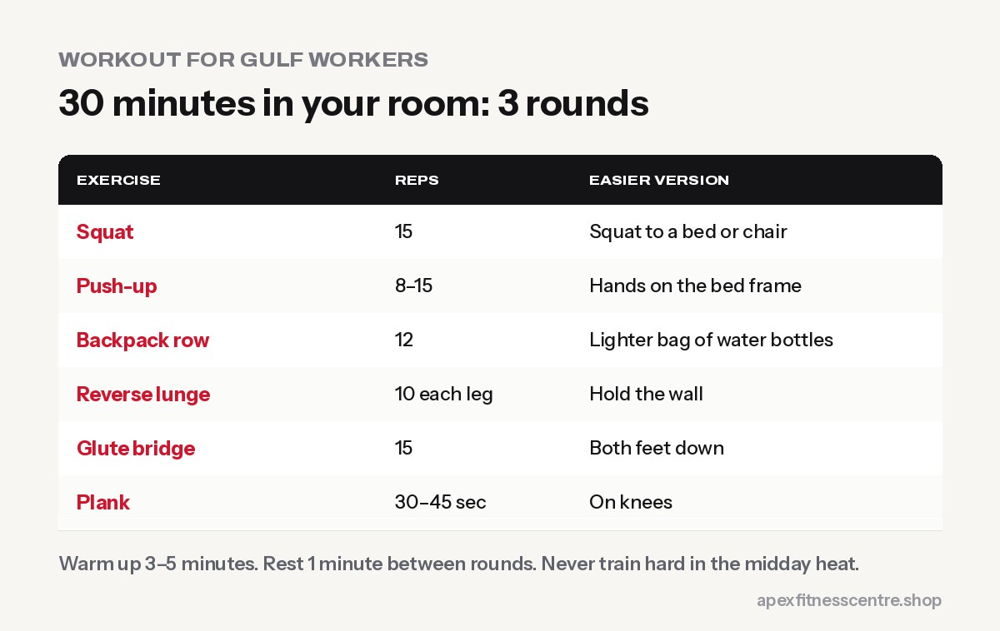
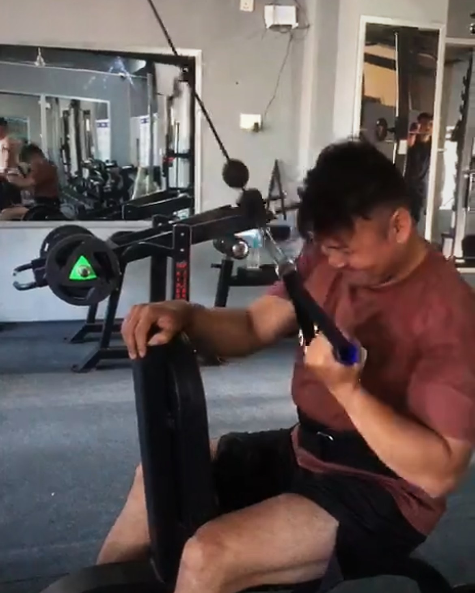

**If you work long shifts in the UAE, Qatar, Saudi Arabia, Kuwait or Bahrain, you can stay fit with just 25–30 minutes of training, 3 times a week, in your room or camp. Focus on short bodyweight strength workouts, drink water and electrolytes all day in the heat, eat enough protein from eggs, dal, chicken and yoghurt, and protect your sleep. Never train hard in the midday heat.**

Hundreds of thousands of Nepalis go abroad to work every year, with the UAE, Saudi Arabia and Qatar among the top destinations ([Himal Press](https://en.himalpress.com/839266-received-labor-permits-for-foreign-employment-in-2024-25/)). Many arrive fit and slowly lose strength and health to long hours, poor food and tiredness. This plan is built for real camp and shared-room life.

## The 3 rules for staying fit on long shifts

1. **Short beats nothing.** 25 minutes, 3 times a week, done for months, changes your body.
2. **Train at the right time.** Early morning before work, or in the evening when it's cooler, never in the midday heat.
3. **Recover first.** Sleep, water and protein matter more than an extra workout when you're doing physical work.

## The 30-minute room workout (no equipment)

Do this **3 days a week** on your lighter days. Each round takes about 8 minutes.

| Exercise | Reps | Easier | Harder |
|---|---|---|---|
| Squat | 15 | Squat to a bed or chair | Slow 3-second lowering |
| Push-up | 8–15 | Hands on the bed frame | Feet on the bed |
| Backpack row (bag with water bottles) | 12 | Lighter bag | Heavier bag |
| Reverse lunge | 10 each leg | Hold the wall | Hold the backpack |
| Glute bridge | 15 | Both feet down | One leg |
| Plank | 30–45 sec | On knees | Lift one foot |

**Warm up** for 3–5 minutes first: marching on the spot, arm circles and slow squats. **Rest** about 1 minute between rounds and do **3 rounds**.

If your camp or building has a small gym, use it. The same plan works with dumbbells. Our [home workout without equipment](../home-workout-without-equipment/) has more ideas.

## If your job is very physical

Construction, warehouse and cleaning work already uses a lot of energy. In that case:

- **Do 2 short strength sessions a week**, not 4–5.
- **Focus on your back, core and hips** to protect against injury: rows, glute bridges, planks and dead bugs.
- **Stretch for 10 minutes** after work: hamstrings, hips, chest and shoulders.
- **Rest properly** on your day off.

## Heat safety: the most important part

Gulf summers are dangerous. The UAE, for example, bans outdoor work under direct sun from **12:30 PM to 3 PM between 15 June and 15 September**, and employers must provide shade, cooling and drinking water ([Khaleej Times](https://www.khaleejtimes.com/uae/uae-midday-break-2025-june-15-to-september-15)). Other Gulf countries have similar summer rules.

- **Drink water regularly** through the shift, not just when you're thirsty.
- **Use electrolytes** (oral rehydration salts) on very hot days if you sweat a lot.
- **Never do extra exercise outdoors in the heat of the day.**
- **Know the warning signs:** dizziness, headache, confusion, nausea, very hot skin, or stopping sweating. Move to shade, cool down and get medical help fast. Heat stroke is an emergency.

Read our full guide to [exercising in hot weather](../exercising-in-hot-weather/) for more.

## Eating for strength in a camp or shared kitchen

| Cheap protein | Easy way to eat it |
|---|---|
| Eggs | Boiled or bhurji, 2–3 at a time |
| Dal and chana | Cook a big pot for 2–3 days |
| Chicken | Curry with rice, or grilled |
| Yoghurt (laban) and milk | With meals or as a snack |
| Tinned tuna or sardines | With rice, roti or bread |
| Peanuts | A handful as a snack |

- **Make the protein portion bigger** and the rice portion a little smaller.
- **Limit sugary drinks and energy drinks**, which add calories and can affect sleep.
- **Pack food for work** so you don't rely on shop snacks.

More ideas: [high-protein Nepali diet plan for muscle gain](../high-protein-nepali-diet-plan-for-muscle-gain/).

## Sleep in shared rooms

- **Use an eye mask and earplugs** if roommates work different shifts.
- **Keep your phone away** for the last 30 minutes before sleep.
- **Avoid tea, coffee and energy drinks** in the hours before bed.

## A sample week

| Day | Plan |
|---|---|
| Day 1 | 30-minute room workout |
| Day 2 | Rest or 20-minute easy walk in the cool evening |
| Day 3 | 30-minute room workout |
| Day 4 | Stretching 10 minutes |
| Day 5 | 30-minute room workout |
| Day off | Rest, a longer walk, cook food for the week |

## Frequently asked questions

### Can I build muscle without a gym in the Gulf?

Yes, especially as a beginner. Bodyweight exercises, a backpack with water bottles and enough protein can build real strength.

### Is it safe to work out after a 12-hour shift?

A short, moderate session is usually fine if you've eaten and drunk enough. If you're exhausted or dizzy, rest instead.

### Should I train before or after work?

Whichever you can do consistently. Many workers prefer the early morning before it's hot; others train in the cooler evening.

### What should I drink in the Gulf heat?

Mostly water through the day, plus oral rehydration salts or electrolytes on very hot days if you sweat heavily. Limit sugary and energy drinks.

## Sources

- [839,266 received labour permits for foreign employment in 2024/25](https://en.himalpress.com/839266-received-labor-permits-for-foreign-employment-in-2024-25/) (Himal Press)
- [UAE midday break for outdoor work](https://www.khaleejtimes.com/uae/uae-midday-break-2025-june-15-to-september-15) (Khaleej Times)
- [Heat exhaustion and heatstroke](https://www.nhs.uk/conditions/heat-exhaustion-heatstroke/) (NHS)

*General information, not medical advice. Follow your employer's heat-safety rules and seek medical help immediately for signs of heat illness.*
