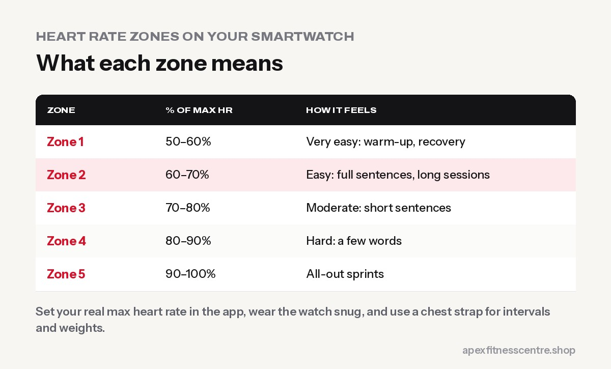

**Heart rate zones divide your effort into five levels, based on a percentage of your maximum heart rate. Zone 1–2 is easy, Zone 3 moderate, and Zones 4–5 hard. To use them well, set your maximum heart rate properly in your watch app (the default "220 minus age" can be off by 10+ beats), check readings with the talk test, and plan most of your cardio in Zone 2 with some harder sessions in Zones 4–5.**

Wearable technology is the **number one fitness trend of 2026** according to the American College of Sports Medicine ([ACSM](https://acsm.org/top-fitness-trends-2026)). Most people wear a watch that shows heart rate zones, but few use them correctly.

## The five heart rate zones

| Zone | % of max heart rate | How it feels | Good for |
|---|---|---|---|
| 1 | 50–60% | Very easy | Warm-up, recovery |
| 2 | 60–70% | Easy, can talk in full sentences | Aerobic base, fat use, long sessions |
| 3 | 70–80% | Moderate, short sentences | General fitness |
| 4 | 80–90% | Hard, a few words | Threshold, race fitness |
| 5 | 90–100% | All-out | Short sprints, intervals |

Different brands use slightly different formulas and zone boundaries, so your watch's "Zone 2" may not match another app exactly.

## Step 1: Set your maximum heart rate properly

Most watches estimate maximum heart rate from your age. Two common formulas:

- **220 − age** (the old default)
- **208 − (0.7 × age)** (the Tanaka formula, often more accurate for adults)

For a 40-year-old, 220 − age gives 180, while Tanaka gives 180 too; for a 60-year-old, they give 160 vs 166. Real maximum heart rate can still differ from either formula by 10 or more beats.

**Better options:**

- **Use your highest reading from a hard workout** (for example, the end of a hard uphill run) if you're healthy and used to hard exercise.
- **Let the watch learn**: many watches update your maximum or zones automatically from your workouts.
- **Use heart rate reserve** if your app offers it: it also uses your resting heart rate and is often more personal.

Taking medicines like beta-blockers? They lower your heart rate, so zones won't be accurate. Use effort and the talk test instead, and ask your doctor.

## Step 2: Check your watch is accurate

Wrist sensors use light to measure blood flow, which can be thrown off by movement, a loose strap, cold skin, tattoos and sweat. A study presented by the American College of Cardiology found that **wrist-worn monitors were less accurate than chest straps**, especially during more intense exercise ([ACC](https://www.acc.org/about-acc/press-releases/2017/03/08/14/02/wrist-worn-heart-rate-monitors-less-accurate-than-standard-chest-strap)).

**To improve accuracy:**

- Wear the watch **snug, a finger's width above the wrist bone**
- Tighten it a notch during workouts
- **Use a chest strap** for intervals, weights or rowing, where arm movement confuses wrist sensors
- Cross-check with the **talk test**: if your watch says Zone 2 but you can't speak, trust your breathing

## Step 3: Plan your week with zones

A simple, research-supported approach is to keep **most of your cardio easy and some of it hard**, often called 80/20 training.

| Goal | Weekly cardio plan |
|---|---|
| General health | 2–3 × 30–45 min Zone 2, plus daily walking |
| Fat loss (with strength training) | 2–3 × Zone 2 sessions, 1 interval session, high daily steps |
| Running a 5K or 10K | 3 × easy Zone 2 runs, 1 interval or tempo session (Zone 4) |
| Heart fitness for older adults | Zone 2 most days, with doctor approval for harder work |

More detail in our guides to [Zone 2 training](../zone-2-training/) and [Japanese interval walking](../japanese-walking-interval-walking/).

## Other watch numbers worth using

- **Resting heart rate:** a gradual fall over months usually means better fitness. A sudden rise can mean poor sleep, stress, illness or overtraining.
- **Heart rate recovery:** how fast your heart rate drops in the minute after hard effort. Faster recovery usually reflects better fitness.
- **Steps:** simple and useful. See [walking for weight loss](../walking-for-weight-loss-steps/).
- **Sleep:** watch estimates aren't perfect, but trends are helpful.

## Numbers to ignore (or take lightly)

- **"Calories burned":** watches often overestimate exercise calories. Don't "eat back" all of them.
- **"Fat-burning zone" promises:** Zone 2 uses a higher *percentage* of fat, but total fat loss mostly depends on your diet and total activity.
- **VO2 max estimates:** useful for trends, not exact numbers.

## When to see a doctor

Stop exercising and seek medical help if you have **chest pain, severe breathlessness, fainting or an irregular heartbeat**, or if your watch repeatedly warns of an irregular rhythm.

## Frequently asked questions

### What heart rate zone burns the most fat?

Zone 2 burns a higher percentage of fat, but harder zones burn more total calories per minute. For fat loss, total calories, diet and consistency matter most.

### Is my Apple Watch or Garmin heart rate accurate?

Usually reasonably accurate at steady efforts, but less reliable during intervals, weights and fast arm movements. A chest strap is more accurate.

### How do I find my real maximum heart rate?

The safest way is to let your watch learn from hard workouts or use a supervised exercise test. Formulas are only estimates.

### How long should I train in Zone 2?

Most people benefit from 2–3 sessions of 30–60 minutes a week.

### Why is my heart rate so high on easy runs?

Heat, dehydration, poor sleep, stress, caffeine or simply being new to running. Slow down, walk if needed, and your easy-pace heart rate will improve over weeks.

## Sources

- [ACSM top fitness trends for 2026](https://acsm.org/top-fitness-trends-2026) (American College of Sports Medicine)
- [Wrist-worn heart rate monitors less accurate than standard chest strap](https://www.acc.org/about-acc/press-releases/2017/03/08/14/02/wrist-worn-heart-rate-monitors-less-accurate-than-standard-chest-strap) (American College of Cardiology)
- [WHO fact sheet: physical activity](https://www.who.int/news-room/fact-sheets/detail/physical-activity) (World Health Organization)

*General information, not medical advice. Check with a doctor before hard exercise if you have a heart condition or take heart medicines.*
