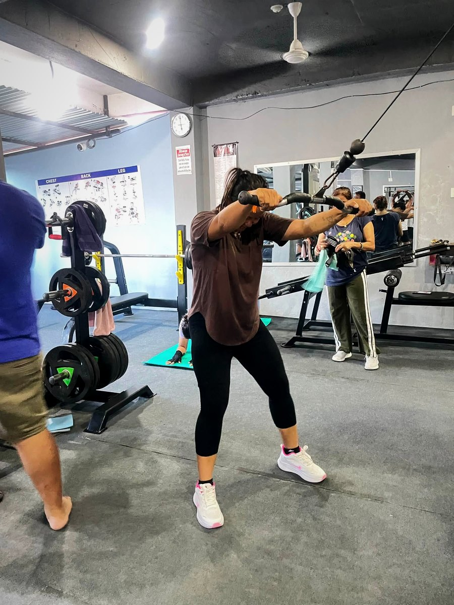
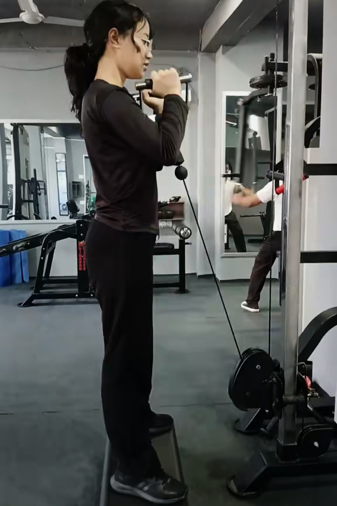
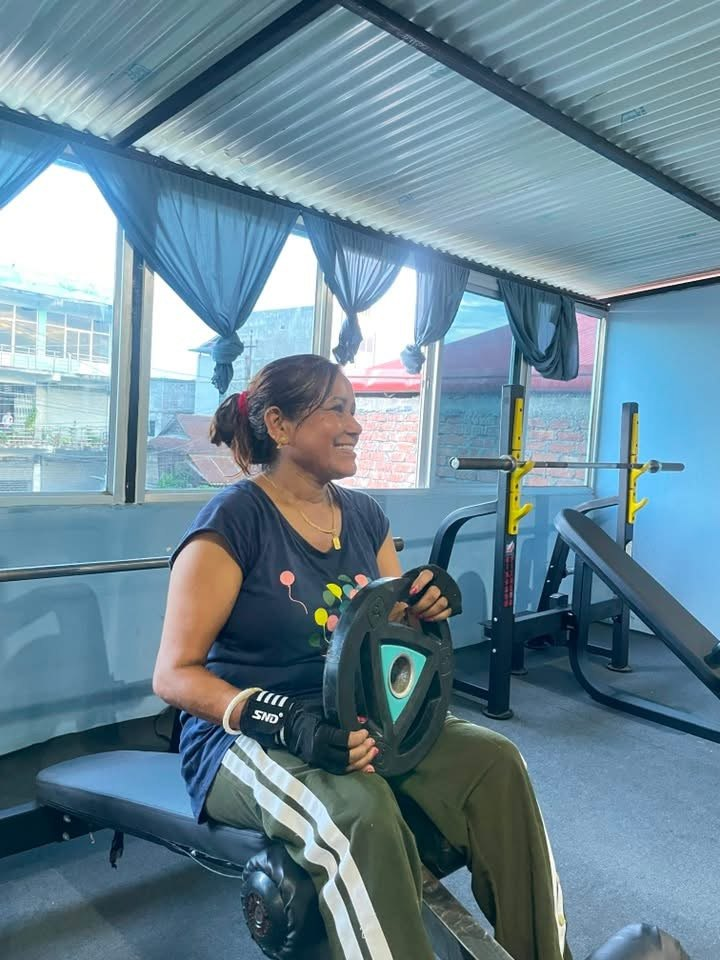

Strength training is one of the best things a woman can do for her body at **any age**: a firmer shape, stronger bones, better posture, more energy and easier weight control. Yet many women in Nepal still avoid the weights section because of myths they have heard for years. Here are the seven most common ones, and the facts.

## Myth 1: "Lifting weights will make me bulky"

**Fact:** Women have much lower testosterone than men and build muscle slowly. Lifting regularly gives most women a **toned, athletic shape**, not a bodybuilder's physique. The very muscular women you see in competitions train and diet specifically for that for many years.

## Myth 2: "Cardio is for women, weights are for men"

**Fact:** Both are for everyone. Cardio is good for your heart; strength training is what changes your **shape** and protects **muscle and bone**. The best results come from combining them. See [cardio vs weights for fat loss](../cardio-vs-weights-for-fat-loss/).

## Myth 3: "I should only use light pink dumbbells for high reps"

**Fact:** To get stronger and see change, the weight must **challenge you**. That might be 2 kg for a shoulder raise but 20 kg or more for a leg press. Choose a weight where the last 2 reps of a set feel hard but your form stays good.

## Myth 4: "I'm too old to start"

**Fact:** Strength training is valuable at 40, 50, 60 and beyond. After menopause, women lose bone density faster, and resistance training is one of the best ways to slow that. Many women start in their 40s or later and become stronger than they were at 25.

*It is never too late to start lifting. A member training with plates at Apex Fitness Centre, Urlabari.*

## Myth 5: "I can't exercise during my period"

**Fact:** If you feel well, exercise is safe during your period, and many women find light to moderate exercise **eases cramps and improves mood**. On difficult days, train lighter, do more walking or stretching, or rest. Listen to your body.

## Myth 6: "Weights will turn fat into muscle"

**Fact:** Fat and muscle are different tissues; one cannot turn into the other. Strength training **builds muscle**, and a sensible diet **reduces fat**. Together they change how you look.

## Myth 7: "Toning exercises target problem areas"

**Fact:** You cannot burn fat from one spot (like the belly or arms) by exercising that area. Fat comes off the whole body. Strength training plus a calorie deficit is what reveals tone. Read [how to lose belly fat](../how-to-lose-belly-fat/).

## Benefits of strength training for women

- **Stronger bones**, lowering the risk of osteoporosis later in life
- **Better posture** and less back pain
- **Firmer shape** at the same body weight
- **Easier everyday life**: carrying shopping, children, water
- **Better mood and confidence**
- **Supports healthy weight** by keeping muscle while losing fat

## A simple start: 3 days a week

| Exercise | Sets x reps |
|---|---|
| Goblet squat or leg press | 3 x 10 |
| Hip thrust or glute bridge | 3 x 12 |
| Lat pulldown | 3 x 10 |
| Dumbbell chest press | 3 x 10 |
| Seated row | 3 x 10 |
| Plank | 3 x 20–30 seconds |

New to the gym? Read our [gym guide for women: your first visit](../gym-guide-for-women-first-visit/).

## Frequently asked questions

### How long until women see results from lifting?

Most women feel stronger within 2 to 4 weeks. Visible changes in shape usually take 8 to 12 weeks of consistent training and eating.

### Is strength training safe during pregnancy?

Many women continue some exercise during pregnancy, but the right type and intensity depends on your health. Always follow your doctor's advice.

### Should women eat more protein when lifting?

Most women benefit from more protein than they usually eat. Aim for a protein food at every meal.

### Can strength training help with PCOS?

Regular exercise, including strength training, is often recommended as part of managing PCOS. Work with your doctor on a plan that suits you.

## Sources

- [WHO fact sheet: physical activity](https://www.who.int/news-room/fact-sheets/detail/physical-activity) (World Health Organization)
- [ACSM position stand: progression models in resistance training for healthy adults](https://pubmed.ncbi.nlm.nih.gov/19204579/) (American College of Sports Medicine, 2009)
- [International Society of Sports Nutrition position stand: protein and exercise](https://pubmed.ncbi.nlm.nih.gov/28642676/) (Jäger et al., 2017)

*General information, not medical advice.*
