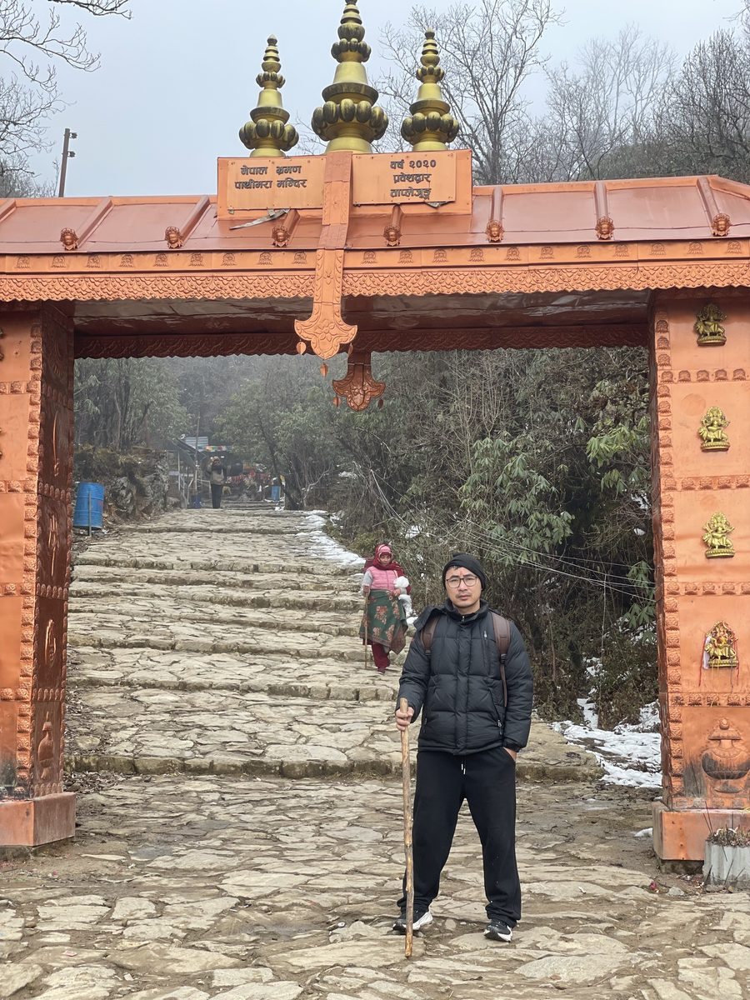
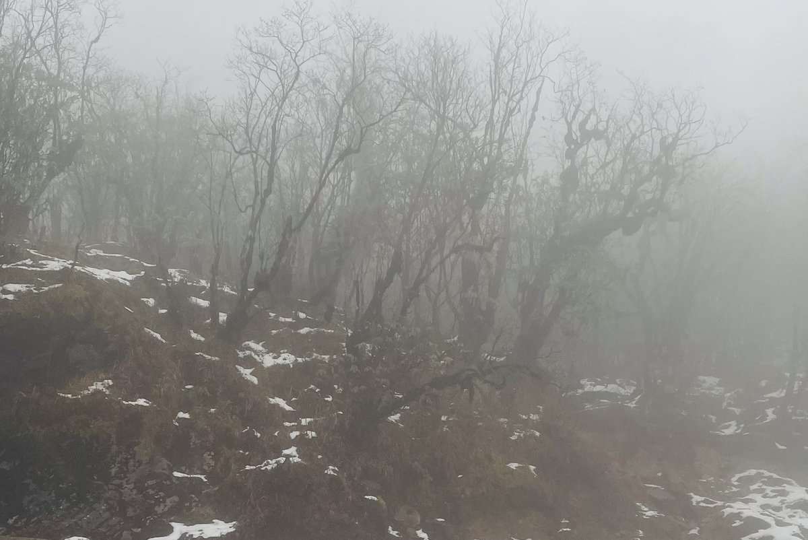

Pathibhara Devi temple sits at **3,794 m** above Taplejung in eastern Nepal, and many families walk up together, from young children to grandparents. **The walk is short compared with a long Himalayan trek, but it is steep, cold and high. With children and older parents, the keys are a slow pace, many breaks, warm layers and turning back if anyone feels unwell.**

I made this walk in winter with my mother and my young son. This guide shares what we saw on the way and what any family should plan for.

*At the gate on the stone-paved trail to Pathibhara. We all walked with wooden sticks.*

## The walk in numbers

According to Nepal's Film Development Board destination guide ([film.gov.np](https://film.gov.np/destination/46)):

| Fact | Detail |
|---|---|
| Temple height | 3,794 m |
| Road ends at | Kafle Pati (Kaflepati), about 9.5 km by road from Suketar |
| Walk to the temple | About 5 km and about 5 hours: roughly 2 hours to Thulo Phedi, then about 3 hours uphill |
| Best time to visit | Mid-February to mid-November |
| Winter | Cold all year; heavy snow falls on nearby hills from mid-December to mid-February |

Road and trail conditions change, so check the latest with locals or your hotel in Taplejung before you set off.

## What we found on a winter walk

Our trip was in winter. The trail was misty, with **snow on the ground near the top** and patches of snow in the forest. We all wore warm hats, gloves and padded jackets and walked with wooden sticks, and we stopped to rest on the benches along the way.

*Mist and snow near the top in winter.*

If you go between mid-December and mid-February, expect snow and plan for it. If you want an easier walk with children or older parents, the months outside winter are usually kinder.

## Pace: the most important rule

Families get into trouble when the fastest walker sets the pace. Instead:

1. **Let the slowest person lead.** Everyone else walks behind.
2. **Stop every 20 to 30 minutes** for water and a snack, even if no one asks.
3. **Use the "talk test":** if anyone is too breathless to speak a short sentence, slow down.
4. **Start early** so you are not rushing to get down before dark.

## Altitude: why 3,794 m matters

The temple is high enough for altitude sickness. Symptoms can start above about 2,500 m, and being fit does not protect you ([TravelHealthPro](https://travelhealthpro.org.uk/factsheets/altitude-illness)). Children may not explain how they feel, so watch them closely.

Turn back and go down if anyone has:

- A headache that gets worse, nausea or vomiting
- Unusual tiredness, dizziness or confusion
- Breathlessness while resting, or stumbling

Read our full guide to [altitude sickness on Nepal treks](../altitude-sickness-nepal-trek/) before you go.

## Walking with children

- **Make it a game:** count steps, spot prayer flags, pick the next resting point.
- **Dress in layers** they can take off and put back on. Children get cold quickly when they stop.
- **Keep snacks easy:** biscuits, fruit, boiled eggs, nuts for older children.
- **Hold hands on wet or icy steps,** especially on the way down.
- **Let them use a walking stick.** Even a simple wooden one helps with balance.

## Walking with older parents

- **Talk to their doctor first,** especially about heart, lung, blood pressure or knee problems, because of the height and the steep steps.
- **Go slowly on the way down.** Descents are hardest on knees. Two walking sticks are better than one.
- **Carry their bag** so they walk with nothing but water and a stick.
- **Plan the day around them,** not around a target time.
- **Have a plan B:** decide before you start where you will turn back if they are tired.

## Getting fit for the walk

A few weeks of preparation makes the day much more enjoyable for everyone:

- **Walk every day** for 30 to 60 minutes, building up to 2 to 3 hours at the weekend.
- **Climb stairs** to train the legs for the steep section. Our [stair climbing workout](../stair-climbing-workout/) has a 4-week plan.
- **Older parents:** gentle step-ups and sit-to-stands from a chair, a few times a day, build the leg strength they need.

Training for a longer trek after this? See our [trek training plan for flat countries](../train-for-nepal-trek-without-hills/).

## What to pack

- Warm layers: thermal top, fleece, down jacket, hat and gloves for everyone
- Waterproof jacket
- Shoes with good grip for wet stone steps
- Walking sticks
- Water and warm drinks in a flask
- Snacks for every stop
- Torch or headlamp
- Basic first aid and any regular medicines

## Food for the day: our biggest lesson

**We carried too little food.** It is easy to think a short walk does not need much, but the climb is steep and cold, and everyone burns more energy than usual. On top of that, appetite can drop on the way up, so people do not want a full meal even when they need the energy. Next time we will carry much more, and mostly quick-energy food that is easy to eat in a few bites.

**Quick-energy foods worth packing:**

| Food | Why it works on the walk |
|---|---|
| Glucose biscuits and crackers | Light, cheap, easy to eat when you are not hungry |
| Chocolate and energy bars | Fast energy in a small packet |
| Dried fruit, dates and raisins | Natural sugar, easy for children and elders |
| Bananas | Quick energy and soft to chew |
| Nuts and peanuts | Slower energy for the long climb; about 164 kcal in a handful ([peanut calories](../../food/peanuts-calories/)) |
| Glucose powder or an electrolyte drink | Easy to sip when no one wants to eat |
| Sweet tea in a flask | Warmth and energy together |

Eat a proper breakfast before you start, and offer everyone a few bites at every stop, even if they say they are not hungry. Children and older parents especially may not notice they are running low until they are very tired. For ideas, see [what to eat on a Nepal trek](../what-to-eat-on-nepal-trek/), and use the [trekking calorie calculator](../../calculators/trekking-calorie-calculator/) if you want a number.

## Frequently asked questions

### How high is Pathibhara temple?
About 3,794 m, according to Nepal's Film Development Board destination guide.

### How long does the walk to Pathibhara take?
About 5 hours for roughly 5 km from the road head at Kafle Pati, according to the same guide. With children or older parents, plan for longer.

### Can children walk to Pathibhara?
Many families walk up with children. Go slowly, keep them warm, watch for signs of altitude sickness, and turn back if they feel unwell.

### Is Pathibhara safe for elderly people?
It can be, with a slow pace and good preparation, but the height and steep steps are demanding. Older people should check with their doctor first, especially with heart, lung or knee problems.

### What food should I carry to Pathibhara?
More than you think. Carry quick-energy foods that are easy to eat in a few bites, such as glucose biscuits, chocolate, dried fruit, bananas, nuts and an electrolyte drink, because appetite can drop on the steep, cold climb.

### When is the best time to visit Pathibhara?
Mid-February to mid-November, according to the Film Development Board. Winter brings snow and much colder weather.

## Sources

- [Pathibhara Temple destination guide](https://film.gov.np/destination/46) (Film Development Board, Nepal)
- [Altitude illness factsheet](https://travelhealthpro.org.uk/factsheets/altitude-illness) (TravelHealthPro, UK National Travel Health Network and Centre)

*General information, not medical advice. If anyone in your group has a heart, lung, blood pressure or joint condition, or is pregnant, speak to a doctor before walking to high altitude.*
