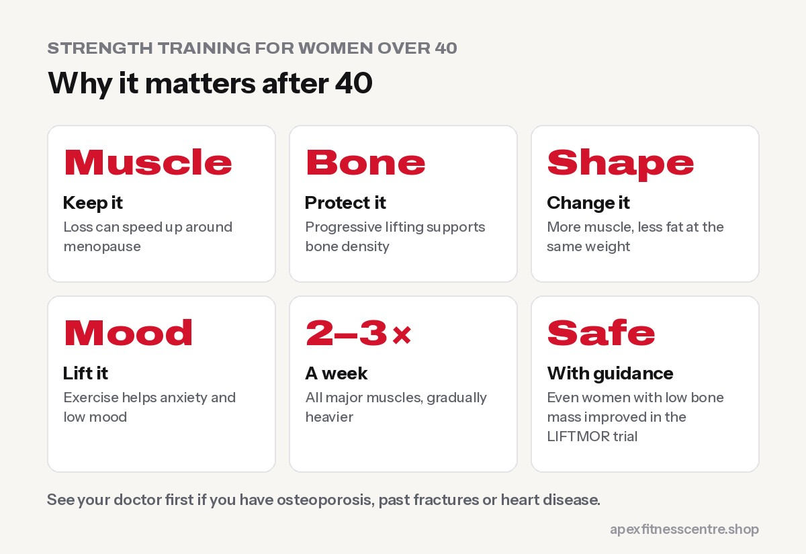
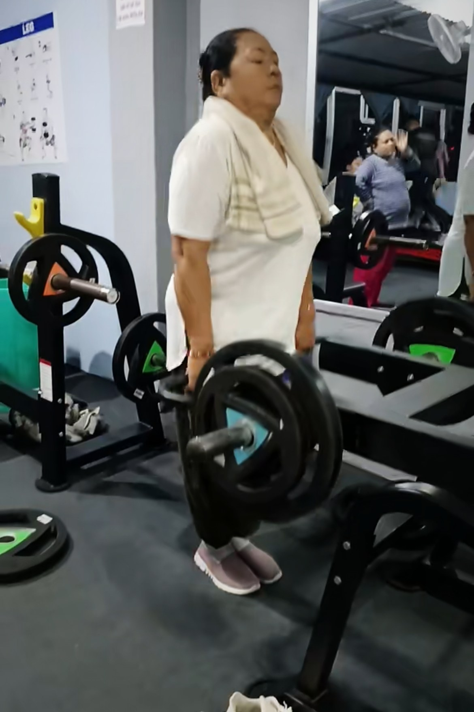
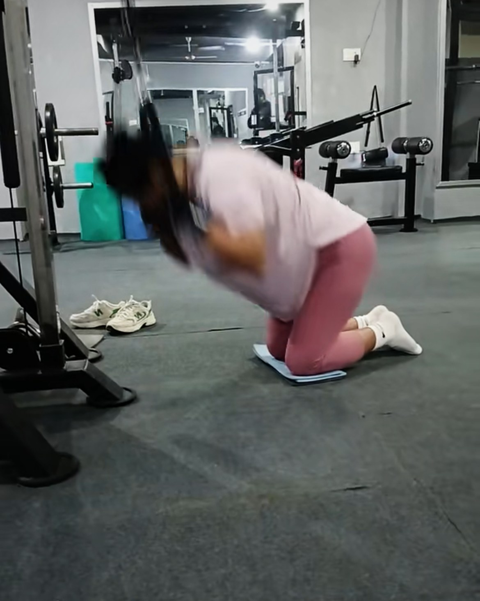

**For women over 40, strength training is one of the most powerful things you can do for your health. During perimenopause and menopause, falling oestrogen speeds up the loss of muscle and bone. Lifting weights 2–3 times a week, building up to challenging loads, helps protect muscle, strength and bone density, supports a healthy weight and mood, and keeps you strong and independent for decades.**

Many women in their 40s and 50s were told to stick to walking or light aerobics. The research now says something different: women in midlife benefit enormously from **real strength training**, and it's safe when you build up sensibly.

## What changes after 40

- **Muscle:** everyone slowly loses muscle with age if they don't train it, and the loss can speed up around menopause.
- **Bone:** bone density falls faster in the years around menopause, raising the risk of osteoporosis and fractures later.
- **Body shape:** many women notice more fat around the middle, even without big changes in weight.
- **Energy, sleep and mood** can be affected by hormonal changes.

Strength training doesn't stop the clock, but it changes how these years feel and how you age.

## What the research says about heavy lifting and bones

For years, women with low bone density were told to avoid heavy weights. The **LIFTMOR trial** tested this. In 101 postmenopausal women with low bone mass (average age 65), 8 months of **supervised, high-intensity resistance and impact training** twice a week, 30 minutes a session, improved spine and hip bone density and physical function, compared with a low-intensity home programme. Only one minor adverse event, a back spasm, was reported ([Watson et al., *Journal of Bone and Mineral Research*](https://pubmed.ncbi.nlm.nih.gov/28975661/)).

The key word is **supervised**: the women built up gradually under expert guidance. But it shows that women can and should train with challenging weights, not just light ones.

## Benefits of strength training for women over 40

1. **Stronger muscles** for daily life: carrying shopping, lifting grandchildren, gardening, stairs
2. **Better bone health**, especially with progressive loading and some impact
3. **Healthier body composition:** less fat, more muscle, even at the same weight
4. **Better blood sugar control**
5. **Improved balance**, reducing fall risk later in life
6. **Mood and confidence:** exercise helps reduce symptoms of anxiety and depression ([WHO](https://www.who.int/news-room/fact-sheets/detail/physical-activity))

## A 3-day beginner plan

Do these on 3 non-consecutive days (for example Sunday, Tuesday, Thursday). Start light, focus on form, and add weight gradually.

| Day | Exercises |
|---|---|
| **Day A** | Goblet squat 3 × 10 · Dumbbell bench press 3 × 10 · Seated cable row 3 × 12 · Glute bridge 3 × 12 · Plank 3 × 20–30 sec |
| **Day B** | Romanian deadlift with dumbbells 3 × 10 · Lat pulldown 3 × 10 · Step-ups 2 × 10 each leg · Seated shoulder press 2 × 10 · Dead bug 3 × 8 each side |
| **Day C** | Leg press 3 × 10 · Incline dumbbell press 3 × 10 · One-arm dumbbell row 3 × 10 each side · Farmer's carry 4 × 30 m · Calf raises 3 × 15 |

**How heavy?** By week 4–6, the last 2 reps of each set should feel challenging but still controlled. Increase the weight when all sets feel comfortable. See [strength training myths for women](../strength-training-for-women-myths/) if you're worried about getting bulky. You won't.

**Add some impact** if your joints allow: small jumps, skipping or hopping can help bone health. Start very gently.

## Don't forget these

- **Protein:** many women eat too little. Aim for protein at every meal. See [how much protein you need](../how-much-protein-do-you-need/).
- **Calcium and vitamin D:** from dairy, leafy greens and sunlight; ask your doctor about testing.
- **Walking and balance work** on other days.
- **Sleep:** 7–9 hours helps recovery and appetite. Hot flushes can disturb sleep; a cool room and regular schedule help.

## Training through perimenopause symptoms

- **Low energy days:** keep the session, but lower the weight and sets.
- **Joint aches:** warm up longer and choose machines or supported exercises.
- **Hot flushes:** train in a cool space, wear layers, and keep water nearby.
- **Pelvic floor issues:** if you leak with jumping or heavy lifts, see a women's health physiotherapist; this is common and treatable.

## Safety first

See your doctor before starting if you have **osteoporosis, previous fractures, heart disease, uncontrolled blood pressure** or recent surgery. If you have osteoporosis, work with a qualified trainer or physiotherapist and build up slowly, as the women in LIFTMOR did.

## Frequently asked questions

### Is it too late to start strength training at 45 or 50?

No. Women gain strength and muscle at any age. Many see big improvements within the first 2–3 months.

### Will lifting weights make me bulky?

No. Women have much lower testosterone than men, so lifting builds strength and a firmer shape, not bulk.

### How often should women over 40 lift weights?

Two to three times a week, working all major muscle groups, plus walking on other days.

### Is heavy lifting safe after menopause?

Research such as LIFTMOR shows heavy, supervised training can be safe and beneficial, even for women with low bone mass. Build up gradually with good form and guidance.

### Can strength training help menopause belly fat?

It helps by building muscle and supporting a healthier body composition, but diet and overall activity also matter. Spot reduction doesn't work.

## Sources

- [High-intensity resistance and impact training improves bone mineral density in postmenopausal women with low bone mass: the LIFTMOR trial](https://pubmed.ncbi.nlm.nih.gov/28975661/) (Watson et al., *Journal of Bone and Mineral Research*, 2018)
- [WHO fact sheet: physical activity](https://www.who.int/news-room/fact-sheets/detail/physical-activity) (World Health Organization)
- [ACSM position stand: progression models in resistance training for healthy adults](https://pubmed.ncbi.nlm.nih.gov/19204579/) (American College of Sports Medicine, 2009)

*General information, not medical advice. Talk to your doctor before starting if you have osteoporosis or other medical conditions. At Apex Fitness Centre, our trainers help women of every age start strength training safely.*
