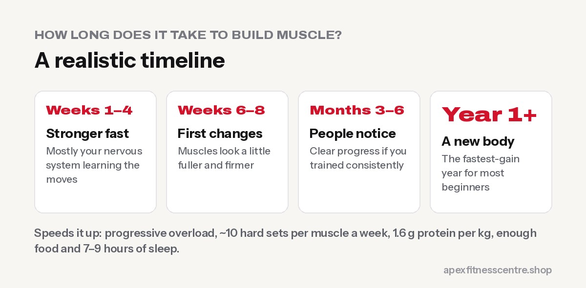
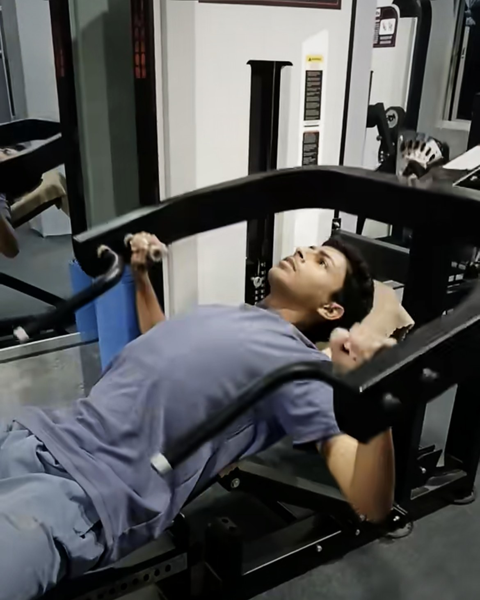
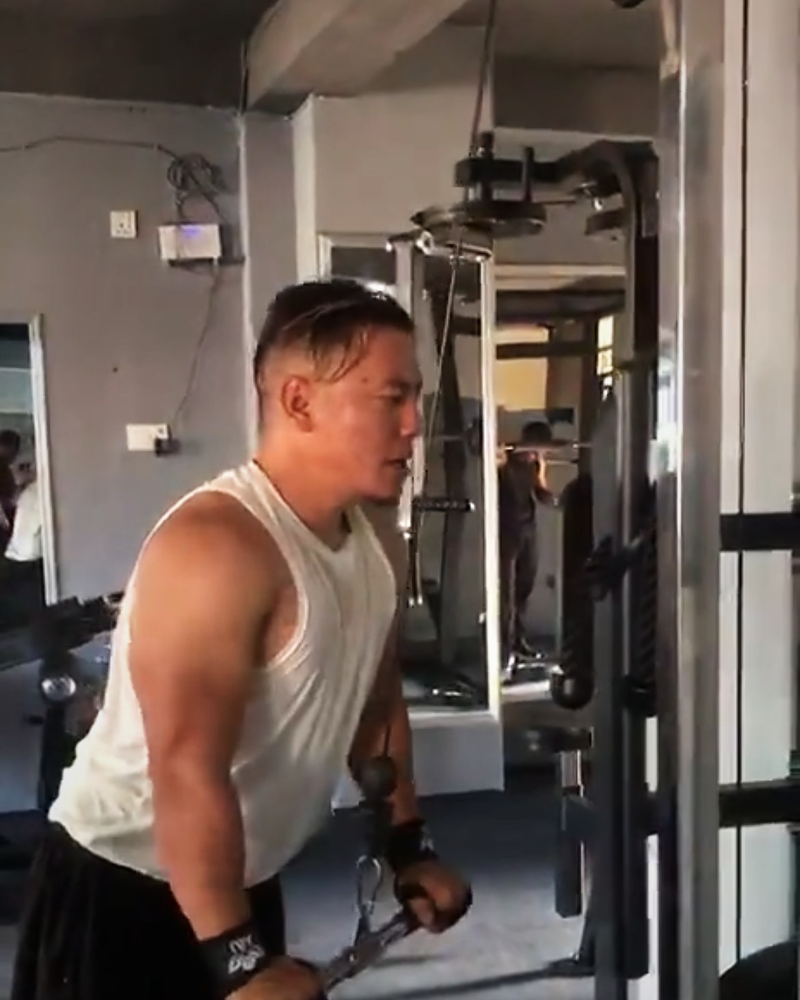

**Most beginners feel stronger within 2–4 weeks of starting the gym, notice small changes in the mirror after about 6–8 weeks, and see clearly visible muscle after 3–6 months of consistent training. Building a noticeably more muscular body usually takes a year or more. The speed depends on your training, protein, calories, sleep, age, genetics and, most of all, consistency.**

"How long until I see results?" is the most common question new gym members ask. Social media makes it look fast. Real progress is slower, but it's very real if you stick with it.

## The realistic muscle-building timeline

### Weeks 1–4: strength goes up fast

Your weights increase quickly, but most of that early strength comes from your **nervous system learning the movements**: better coordination and more muscle fibres working together. You may feel "pumped" and a bit sore, but actual new muscle is small.

### Weeks 6–8: first visible changes

Muscles start to look a little fuller and firmer, especially if you were completely new to training. Clothes may fit slightly differently. Studies on new lifters commonly measure real muscle growth over training periods of around 8–12 weeks.

### Months 3–6: clear progress

If you've trained 3–4 times a week, increased your weights steadily and eaten enough protein, friends and family start to notice. Your shoulders, arms, chest and legs look more defined.

### Months 6–12: a different body

Consistent lifters often look noticeably more athletic by the end of the first year. This is often called the "beginner gains" period, when progress is fastest.

### Year 2 and beyond: slower, steady gains

Progress slows as you get more experienced. Gains still come, but they take more patience, better programming and attention to food and sleep.

## What speeds up muscle growth

### 1. Progressive overload

Your muscles grow when they're challenged a little more over time: more weight, more reps or more sets. Keep a training log. See [how many sets and reps to build muscle](../how-many-sets-and-reps-to-build-muscle/).

### 2. Enough weekly volume

Research suggests that more weekly sets per muscle tend to build more muscle, up to a point ([Schoenfeld et al.](https://pubmed.ncbi.nlm.nih.gov/27433992/)). For beginners, around **10 hard sets per muscle per week** is a great target.

### 3. Protein every day

About **1.6 g of protein per kg of body weight** a day covers most people's muscle-building needs ([Morton et al.](https://bjsm.bmj.com/content/52/6/376)). See [how much protein do you need](../how-much-protein-do-you-need/).

### 4. Enough calories

It's hard to build much muscle while eating very little. If you're skinny, eat a little above maintenance. If you have fat to lose, a small deficit with high protein can still build muscle as a beginner: see [body recomposition](../body-recomposition-lose-fat-build-muscle/).

### 5. Sleep 7–9 hours

Muscles repair and adapt while you recover. Short sleep slows progress and makes training feel harder.

### 6. Consistency for months

Three good sessions a week for a year beats six perfect weeks followed by a break.

## What slows it down

- **Changing programmes every week**
- **Not tracking weights**, so you never really progress
- **Too little protein or food**
- **Too much hard cardio** if your main goal is size
- **Poor sleep and high stress**
- **Skipping legs and big compound lifts**

## How to track muscle growth properly

| Measure | How often |
|---|---|
| Strength in key lifts (squat, bench press, rows) | Every session (training log) |
| Photos (front, side, back, same light) | Every 4 weeks |
| Arm, chest, waist and thigh measurements | Every 4 weeks |
| Body weight (weekly average) | 3–7 mornings a week |

If your lifts and measurements are going up while your waist stays similar, you're building muscle.

## Does age matter?

Younger lifters often build muscle a bit faster, but people in their 40s, 50s and beyond still gain strength and muscle with training. See [strength training after 50](../strength-training-after-50/) and [strength training for women over 40](../strength-training-women-over-40/).

## Does creatine help?

Creatine monohydrate, 3–5 g a day, can help you train a little harder and gain slightly more strength and muscle over time ([ISSN position stand](https://pmc.ncbi.nlm.nih.gov/articles/PMC5469049/)). It's optional, and food, training and sleep matter more.

## Frequently asked questions

### Can you build muscle in 30 days?

You can start building muscle and gain noticeable strength, but visible changes usually take longer than a month.

### How much muscle can a beginner gain in a year?

It varies a lot by person, sex, age, genetics and effort. The first year is usually the fastest, and many beginners look noticeably more muscular by the end of it.

### Why am I getting stronger but not bigger?

Early strength gains come mostly from your nervous system. Keep training, eat enough protein and calories, and size usually follows.

### How many days a week should I train to build muscle?

Three to four days a week, training each muscle about twice a week, works very well for most people.

### Do I need to lift heavy to build muscle?

You need to train close to failure, with good form. Both heavier weights for fewer reps and lighter weights for more reps can build muscle if the sets are hard.

## Sources

- [Dose-response relationship between weekly resistance training volume and muscle growth](https://pubmed.ncbi.nlm.nih.gov/27433992/) (Schoenfeld et al., *Journal of Sports Sciences*, 2017)
- [Protein supplementation and resistance training: systematic review and meta-analysis](https://bjsm.bmj.com/content/52/6/376) (Morton et al., *British Journal of Sports Medicine*, 2018)
- [ISSN position stand: safety and efficacy of creatine supplementation](https://pmc.ncbi.nlm.nih.gov/articles/PMC5469049/) (Kreider et al., 2017)

*General information. Results vary from person to person. At Apex Fitness Centre, Urlabari, our trainers can set up a muscle-building plan that fits you.*
