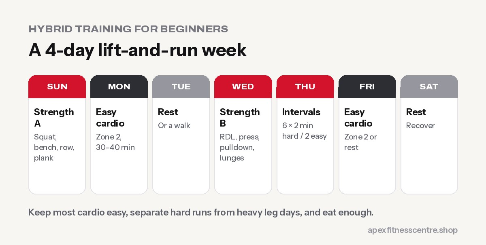

**Hybrid training means training for strength and endurance in the same programme, for example lifting weights 2–3 times a week and running or doing cardio 2–3 times a week. Done well, you get stronger and fitter at the same time. To avoid one cancelling out the other, keep most cardio easy, separate hard runs from heavy leg days, eat enough and progress gradually.**

Hybrid training is one of the fastest-rising fitness searches. In the UK, searches for "hybrid training" rose by **68% in a quarter** and "Hyrox training" by 37% ([Crave Magazine, from Google Trends](https://cravemag.co.uk/?p=618775)). People no longer want to choose between looking strong and being fit.

## Does running kill your gains?

This worry is called the **interference effect**. A large meta-analysis of concurrent training found that combining endurance and strength training can reduce gains in muscle size, strength and power compared with strength training alone, with the effects depending on the **type, frequency and duration** of the cardio ([Wilson et al., *Journal of Strength and Conditioning Research*](https://pubmed.ncbi.nlm.nih.gov/22002517/)). Running showed more interference than cycling in that analysis.

In real life, for most beginners and recreational lifters:

- **The interference is small** if cardio is moderate and you eat enough
- **Easy cardio interferes much less** than lots of hard running
- **Being fitter helps you recover** between sets and sessions

So yes, you can be strong and fit. You just need a smart plan.

## 6 rules for successful hybrid training

1. **Keep most cardio easy (Zone 2).** You should be able to talk. See [Zone 2 training](../zone-2-training/).
2. **Limit hard cardio** to 1 session a week at first.
3. **Separate hard runs and heavy leg days** by at least a day, or do them 6+ hours apart.
4. **Lift first** if you do both on the same day and strength is your priority.
5. **Eat enough:** hybrid training burns a lot of energy. Don't diet hard at the same time.
6. **Increase running gradually:** add no more than about 10% to your weekly running time or distance.

## A 4-day beginner hybrid plan

| Day | Session |
|---|---|
| **Sunday** | Strength A: squat or leg press, bench press, row, plank (45 min) |
| **Monday** | Easy run or bike, Zone 2 (30–40 min) |
| **Tuesday** | Rest or walk |
| **Wednesday** | Strength B: Romanian deadlift, overhead press, lat pulldown, lunges (45 min) |
| **Thursday** | Intervals: 6 × 2 min hard, 2 min easy (run, row or bike) |
| **Friday** | Easy Zone 2 cardio (30–45 min) or rest |
| **Saturday** | Rest |

After 6–8 weeks, add a third strength day or a longer easy run.

## Hybrid training goals

- **General fitness and health:** the plan above is ideal
- **Hyrox or fitness races:** add sled, carry and wall-ball practice. See [HYROX training for beginners](../hyrox-training-for-beginners/)
- **Your first 5K:** keep 2 strength days and build your easy running
- **Fat loss:** combine the plan with a moderate calorie deficit and high protein

## Fuel and recovery

- **Protein:** about 1.6 g per kg of body weight a day ([Morton et al.](https://bjsm.bmj.com/content/52/6/376))
- **Carbohydrates** around harder sessions: rice, oats, fruit, roti
- **Sleep 7–9 hours**
- **One full rest day** a week, minimum

## Signs you're overdoing it

- Lifts going down for 2+ weeks
- Resting heart rate rising
- Constant soreness, poor sleep or low mood
- Niggles in knees, shins or Achilles

If you notice these, take an easier week with less running and lighter weights.

## Frequently asked questions

### What is hybrid training?

Training for both strength and endurance in one programme, usually combining weight training with running, cycling, rowing or functional fitness.

### Can you build muscle while running?

Yes. Most recreational athletes can build muscle while running moderately, especially if most runs are easy and they eat enough protein and calories.

### Should I lift or run first?

Do first whatever matters most to you that day. If strength is your priority, lift first. If you're training for a race, run first.

### How many days a week should I do hybrid training?

Four to five days is a good start: two strength days, two cardio days and possibly one combined session, with rest days in between.

### Is hybrid training good for beginners?

Yes, if you start with easy cardio, basic strength exercises and gradual progress.

## Sources

- [Concurrent training: a meta-analysis examining interference of aerobic and resistance exercises](https://pubmed.ncbi.nlm.nih.gov/22002517/) (Wilson et al., *Journal of Strength and Conditioning Research*, 2012)
- [The workouts Brits are actually searching for](https://cravemag.co.uk/?p=618775) (Crave Magazine, Google Trends data)
- [Protein supplementation and resistance training: systematic review and meta-analysis](https://bjsm.bmj.com/content/52/6/376) (Morton et al., 2018)

*General information. Build up running gradually and see a doctor if you have heart, joint or other health concerns.*
