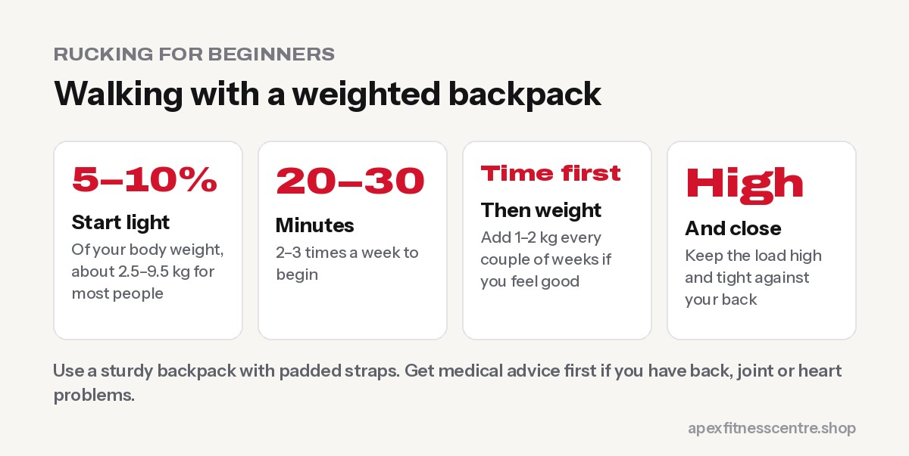

**Rucking means walking with a weighted backpack. It turns an ordinary walk into a tougher, low-impact workout that builds leg, back and core strength and burns more energy than walking alone. Beginners should start light, around 5–10% of body weight, for 20–30 minutes, two or three times a week, then add time before adding weight.**

In Nepal, rucking isn't new: porters, farmers and trekkers have carried loads up hills for generations. Around the world, it has become a popular fitness trend for people who want a challenging workout without running.

## Why rucking works

- **More effort than walking:** carrying weight raises your heart rate and energy use
- **Low impact:** easier on the joints than running for many people
- **Builds real-world strength:** legs, glutes, upper back and core all work to carry the load
- **Great for trekkers:** perfect training for Poon Hill, Annapurna or Everest Base Camp
- **Simple and cheap:** all you need is a backpack and something heavy

## How much weight should a beginner carry?

There's no single official rule, but a conservative start is sensible:

| Your body weight | Starting load (about 5–10%) |
|---|---|
| 50 kg | 2.5–5 kg |
| 65 kg | 3–6.5 kg |
| 80 kg | 4–8 kg |
| 95 kg | 5–9.5 kg |

**Progress slowly.** Increase your walking time first, then add 1–2 kg every couple of weeks if you feel good. Many people never need to go above 15–20% of body weight for fitness.

## The right backpack and load

- **Use a sturdy backpack** with padded, wide shoulder straps and ideally a chest or waist strap.
- **Keep the weight high and close to your back.** A loose, low load pulls on your shoulders and lower back.
- **Good loads:** water bottles (easy to adjust and pour out if needed), sandbags, wrapped weight plates, or bags of rice.
- **Pad hard objects** with a towel so nothing digs into your spine.

## An 8-week beginner rucking plan

| Weeks | Sessions | Time | Load |
|---|---|---|---|
| 1–2 | 2 a week | 20–30 min | ~5% of body weight |
| 3–4 | 2–3 a week | 30–40 min | ~5–7% |
| 5–6 | 3 a week | 40–45 min, one hilly route | ~7–10% |
| 7–8 | 3 a week | 45–60 min, more hills | ~10% (or stay lighter) |

Walk at a brisk pace where you can still talk. See [walking for weight loss](../walking-for-weight-loss-steps/) for your daily step target on other days.

## Technique tips

- **Stand tall**, chest up, shoulders relaxed, and look ahead
- **Short, quick steps**, especially downhill
- **Tighten the straps** so the bag doesn't bounce
- **Brace your stomach lightly** on hills
- **Wear comfortable, supportive shoes**

## Rucking and strength training

Rucking is a great partner to the gym, but it isn't a full strength programme. Add 2 strength sessions a week with squats, deadlifts, step-ups and rows. If you're preparing for a trek, also see our [Annapurna Circuit](../annapurna-circuit-trek-fitness/) and [Everest Base Camp](../everest-base-camp-trek-training-plan/) training plans.

## Who should be careful

Talk to a doctor or physiotherapist first if you have **back pain or a disc problem, knee or hip arthritis, osteoporosis, heart disease or high blood pressure**, or if you're pregnant. Stop if you feel sharp pain, numbness or tingling.

## Frequently asked questions

### Is rucking better than walking?

It's harder than walking at the same pace, so it builds more strength and burns more energy. Both are great; rucking is a good way to progress.

### Is rucking good for weight loss?

It burns more energy than ordinary walking and can help weight loss alongside a sensible diet.

### Is rucking bad for your back?

Not when you start light, keep the load high and close to your body, and build up gradually. Heavy, badly packed loads can strain your back.

### How often should I ruck?

Two to three times a week is plenty for most people, with ordinary walks on other days.

### Can I ruck every day?

Light rucking can be done often, but most people progress better with rest days, especially as the load gets heavier.

## Sources

- [WHO fact sheet: physical activity](https://www.who.int/news-room/fact-sheets/detail/physical-activity) (World Health Organization)
- [ACSM position stand: progression models in resistance training for healthy adults](https://pubmed.ncbi.nlm.nih.gov/19204579/) (American College of Sports Medicine, 2009)

*General information, not medical advice. Start light and get medical advice first if you have back, joint or heart problems.*
