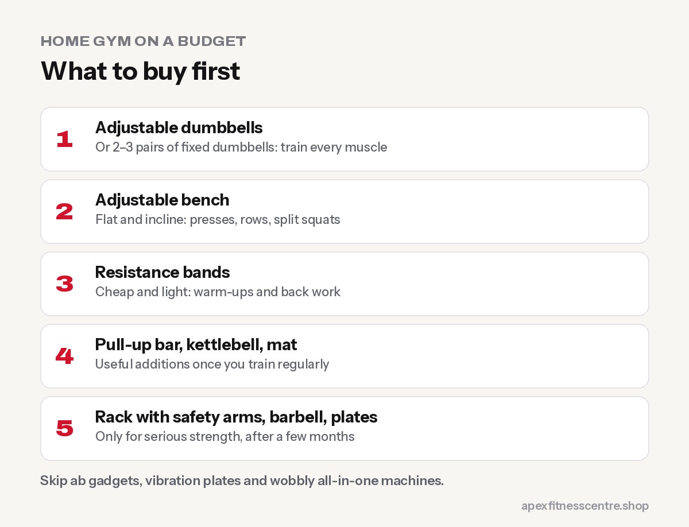

**The best budget home gym starts with just three things: adjustable dumbbells (or a few pairs of fixed dumbbells), a sturdy adjustable bench, and resistance bands. With those, you can train every major muscle. Add a pull-up bar, a kettlebell and a floor mat next, and only buy bigger items like a squat rack or barbell once you've trained consistently for a few months.**

Home gyms are hugely popular, but many people waste money on gadgets that end up holding laundry. This guide shows what actually gets used, in the order to buy it.

## Before you buy anything

Ask yourself three questions:

1. **What's my goal?** General fitness, fat loss, or building as much muscle and strength as possible?
2. **How much space do I have?** A corner of a bedroom is enough for a great dumbbell setup.
3. **Will I train at home consistently?** If you're not sure, start with bodyweight training and bands for a month. Try our [home workout without equipment](../home-workout-without-equipment/).

## The buying order

### Stage 1: The essentials

| Item | Why it's first | Tip |
|---|---|---|
| **Adjustable dumbbells** (or 2–3 fixed pairs) | Train every muscle; easy to add weight | Pick a range that will still challenge your legs in 6 months |
| **Adjustable bench** (flat and incline) | Presses, rows, step-ups, split squats | Check the weight limit and stability |
| **Resistance bands** (loop and handle types) | Cheap, light, great for warm-ups and back work | Buy a set with different strengths |

### Stage 2: Useful additions

| Item | Why |
|---|---|
| **Doorway pull-up bar** | Pull-ups and hanging core work. Check your door frame first. |
| **One kettlebell** | Swings, goblet squats, carries |
| **Exercise mat** | Core work, stretching, floor protection |

### Stage 3: Serious strength (optional)

| Item | Why |
|---|---|
| **Squat rack with safety arms** | Safe heavy squats and bench presses |
| **Barbell and plates** | Heavy squats, deadlifts and presses |
| **Rubber flooring** | Protects the floor and reduces noise |

**Only buy stage 3 if** you've been training consistently for a few months and want to lift heavier than dumbbells allow. Always use **safety arms** when lifting heavy alone.

## Things you can skip

- **Ab rollers and ab machines** with big promises. Planks and dead bugs do the job.
- **Vibration plates and "toning" gadgets.**
- **All-in-one home "gym machines"** with many pulleys, which are often wobbly and limiting.
- **Very light, colourful dumbbells** you'll outgrow in weeks (unless they're for warm-ups).

## Three home workouts with dumbbells

Do each workout once a week, with a rest day between. Choose a weight you could lift 2–3 more times at the end of each set.

### Workout A: legs and push

| Exercise | Sets × reps |
|---|---|
| Goblet squat | 3 × 10–12 |
| Dumbbell bench press | 3 × 8–12 |
| Split squat (back foot on bench) | 3 × 8–10 each leg |
| Seated shoulder press | 3 × 10 |
| Plank | 3 × 30–45 sec |

### Workout B: pull and hinge

| Exercise | Sets × reps |
|---|---|
| Romanian deadlift | 3 × 10 |
| One-arm dumbbell row | 3 × 10 each side |
| Pull-ups or band pull-downs | 3 × as many as you can |
| Hip thrust (shoulders on bench) | 3 × 12 |
| Dead bug | 3 × 10 each side |

### Workout C: full body

| Exercise | Sets × reps |
|---|---|
| Step-ups onto the bench | 3 × 10 each leg |
| Incline dumbbell press | 3 × 10 |
| Band face pulls | 3 × 15 |
| Kettlebell or dumbbell swings | 3 × 15 |
| Farmer's carry | 4 × 30–40 m |

## How to keep making progress at home

The biggest limit of a home gym is running out of weight. To keep improving:

- **Add reps** before adding weight
- **Slow the lowering phase** to 3 seconds
- **Use single-leg and single-arm exercises**, which are harder with the same weight
- **Add a pause** at the hardest point
- **Upgrade your dumbbells** when you can do 15+ good reps on most exercises

## Home gym vs gym membership

| | Home gym | Gym membership |
|---|---|---|
| **Upfront cost** | Higher | Low |
| **Ongoing cost** | Almost none | Monthly fee |
| **Equipment range** | Limited | Wide |
| **Coaching** | You're on your own | Trainers available |
| **Motivation** | Depends on you | Training around others helps many people |
| **Travel time** | None | Some |

Many people do both: train at the gym most weeks and keep dumbbells at home for busy days.

## Frequently asked questions

### What is the first thing to buy for a home gym?

Adjustable dumbbells or a few pairs of fixed dumbbells. They're the most versatile piece of equipment.

### Can you build muscle with a home gym?

Yes. With progressive overload, good form and enough protein, dumbbells and a bench are enough to build plenty of muscle, especially for beginners and intermediates.

### How much space do I need for a home gym?

A space of roughly 2 × 2 metres is enough for dumbbells, a bench and a mat. A squat rack needs much more room and ceiling height.

### Are resistance bands as good as weights?

They're excellent for warm-ups, back exercises and travel, but most people build strength faster with dumbbells for the big movements.

### Is a home gym worth it?

If you'll train at home regularly, yes. If you need structure, coaching or company, a gym membership may suit you better.

## Sources

- [ACSM position stand: progression models in resistance training for healthy adults](https://pubmed.ncbi.nlm.nih.gov/19204579/) (American College of Sports Medicine, 2009)
- [WHO fact sheet: physical activity](https://www.who.int/news-room/fact-sheets/detail/physical-activity) (World Health Organization)

*General information. We aren't paid to recommend any equipment brand. Always follow manufacturers' safety instructions and weight limits.*
