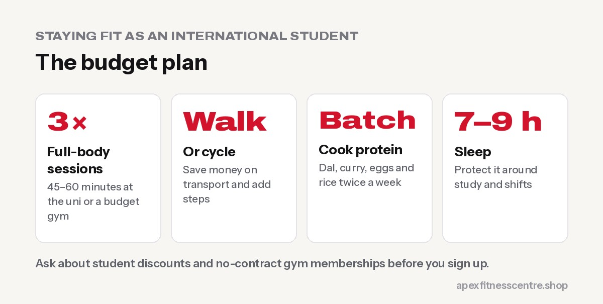
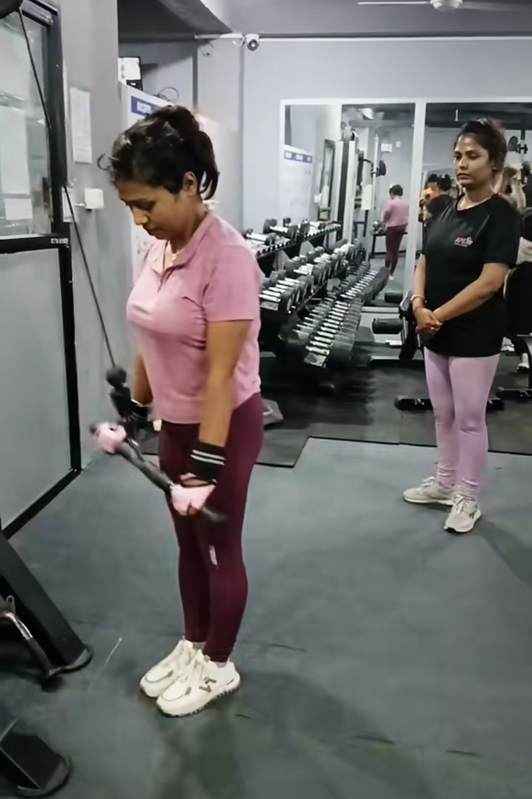

**International students can stay fit on a small budget by using their university gym or a low-cost gym, training 3 times a week with a simple full-body plan, walking or cycling instead of paying for transport, cooking high-protein meals in batches, and protecting sleep around work and study. Fitness also helps with stress and homesickness, which hit many students in their first year abroad.**

Moving abroad to study is exciting, and exhausting. Between classes, part-time work, rent and missing home, fitness is often the first thing to go. This guide is for students from Nepal and everywhere else who want to stay strong and healthy without spending much.

## Step 1: Find cheap (or free) places to train

| Option | Cost | Good for |
|---|---|---|
| **University gym** | Often discounted for students | Full equipment, close to class |
| **Budget gym chains** | Low monthly fees, often no lock-in contract | Long opening hours, many locations |
| **Outdoor gyms and parks** | Free | Pull-ups, dips, push-ups, running |
| **Your room** | Free | Bodyweight circuits, bands |
| **Student sports clubs** | Low fees | Football, badminton, running, cricket, social life |

**Tips before you sign up:**

- Ask about **student discounts** and **no-contract** memberships
- Check **cancellation rules**, especially before going home for holidays
- Try a **free trial pass** first

## Step 2: A simple plan that fits student life

Train **3 times a week**, about 45–60 minutes. Full-body sessions are ideal when your schedule changes every week.

| Exercise | Sets × reps |
|---|---|
| Squat or leg press | 3 × 8–12 |
| Bench press or push-ups | 3 × 8–12 |
| Row (cable, dumbbell or inverted) | 3 × 10–12 |
| Romanian deadlift | 3 × 10 |
| Shoulder press | 2 × 10–12 |
| Plank | 3 × 30–45 sec |

New to the gym? Start with our [beginner gym workout plan](../beginner-gym-workout-plan-first-3-months/). Nervous about a new gym in a new country? Read [gym anxiety: how to feel confident](../gym-anxiety/).

No gym at all? Use our [home workout without equipment](../home-workout-without-equipment/).

## Step 3: Move more for free

- **Walk or cycle** to university and work when it's safe; it saves money and adds thousands of steps
- **Take the stairs**
- **Join a free running group** or weekend park run, where available
- **Walk while calling family** back home

## Step 4: Eat well on a student budget

- **Cook in batches** twice a week: dal, chicken or chickpea curry, and rice
- **Cheap protein:** eggs, tinned legumes, lentils, frozen chicken, yoghurt, milk, tofu
- **Shop home brands** in supermarkets and buy spices and dal from Indian or Nepali stores
- **Limit takeaways and energy drinks**, which eat your budget and your health
- **Pack lunch** for long uni and work days

Studying in Australia? See our [high-protein Nepali meals with Australian supermarket food](../high-protein-nepali-meals-australia/).

## Step 5: Protect your sleep

Late-night assignments and shift work make sleep hard, but it affects your grades, mood, hunger and gym progress.

- Aim for **7–9 hours** most nights
- Keep **regular wake times** where possible
- Stop caffeine by mid-afternoon
- Put your phone away 30–60 minutes before bed

## Fitness and homesickness

Your first months abroad can be lonely. Regular exercise can help with stress, anxiety and low mood ([WHO](https://www.who.int/news-room/fact-sheets/detail/physical-activity)), and gyms and sports clubs are great places to meet people. If you feel low for weeks, talk to your university's student support or counselling service. Asking for help is normal.

## Working part-time? Fit training around shifts

- **Train before a late shift** or on your days off
- **Keep sessions short** (45 minutes) in busy weeks
- **Never skip meals** before physical shifts in cafés, warehouses or hospitality
- Check your **visa work-hour limits**: in Australia, student visa holders can generally work up to 48 hours a fortnight during study periods ([One Planet Migration Law](https://oneplanetmigrationlaw.com.au/immigration-blog/student-visa-work-hours-australia-2026/))

## Frequently asked questions

### How can students stay fit with no money?

Use free outdoor gyms and parks, do bodyweight workouts in your room, walk or cycle everywhere, and cook simple high-protein meals.

### Is a university gym worth it?

Usually yes: it's often cheaper for students, close to your classes, and a good place to meet people.

### How many times a week should a student work out?

Three full-body sessions a week, plus daily walking, is enough for great progress.

### What should I eat as an international student to build muscle?

Eggs, lentils, chickpeas, chicken, yoghurt, milk and tofu, with rice, roti or oats. Cook in batches to save time and money.

## Sources

- [WHO fact sheet: physical activity](https://www.who.int/news-room/fact-sheets/detail/physical-activity) (World Health Organization)
- [Student visa work hours in Australia](https://oneplanetmigrationlaw.com.au/immigration-blog/student-visa-work-hours-australia-2026/) (One Planet Migration Law)

*General information. Check your visa conditions with official government sources.*
