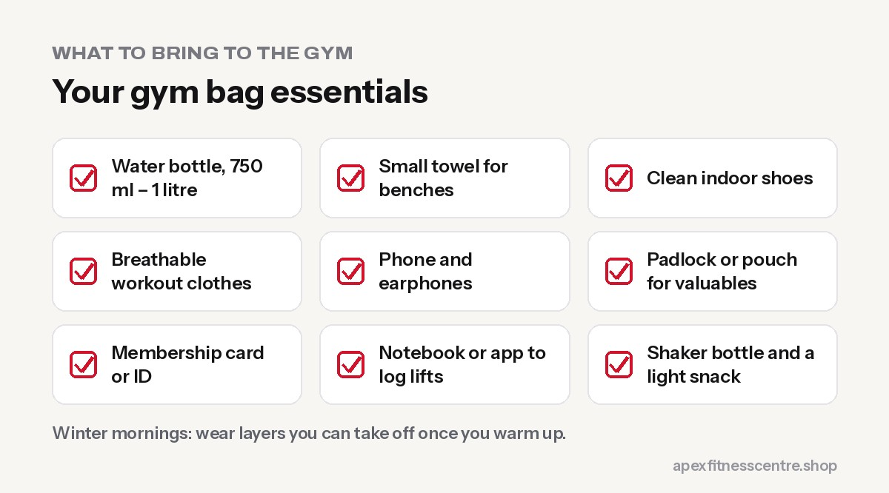

A well-packed gym bag saves time, keeps you comfortable and means you never have an excuse to skip a session. Here's exactly what to bring.

## The essentials

1. **Water bottle:** at least 750 ml to 1 litre. See [how much water you should drink](../how-much-water-should-you-drink/).
2. **Small towel:** for sweat and to lay on benches.
3. **Indoor shoes:** clean sports shoes with a flat, stable sole. Change into them at the gym in the monsoon so mud stays outside.
4. **Comfortable workout clothes:** breathable T-shirt or vest, shorts, track pants or leggings.
5. **Phone and earphones:** for music and logging your workouts.
6. **Padlock or small pouch** for valuables, if lockers are available.
7. **Membership card** or ID, if your gym uses them.

## Useful extras

- **Notebook or workout app:** write down weights and reps. It's the simplest way to make sure you progress.
- **Lifting gloves or grips:** optional; useful if bars hurt your hands.
- **Lifting belt:** only for heavy compound lifts once you know how to brace. A [weightlifting belt](../../products/valeo-weightlifting-belt/) is not needed as a beginner.
- **Shaker bottle:** if you drink a protein shake after training.
- **A light snack:** banana, boiled eggs or chiura for after training.
- **Deodorant and a spare T-shirt:** especially if you go straight to work or college.
- **Hair ties** and a cap.
- **Light jacket** for winter mornings so you warm up properly.

## What to wear by season in Nepal

| Season | Tips |
|---|---|
| **Summer and monsoon** | Light, quick-dry fabric; carry a spare T-shirt; change into clean shoes at the gym |
| **Winter** | Layers you can remove after warming up; track pants; jacket for the trip home |
| **Festival months** | Check changed gym timings around Dashain and Tihar |

## What to leave at home

- **Expensive jewellery and watches** that can scratch equipment or get lost
- **Heavy perfume:** a light deodorant is enough
- **Outdoor shoes** for training
- **Too much stuff:** a small bag is easier to carry and store

## For beginners: your first visit

Don't overthink it. Comfortable clothes, clean shoes, water and a towel are all you need on day one. Then read our [gym guide for women](../gym-guide-for-women-first-visit/) or the [beginner gym workout plan](../beginner-gym-workout-plan-first-3-months/) to know what to do once you're there.

## A simple gym bag checklist

Pack the night before, especially if you train at 4:30 or 5 AM. Use this list:

| Item | Why |
|---|---|
| Water bottle (500 ml to 1 L) | Sip between sets; refill at the gym |
| Small towel | Wipe benches and your face |
| Clean indoor shoes | Keeps mud and dust off the floor, especially in monsoon |
| Notebook or phone notes app | Write down your weights and reps |
| Padlock | For lockers, if your gym has them |
| Spare T-shirt | Useful if you go straight to work or college |
| A snack (banana, boiled eggs, chana) | For after the session if your next meal is late |

**The one thing most beginners forget is the training log.** Writing down what you lift is the easiest way to make sure you're getting stronger week by week. See [how many sets and reps to build muscle](../how-many-sets-and-reps-to-build-muscle/).

## Frequently asked questions

### Can I wear running shoes for weightlifting?

For beginners, yes. Very soft, cushioned running shoes can feel unstable on heavy squats; flat, firm shoes are better as you get stronger.

### Do I need gym gloves?

No. They're optional. Many lifters prefer bare hands for better grip.

### What should I eat before going to the gym?

A light snack 30 to 60 minutes before, or a meal 2 to 3 hours before. See [what to eat before a workout](../what-to-eat-before-workout/).

### Is it okay to train barefoot?

Some lifters deadlift in socks or barefoot, but most gyms require shoes for safety and hygiene. Follow your gym's rules.

## Sources

- [EFSA scientific opinion on dietary reference values for water](https://doi.org/10.2903/j.efsa.2010.1459) (European Food Safety Authority, 2010)
- [ISSN position stand: safety and efficacy of creatine supplementation](https://pmc.ncbi.nlm.nih.gov/articles/PMC5469049/) (Kreider et al., 2017)

*Packing for Apex? We're open 4:30 AM to 8:30 PM, Sunday to Friday. See [timings and plans](../../gym/).*
