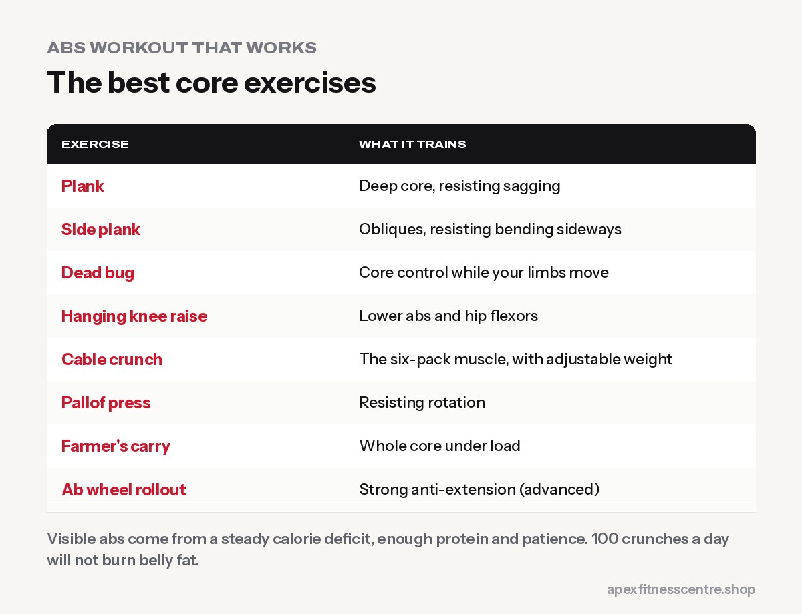

Everyone has abdominal muscles. Whether you can **see** them depends mainly on your **body fat level**, not on how many crunches you do. A good core routine makes your abs **stronger and slightly thicker**, improves posture and protects your back. A calorie deficit is what reveals them.

So the honest plan is: **train your core 2 to 3 times a week, and lose fat with diet and overall training.**

## What your core actually does

Your core is more than the six-pack muscle (rectus abdominis). It includes the **obliques** (sides), the **transverse abdominis** (deep "corset" muscle) and the muscles of your **lower back and hips**. Its main jobs are to **brace and resist movement**: keeping your spine stable when you squat, carry, twist or get bumped.

That's why the best core training includes **anti-movement** exercises, not just crunches.

## The best core exercises

| Exercise | What it trains |
|---|---|
| **Plank** | Deep core, resisting sagging |
| **Side plank** | Obliques, resisting bending sideways |
| **Dead bug** | Core control while limbs move |
| **Hanging knee raise or leg raise** | Lower abs and hip flexors |
| **Cable crunch** | Six-pack muscle, with adjustable weight |
| **Pallof press** | Resisting rotation |
| **Farmer's carry** | Whole core under load |
| **Ab wheel rollout** (advanced) | Strong anti-extension |

## A twice-a-week abs routine (15 minutes)

Add this at the end of two of your gym sessions.

**Workout A**

- Plank: 3 x 30–45 seconds
- Dead bug: 3 x 8 each side
- Cable crunch: 3 x 12–15

**Workout B**

- Side plank: 3 x 20–30 seconds each side
- Hanging knee raise: 3 x 10
- Farmer's carry: 3 x 30 metres

When it gets easy, make it harder: longer holds, more reps, heavier cable or carry weights.

## Why you can't see your abs yet

Visible abs usually require a fairly **low body fat level**. For many men that's somewhere around the low teens percentage or lower; for women it is usually higher, but still lean. Genetics also affect how your abs look and where you store fat.

To get there:

1. **A steady calorie deficit:** see [calorie deficit explained](../calorie-deficit-explained/).
2. **Enough protein** to keep muscle while dieting.
3. **Strength training** for the whole body.
4. **Daily walking.**
5. **Patience.** The belly is often the last place to lean out. Read [how to lose belly fat](../how-to-lose-belly-fat/).

## Myths about abs

- **"100 crunches a day burns belly fat."** It doesn't. Spot reduction is not supported by research.
- **"Abs are made in the kitchen."** Mostly true, but strong abs are also made in the gym.
- **"Train abs every day."** Abs are muscles; they also need recovery.
- **"Ab belts and machines will get you a six-pack."** They don't burn fat.

## How to progress your core training

Doing more and more crunches isn't progress. Make the exercises harder instead:

- **Planks:** once you can hold 45–60 seconds with good form, move to longer levers (arms further forward), side planks or plank shoulder taps.
- **Dead bugs:** slow the movement down, then hold a light weight in your hands.
- **Hanging knee raises:** progress to raising your knees higher, then to straight-leg raises.
- **Cable crunches and Pallof presses:** add weight in small steps, as you would for any other exercise.
- **Carries:** farmer's and suitcase carries get harder simply by holding heavier dumbbells.

Aim for 8–15 controlled reps or 20–60 second holds, and stop sets when your form slips (for example, when your lower back arches during a plank).

## Breathing and bracing

A strong core is also about **bracing**: tightening your stomach muscles as if you're about to be poked in the belly, then breathing behind that brace. Practise it during planks, then use it on squats, deadlifts and overhead presses. It protects your back and helps you lift more.

## Frequently asked questions

### How long does it take to get abs?

It depends on your starting body fat. For many people it takes several months of consistent dieting and training.

### Are planks better than crunches?

They do different jobs. Planks build stability; crunches train the abs to flex the spine. A good routine uses both types.

### Do squats and deadlifts work the abs?

Yes, they train your core hard as a stabiliser, but direct ab exercises still help.

### Should women train abs differently?

No. The same exercises work for everyone. Postpartum women should get advice from a doctor or physiotherapist first.

## Sources

- [WHO fact sheet: obesity and overweight](https://www.who.int/news-room/fact-sheets/detail/obesity-and-overweight) (World Health Organization)
- [Effects of aerobic and/or resistance training on body mass and fat mass in overweight or obese adults](https://pubmed.ncbi.nlm.nih.gov/23019316/) (Willis et al., Journal of Applied Physiology, 2012)
- [ACSM position stand: progression models in resistance training for healthy adults](https://pubmed.ncbi.nlm.nih.gov/19204579/) (American College of Sports Medicine, 2009)

*General information, not medical advice. If you have back pain or are recovering from pregnancy, get personal advice before intense core training.*
