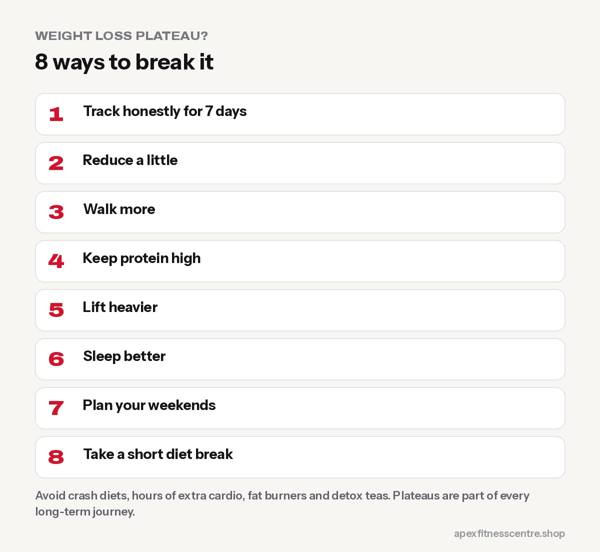

If you lost weight steadily and then the scale stopped moving for **3 weeks or more**, you've probably hit a plateau. It's normal. As you get lighter, **your body needs less energy**, and small habits often creep back. The fix is usually a **small adjustment**, not a dramatic diet.

## First: is it a real plateau?

Not every flat week is a plateau. Water, salt, hormones and digestion can hide fat loss for 1 to 2 weeks.

It's probably a **real plateau** if:

- Your **weekly average weight** hasn't changed for 3 weeks or more, and
- Your **waist measurement** hasn't changed either.

If your waist is shrinking while the scale is stuck, you're still losing fat. Keep going.

## Why plateaus happen

1. **You weigh less now,** so you burn less energy than when you started.
2. **Portions crept back up:** a little more rice, extra snacks, sweeter tea.
3. **You move less** without noticing, especially when dieting makes you tired.
4. **Weekends got bigger.**
5. **Water retention** from new training, stress, poor sleep or salty food.

## 8 ways to break a plateau

### 1. Track honestly for 7 days

Write down everything you eat and drink. Most plateaus are explained here.

### 2. Reduce a little

Cut about **100 to 200 calories a day**: a few spoons less rice, no sugar in one tea, half the cooking oil. Small cuts are easier to sustain.

### 3. Walk more

Add **2,000 to 3,000 steps a day**. See [walking for weight loss](../walking-for-weight-loss-steps/).

### 4. Keep protein high

Protein protects muscle and keeps hunger down. See [how much protein you need](../how-much-protein-do-you-need/).

### 5. Lift heavier

If your strength training has become easy, increase weights or reps. Muscle helps you look leaner and supports your metabolism. Read [how many sets and reps to build muscle](../how-many-sets-and-reps-to-build-muscle/).

### 6. Sleep better

Poor sleep increases hunger and cravings. Aim for 7 to 9 hours.

### 7. Plan your weekends

Keep one planned treat meal rather than two days of eating out.

### 8. Take a short diet break

If you've been dieting for months and feel exhausted, eating at **maintenance for 1 to 2 weeks** can restore energy and motivation before continuing. You won't undo your progress.

## What not to do

- **Crash dieting:** it causes muscle loss, hunger and rebound.
- **Hours of extra cardio overnight:** you'll burn out.
- **Fat burners and detox teas:** they don't fix plateaus.
- **Giving up:** plateaus are part of every long-term weight loss journey.

## A 2-week plateau-breaking plan

If you've been stuck for 3–4 weeks, try this before making bigger changes:

| Week | What to do |
|---|---|
| **Week 1** | Weigh yourself every morning and use the weekly average. Track everything you eat and drink for 7 days, including tea, oil and snacks. Add 2,000 steps to your daily average. |
| **Week 2** | Remove about 200–300 kcal a day from the easiest place (sugar in tea, fried snacks, second helpings of rice). Keep protein high at every meal. Keep lifting with the same or heavier weights. |

Then compare the weekly averages. Most people see the scale move again within 2–3 weeks. If you've been dieting for many months and feel exhausted, a 1–2 week diet break at maintenance may help you restart with more energy.

## Check your waist, not just the scale

Measure your waist at the level of your belly button once a week. If the scale is stuck but your waist is shrinking and your lifts are going up, you're likely losing fat and holding or building muscle. See [calorie deficit explained](../calorie-deficit-explained/).

## Frequently asked questions

### How long does a weight loss plateau last?

It lasts until you adjust something. With small changes, most people start losing again within 2 to 4 weeks.

### Should I eat more to break a plateau?

Sometimes a short diet break at maintenance helps energy and adherence, but it won't magically speed up fat loss. Small, sustainable reductions usually work.

### Why am I not losing weight but losing inches?

You're likely losing fat while gaining a little muscle or holding water. That's progress.

### Is a plateau a sign my metabolism is damaged?

No. Your energy needs drop as you get lighter, which is normal and adjustable.

## Sources

- [WHO fact sheet: obesity and overweight](https://www.who.int/news-room/fact-sheets/detail/obesity-and-overweight) (World Health Organization)
- [A new predictive equation for resting energy expenditure in healthy individuals](https://pubmed.ncbi.nlm.nih.gov/2305711/) (Mifflin et al., 1990)
- [ISSN position stand: protein and exercise](https://pubmed.ncbi.nlm.nih.gov/28642676/) (Jäger et al., 2017)

*See also [why am I not losing weight?](../why-am-i-not-losing-weight/). General information, not medical advice.*
